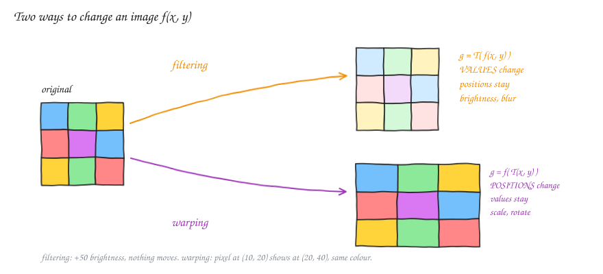
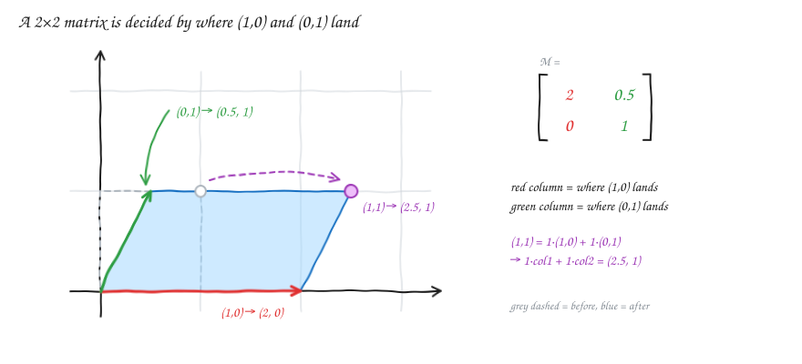
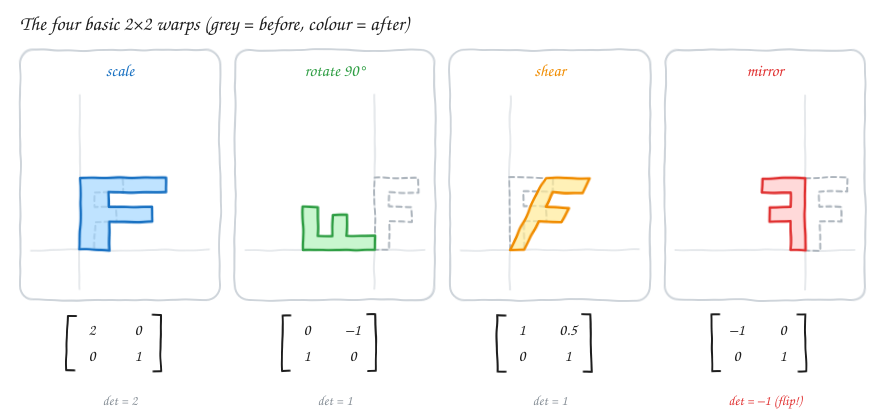
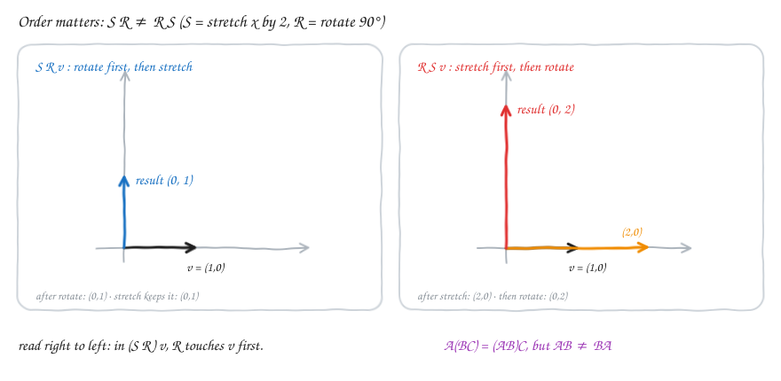
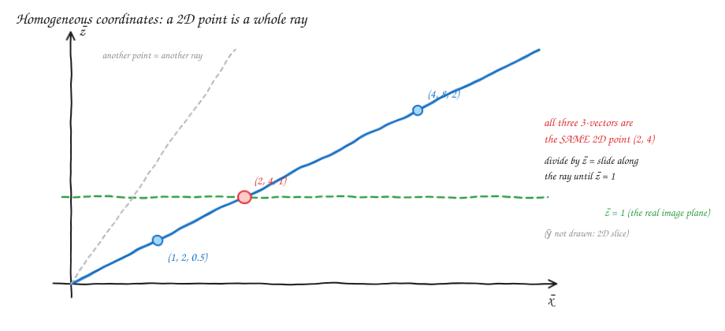
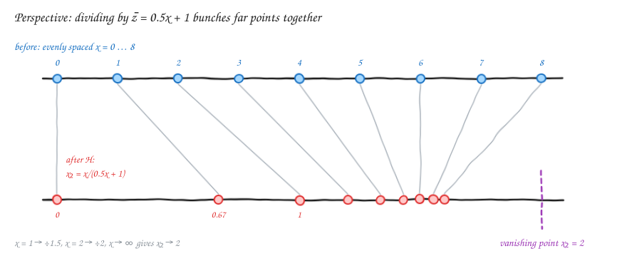
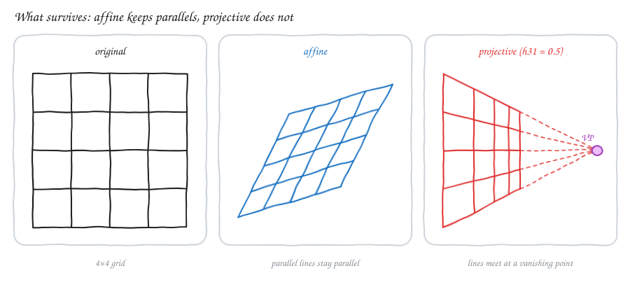
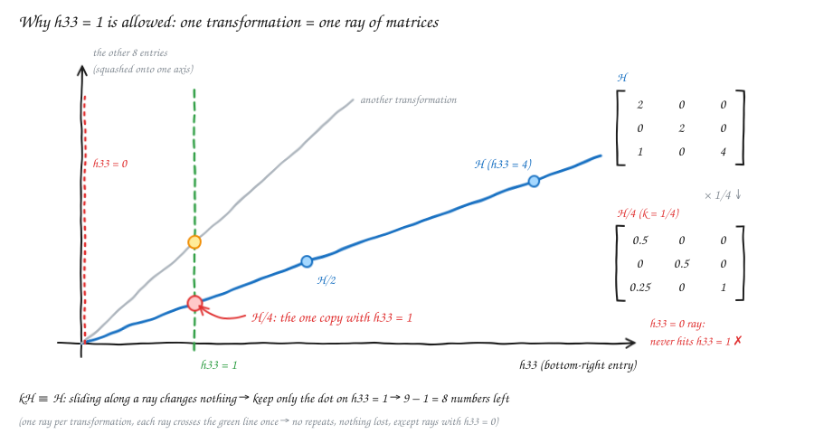
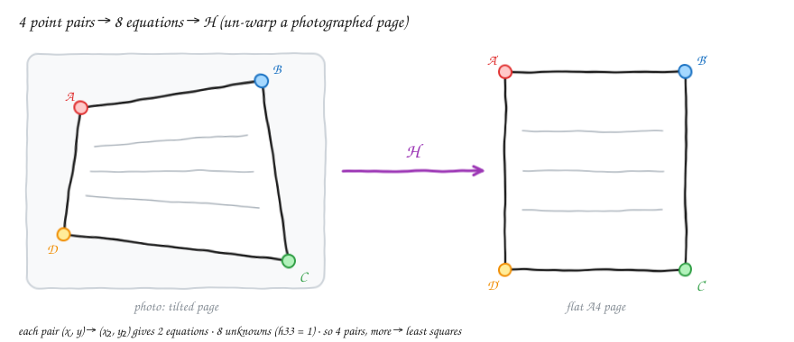

# Linear Algebra — v1.1: Image Transformations (2×2, Affine, Homography)

How do we move, rotate, stretch or "un-tilt" an image with matrices? This note builds up from 2×2 matrices to the 3×3 **homography**, and explains in simple words why a homography has **8**, not 9, numbers that matter.

---

## 1. Two ways to change an image

An image is a function **f(x, y)** that gives the colour at position (x, y).

| | Formula | What changes | Examples |
|---|---|---|---|
| **Filtering** | g(x, y) = T( f(x, y) ) | the **values** (colours), while positions stay | brightness, contrast, blur |
| **Warping** | g(x, y) = f( T(x, y) ) | the **positions**, while colours stay | scale, rotate, perspective |

> **In plain English:**
> - Filtering repaints every pixel in place, e.g. +50 brightness, where nothing moves.
> - Warping moves pixels around, e.g. the pixel that was at (10, 20) now shows at (20, 40) with the same colour.
>
> In filtering, T acts on the **colour**. In warping, T acts on the **coordinates**, and we then look up the colour at the new spot.

The rest of this note is about **warping**.

---

## 2. 2×2 matrices: linear warps

A matrix times a point gives a new point:

$$\begin{bmatrix} a & b \\ c & d \end{bmatrix}\begin{bmatrix} x \\ y \end{bmatrix} = \begin{bmatrix} ax + by \\ cx + dy \end{bmatrix}$$

The identity matrix [[1, 0], [0, 1]] leaves every point where it is.

### The key idea: columns = where the axes land

- **Column 1** is where (1, 0) lands.
- **Column 2** is where (0, 1) lands.
- Every other point follows: (x, y) lands at **x·column1 + y·column2**.

> **In plain English:** you don't need to memorise matrices. Ask "where should (1, 0) go, and where should (0, 1) go?" Write those two answers as the columns, and you have the matrix.

### The four basic warps

**Scaling:** [[a, 0], [0, b]] stretches x by a and y by b.
E.g. a = 2, b = 1 makes the image twice as wide with the same height.

**Rotation by φ.** Write a point as x₁ = r cos θ, y₁ = r sin θ. Rotating it by φ gives r cos(θ+φ), r sin(θ+φ). Use the angle-addition formulas:

$$\cos(\theta+\varphi) = \cos\theta\cos\varphi - \sin\theta\sin\varphi \qquad \sin(\theta+\varphi) = \sin\theta\cos\varphi + \cos\theta\sin\varphi$$

Multiply by r and substitute x₁ and y₁:

$$x_2 = x_1\cos\varphi - y_1\sin\varphi \qquad y_2 = x_1\sin\varphi + y_1\cos\varphi \;\;\Rightarrow\;\; R = \begin{bmatrix} \cos\varphi & -\sin\varphi \\ \sin\varphi & \cos\varphi \end{bmatrix}$$

The column check works: (1, 0) → (cos φ, sin φ) and (0, 1) → (−sin φ, cos φ).
E.g. φ = 90° gives [[0, −1], [1, 0]], so (1, 0) → (0, 1).

**Shear (skew):** x₂ = a₁₁x₁ + a₁₂y₁, y₂ = a₂₁x₁ + a₂₂y₁. In aᵢⱼ the first index is the row and the second is the column.

- a₁₂ ≠ 0: x shifts by an amount that depends on y. Higher points slide further sideways, so a square becomes a slanted box.
- a₂₁ ≠ 0: y shifts by an amount that depends on x.
- E.g. [[1, 0.5], [0, 1]] sends (0, 1) → (0.5, 1). The bottom edge stays put and the top edge slides right.

**Mirror:**

- [[−1, 0], [0, 1]] flips left–right.
- [[1, 0], [0, −1]] flips top–bottom.
- A mirror has **determinant −1**.

> **The determinant as a detector:** |det| is how much areas get scaled, and the **sign** says whether the image was flipped.
> - det > 0 means no flip.
> - det < 0 means a mirror is included, e.g. [[−2, 0], [0, 1]] has det −2: a stretch plus a flip.
>
> The four basic warps above have det = 2, 1, 1 and −1.

---

## 3. Combining transformations: order matters

To rotate and then stretch a vector v: first compute R v, then S(R v). Because matrix multiplication is **associative**, S(R v) = (S R) v. So you can multiply the matrices **once**, M = S R, and apply M to every pixel.

With S = stretch x by 2 and R = rotate 90°, applied to v = (1, 0):

- **S R v:** rotate to (0, 1), then stretch gives **(0, 1)**. Stretching x does nothing to a vertical arrow.
- **R S v:** stretch to (2, 0), then rotate gives **(0, 2)**.

| Property | Rule | Meaning |
|---|---|---|
| Associative | A(BC) = (AB)C | grouping doesn't matter |
| Not commutative | AB ≠ BA | **order** matters |

> **Read right to left:** in (S R) v, R is next to v, so R happens first. The vector is always on the far right.

**What every 2×2 (linear) warp keeps:**
- the origin stays at the origin
- lines stay lines
- parallel lines stay parallel
- evenly spaced points stay evenly spaced

---

## 4. Translation needs a third coordinate (affine)

A translation is x₂ = x₁ + t_x, y₂ = y₁ + t_y. **No 2×2 matrix can do this**, because a 2×2 matrix always sends (0, 0) to (0, 0), and a translation has to move the origin.

**Fix: homogeneous coordinates.** Write the 2D point (x, y) as **(x, y, 1)**. To read a 3-vector (x̄, ȳ, z̄) back as a 2D point, **divide by z̄**:

$$x = \bar{x}/\bar{z}, \qquad y = \bar{y}/\bar{z}$$

So (2, 4, 1), (4, 8, 2) and (1, 2, 0.5) are all **the same point (2, 4)**.

> **In plain English:** in 3D, every point on the line from the origin through (2, 4, 1) means the same 2D point. "Divide by z̄" just slides along that line until it hits the sheet z̄ = 1. **Keep this picture in mind: section 7 uses exactly the same idea for matrices.**

**Translation as a 3×3 matrix:**

$$\begin{bmatrix} 1 & 0 & t_x \\ 0 & 1 & t_y \\ 0 & 0 & 1 \end{bmatrix}\begin{bmatrix} x \\ y \\ 1 \end{bmatrix} = \begin{bmatrix} x + t_x \\ y + t_y \\ 1 \end{bmatrix}$$

z̄ = 1, so dividing changes nothing, and we read off (x + t_x, y + t_y).

**General affine** = any 2×2 block in the top-left, plus a translation in the last column:

$$\begin{bmatrix} a & b & t_x \\ c & d & t_y \\ 0 & 0 & 1 \end{bmatrix} \qquad \text{6 free numbers}$$

The bottom row is [0 0 1], so z̄ is always 1 and the division never does anything.

> **The trick of the extra coordinate:** an affine map moves the origin, so in 2D it is *not* linear. On the 3-vector (x, y, 1), though, it's a plain matrix multiply, which *is* linear in 3D.

---

## 5. Projective transformations (homography)

$$H = \begin{bmatrix} h_{11} & h_{12} & h_{13} \\ h_{21} & h_{22} & h_{23} \\ h_{31} & h_{32} & h_{33} \end{bmatrix}$$

Now the **bottom row is free**, so the third coordinate depends on the point:

$$\bar{z} = h_{31}x + h_{32}y + h_{33}, \qquad x_2 = \frac{h_{11}x + h_{12}y + h_{13}}{h_{31}x + h_{32}y + h_{33}}, \qquad y_2 = \frac{h_{21}x + h_{22}y + h_{23}}{h_{31}x + h_{32}y + h_{33}}$$

Each point is divided by a **different** number. Points further along the direction (h₃₁, h₃₂) get divided by more, so they shrink together. **That is perspective.**

**Example:** h₃₁ = 0.5, everything else as in the identity, so x₂ = x / (0.5x + 1).

| x | divided by | x₂ |
|---|---|---|
| 0 | 1 | 0 |
| 1 | 1.5 | 0.67 |
| 2 | 2 | 1 |
| → ∞ | → ∞ | → h₁₁/h₃₁ = **2** (the vanishing point) |

**What a homography keeps:**
- lines stay lines ✓
- the origin does **not** stay fixed
- parallel lines do **not** stay parallel: they meet at a vanishing point (the horizon)
- two homographies in a row is still a homography

### Where things live in the matrix

| Entries | Job |
|---|---|
| h₁₁ h₁₂ h₂₁ h₂₂ | the 2×2 part: scale, rotate, shear |
| h₁₃ h₂₃ | translation (third column) |
| h₃₁ h₃₂ | perspective (third row) |
| h₃₃ | overall scale of the output (see the next section) |

---

## 6. "Defined up to scale": H and kH are the same transformation

Multiply **all nine** entries by any nonzero number k:

$$(kH)\,p = k\,(Hp) = (k\bar{x},\; k\bar{y},\; k\bar{z}) \;\xrightarrow{\text{divide}}\; \left(\frac{k\bar{x}}{k\bar{z}},\; \frac{k\bar{y}}{k\bar{z}}\right) = \left(\frac{\bar{x}}{\bar{z}},\; \frac{\bar{y}}{\bar{z}}\right)$$

**The k cancels**, so H and kH move every point to exactly the same place. It's the same reason (x, y, 1) and (2x, 2y, 2) are the same point.

**Check with numbers.** Take H = [[2, 0, 0], [0, 2, 0], [1, 0, 4]] and the point p = (1, 1):

- H·(1, 1, 1) = (2, 2, 5), which divided by 5 gives **(0.4, 0.4)**
- (H/4)·(1, 1, 1) = (0.5, 0.5, 1.25), which divided by 1.25 gives **(0.4, 0.4)** ✓

⚠️ **Careful:** this is about scaling **all nine** entries together. Changing **h₃₃ alone** *does* change the picture:
- For an affine matrix, [[1, 0, 0], [0, 1, 0], [0, 0, 2]] halves everything, because every output is divided by 2.
- For a projective one, changing h₃₃ also moves the horizon.

### In simple words: what "up to scale" really means

Think of **fractions**. 1/2, 2/4 and 3/6 are written differently but are **the same number**. Multiplying top and bottom by the same k doesn't change the value.

A homography is like that fraction. The matrix is the "written form", and the transformation is the "value". Multiplying all of H by k is like multiplying top and bottom of a fraction by k: the **writing** changes, the **meaning** doesn't.

**Writing the fraction in lowest terms** is choosing one standard way to write it. For a homography the standard choice is "**make the bottom-right entry 1**", i.e. divide everything by h₃₃.

---

## 7. Why we can fix h₃₃ = 1, and why that leaves 8 numbers

These are **not two separate facts. The second one is the first one, used.**

1. **kH ≡ H** says: you may multiply H by **any** nonzero k, and the transformation doesn't change. **You get to choose k.**
2. **Fixing h₃₃ = 1** means: choose **k = 1/h₃₃**.

That's the whole link. With numbers:

$$H = \begin{bmatrix} 2 & 0 & 0 \\ 0 & 2 & 0 \\ 1 & 0 & \mathbf{4} \end{bmatrix} \;\xrightarrow{\;k = 1/4\;}\; \tfrac{1}{4}H = \begin{bmatrix} 0.5 & 0 & 0 \\ 0 & 0.5 & 0 \\ 0.25 & 0 & \mathbf{1} \end{bmatrix}$$

H/4 is the **same transformation** as H (fact 1), **and** it has h₃₃ = 1 (what we wanted). We didn't assume anything about H. We used the freedom that kH ≡ H gives us and **spent it on making one entry convenient**.

> **So "we can fix h₃₃ = 1" means:** for any H, the copy H/h₃₃ exists, is the same transformation, and has a 1 in that corner. It's a **thing you do**, not a restriction on which transformations exist.

### Why the count comes out to 8

- Every transformation is a **family** {kH}: a whole ray of matrices through the origin, just like a 2D point was a whole ray in section 4.
- On each ray, **exactly one** member has h₃₃ = 1, the one with k = 1/h₃₃. That's where the ray crosses the green line in the diagram.
- So if you only look at matrices with h₃₃ = 1, you see **each transformation exactly once**: no repeats, and nothing missing.
- Those matrices have **8 entries left to choose**.

$$9 \text{ entries} - 1 \text{ invisible direction (overall scale)} = \mathbf{8 \text{ degrees of freedom}}$$

> **The same idea one level up:** a 2D point uses 3 numbers (x̄, ȳ, z̄) but has only 2 dimensions, because one direction (scaling) is invisible. A homography uses 9 numbers but has only 8 dimensions, for the same reason.

### The one case where it breaks: h₃₃ = 0

If h₃₃ = 0, then 1/h₃₃ doesn't exist, and **no** member of the family has h₃₃ = 1. Its ray lies flat and never reaches the green line. This is the one case the convention can't represent.

- **Example:** H = [[1, 0, 0], [0, 1, 0], [1, 0, 0]] sends (x, y) → (1, y/x). It's a real transformation, but you can't scale it so that h₃₃ = 1.
- **Why not pin a different entry?** You could pin h₁₁ = 1 instead, but h₁₁ = 0 happens for an ordinary 90° rotation. h₃₃ = 0 is rare in practice, so h₃₃ is the usual choice.
- **The robust choice** used in real code: scale H so that the **sum of squares of all 9 entries = 1**. This always works, because every ray crosses a sphere.
  For our H: 2² + 2² + 1² + 4² = 25, so divide by √25 = 5 to get [[0.4, 0, 0], [0, 0.4, 0], [0.2, 0, 0.8]].

---

## 8. Finding H from points

- Each point pair (x, y) → (x₂, y₂) gives **2 equations**, one for x₂ and one for y₂.
- There are **8 unknowns**, after fixing the scale.
- So **4 point pairs** are enough. That's 4 *points*, not 8.
- With more than 4 pairs, use least squares.

**Example:** take the 4 corners of a tilted document in a photo and the 4 corners of a flat A4 page. That fixes H, and applying it un-warps the photo. This is what "scan document" apps do.

> One condition: no 3 of the 4 points may lie on a line, or the equations don't pin down H.

---

## Summary table

| Type | Bottom row | Free numbers | Keeps |
|---|---|---|---|
| 2×2 linear | (none) | **4** | origin, lines, parallels, even spacing |
| Affine | [0 0 1] | **6** | lines, parallels, even spacing along a line |
| Projective | [h₃₁ h₃₂ h₃₃] | **8** (9 − 1 for scale) | lines only |

⚠️ **Correction to my original table.** Affine maps also keep **evenly spaced points evenly spaced**, because they keep ratios of lengths along a line. Only the projective map loses that, as diagram 08 shows: equal steps bunch up.

---

## Cheat sheet

| Idea | Formula | Plain English |
|---|---|---|
| Columns | M·(x, y) = x·col1 + y·col2 | the columns are where the axes land |
| Rotation | [[cos φ, −sin φ], [sin φ, cos φ]] | turn by φ |
| Determinant | det = ad − bc | area scale, with a negative sign meaning a flip |
| Composition | (S R) v = S(R v) | read right to left, AB ≠ BA |
| Homogeneous | (x̄, ȳ, z̄) → (x̄/z̄, ȳ/z̄) | a point is a ray |
| Affine | bottom row [0 0 1] | linear + translation |
| Homography | divide by h₃₁x + h₃₂y + h₃₃ | perspective |
| Up to scale | kH ≡ H | like 1/2 = 2/4 |
| Normalise | H / h₃₃, or ‖H‖ = 1 | pick one copy per transformation |
| Degrees of freedom | 9 − 1 = 8 | 4 point pairs |

---

## Revision questions

Try each question first, then expand it to check your answer.

<b>Q1.</b> Is "increase contrast" a filter or a warp? What about "rotate by 10°"?

Contrast changes values, so it's a **filter**. Rotation moves positions, so it's a **warp**.

<b>Q2.</b> Write the 2×2 matrix that sends (1, 0) → (3, 1) and (0, 1) → (−1, 2). Where does (2, 1) go?

The columns are the landing spots: M = [[3, −1], [1, 2]].
(2, 1) → 2·(3, 1) + 1·(−1, 2) = **(5, 4)**.

<b>Q3.</b> Write the rotation matrix for φ = 180°. Where does (3, 4) go?

[[−1, 0], [0, −1]], so (3, 4) → **(−3, −4)**.

<b>Q4.</b> What is the determinant of [[0, 1], [1, 0]]? What does the matrix do?

det = 0·0 − 1·1 = **−1**, so it includes a flip. It swaps x and y, which is a mirror across the line y = x.

<b>Q5.</b> S = [[2, 0], [0, 1]] and R = 90° rotation. Compute S R and R S as matrices and check them on (1, 0).

S R = [[2,0],[0,1]]·[[0,−1],[1,0]] = [[0, −2], [1, 0]], and (1,0) → (0, 1).
R S = [[0,−1],[1,0]]·[[2,0],[0,1]] = [[0, −1], [2, 0]], and (1,0) → (0, 2).
The results differ, so the order matters.

<b>Q6.</b> Why can't a 2×2 matrix translate an image by (5, 0)?

M·(0, 0) = (0, 0) for **every** 2×2 matrix, so the origin can never move. A translation must move it.

<b>Q7.</b> Which 2D point is (6, 3, 3)? Which is (−2, 4, −2)?

Divide by z̄: (6, 3, 3) is **(2, 1)** and (−2, 4, −2) is **(1, −2)**.

<b>Q8.</b> Write the 3×3 matrix that rotates by 90° and then translates by (3, 2). Where does (1, 0) go?

[[0, −1, 3], [1, 0, 2], [0, 0, 1]].
(1, 0, 1) → (0 + 3, 1 + 2, 1) = **(3, 3)**.

<b>Q9.</b> With h₃₁ = 0.5 (and the rest as in the identity), where does (4, 0) go? What is the vanishing point?

x₂ = 4 / (0.5·4 + 1) = 4/3 ≈ **1.33**. The vanishing point is x₂ → 1/0.5 = **2**.

<b>Q10.</b> Are [[1, 0, 2], [0, 1, 0], [0, 0, 1]] and [[3, 0, 6], [0, 3, 0], [0, 0, 3]] the same transformation? What about [[1, 0, 2], [0, 1, 0], [0, 0, 3]]?

The first two are the same, because the second is 3× the first (all nine entries). The third is **different**: only h₃₃ changed, so every output gets divided by 3 and the translation becomes (2/3, 0) with everything shrunk.

<b>Q11.</b> Normalise H = [[4, 0, 2], [0, 4, 0], [0, 2, 2]] so that h₃₃ = 1. Is the result a different transformation?

Divide by 2: [[2, 0, 1], [0, 2, 0], [0, 1, 1]]. It's **the same transformation**, just the "lowest terms" way of writing it.

<b>Q12.</b> In your own words: why does a homography have 8 degrees of freedom when it has 9 entries?

Multiplying all 9 entries by the same k doesn't change any output point, because the k cancels in the division. So one of the 9 directions is invisible. Each transformation is a ray {kH}, and picking one point per ray (e.g. h₃₃ = 1) leaves 8 numbers that actually change the picture.

<b>Q13.</b> Why is "set h₃₃ = 1" not always safe, and what do libraries do instead?

If h₃₃ = 0, no scaled copy has h₃₃ = 1, so the transformation can't be written that way. Libraries scale H so that the sum of squares of all entries = 1, which always works.

<b>Q14.</b> How many point pairs do you need for an affine transform? For a homography? Why?

Each pair gives 2 equations.
- Affine has 6 unknowns, so it needs **3 pairs**.
- A homography has 8 unknowns, so it needs **4 pairs**.

<b>Q15.</b> A photo shows railway tracks meeting at the horizon. Could an affine transform have produced this from a top-down view? Why or why not?

**No.** Affine maps keep parallel lines parallel, but the tracks (parallel in reality) meet in the photo. Only a projective map, with a non-zero bottom row h₃₁ or h₃₂, can do that.

