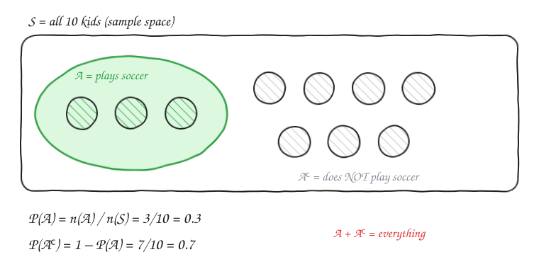
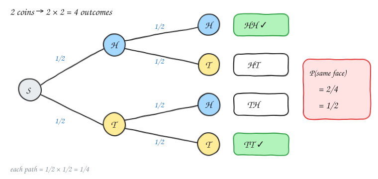
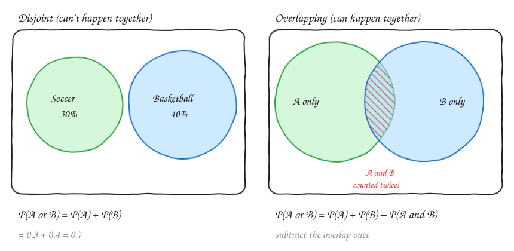
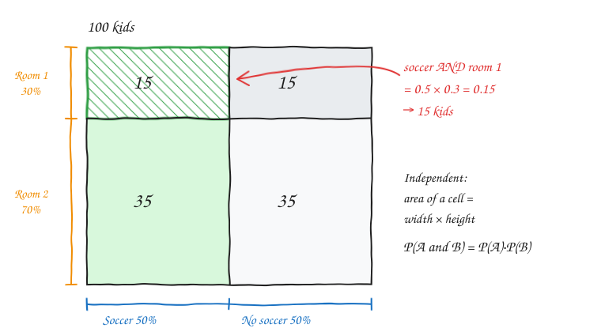
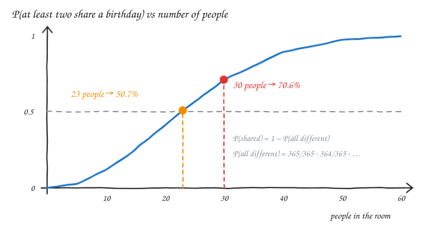
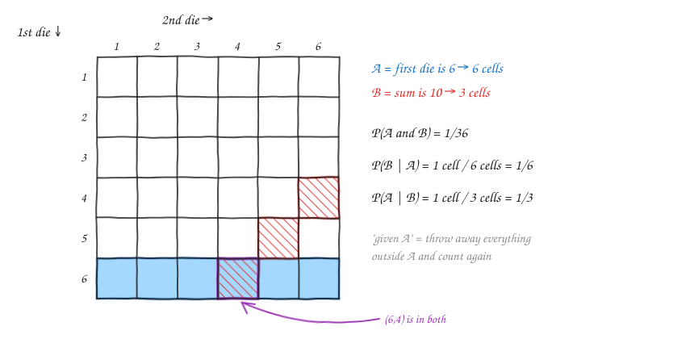
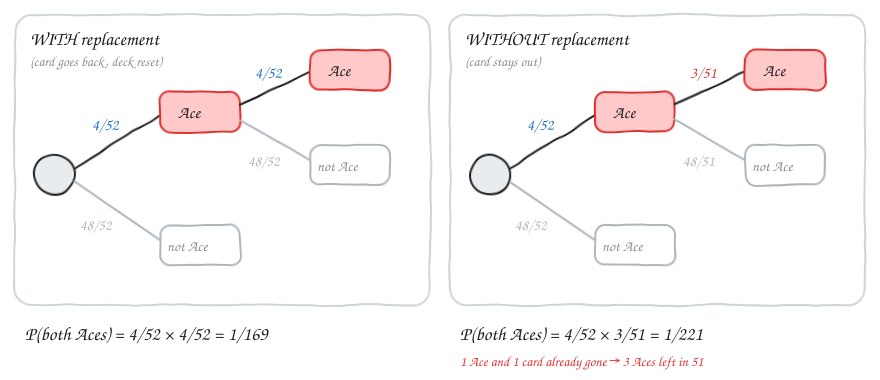

# Probability — v1.1

Notes on probability basics: sample spaces, complements, the sum rule, independence, the birthday problem and conditional probability.

---

## 1. Basics

**Experiment**: an activity with an uncertain outcome, like flipping a coin, rolling a die or picking a kid at random.
**Sample space (S)**: the set of *all* possible outcomes.
**Event (A)**: the outcomes we care about.

When every outcome is equally likely:

$$P(A) = \frac{n(A)}{n(S)} = \frac{\text{favourable outcomes}}{\text{total outcomes}}$$

**Example (school)**: 10 kids, 3 play soccer, 7 don't. Pick one kid at random:

$$P(\text{soccer}) = \frac{3}{10} = 0.3 = 30\%$$

### Coins and dice

| Experiment | Sample space size | Event | Probability |
|---|---|---|---|
| 1 coin | 2 (H, T) | H | 1/2 |
| 2 coins | 2 × 2 = 4 (HH, HT, TH, TT) | both the same (HH or TT) | 2/4 = 1/2 |
| 3 coins | 2³ = 8 | HHH | 1/8 |
| 2 dice | 6 × 6 = 36 | (6, 6) | 1/36 |

> Each extra coin doubles the sample space and each extra die multiplies it by 6.
> For (6, 6) there is exactly **one** favourable outcome out of 36, so the answer is 1/36.

---

## 2. Complement of an event

The complement **Aᶜ** (also written A′ or "not A") is everything in S that is *not* in A.

$$P(A^c) = 1 - P(A)$$

**Example**: P(kid plays soccer) = 3/10, so P(kid does **not** play soccer) = 1 − 3/10 = **7/10 = 70%**.

> Tip: when "at least one" is hard to count, count "none" and subtract it from 1 (the birthday problem uses this trick).

---

## 3. Sum of probabilities (OR)

### 3a. Disjoint (mutually exclusive) events

If A and B **can't happen together**:

$$P(A \text{ or } B) = P(A) + P(B)$$

- Each kid plays **only one** sport: soccer 30%, basketball 40%.
  P(plays a sport) = 0.3 + 0.4 = **0.7**, so **30% play neither** sport.
- Die roll: P(even **or** 5) = 3/6 + 1/6 = 4/6 = **2/3**. A 5 is never even, so the events are disjoint.

### 3b. Overlapping (joint) events

If some kids play **both**, adding P(A) + P(B) counts them **twice**. Subtract the overlap once:

$$P(A \text{ or } B) = P(A) + P(B) - P(A \text{ and } B)$$

Example: soccer 30%, basketball 40%, both 10%, so P(soccer or basketball) = 0.3 + 0.4 − 0.1 = **0.6**.

> Disjoint is the special case where P(A and B) = 0, so the general formula still works.

---

## 4. Independence (AND)

Two events are **independent** if knowing one happened does **not** change the probability of the other.

- ✅ Independent: the 1st coin flip and the 2nd coin flip. The coin has no memory.
- ❌ Dependent: whether a student is absent and whether it's raining. Rain changes the absence rate.

For independent events:

$$P(A \text{ and } B) = P(A) \cdot P(B)$$

**Example**: 100 kids, 50% play soccer. They are split 30% / 70% into two rooms *at random*, so room choice is independent of soccer.

- P(soccer **and** room 1) = 0.5 × 0.3 = 0.15, so **15 kids**
- P(soccer **and** room 2) = 0.5 × 0.7 = 0.35, so **35 kids**

**More examples**

- 5 heads in 5 flips: (1/2)⁵ = **1/32**
- (6, 6) on two dice: 1/6 × 1/6 = **1/36**, the same as counting cells in the 6×6 grid

---

## 5. Birthday problem

> In a group of 30 people, what is the probability that **at least two** share a birthday? (Ignore leap years and assume all 365 days are equally likely.)

Counting "at least two share" directly is messy, so use the **complement**: everyone has a *different* birthday.

$$P(\text{all different}) = \frac{365}{365} \cdot \frac{364}{365} \cdot \frac{363}{365} \cdots \frac{336}{365} \approx 0.294$$

- Person 1: any day (365/365)
- Person 2: must avoid 1 day (364/365)
- Person 30: must avoid 29 days (336/365)

$$P(\text{at least two share}) = 1 - 0.294 \approx \mathbf{0.706 \; (70.6\%)}$$

> Surprising fact: only **23 people** are needed for a better-than-50% chance. With n people there are n(n−1)/2 *pairs*, and for 23 people that is already 253 pairs.

---

## 6. Conditional probability

**P(B | A)** means "the probability of B **given that** A has happened".

Knowing A happened **shrinks the sample space** to A. Then you ask what fraction of A is also B:

$$P(B \mid A) = \frac{P(A \text{ and } B)}{P(A)}$$

Rearranged, this gives the **multiplication rule (chain rule)**:

$$P(A \text{ and } B) = P(A) \cdot P(B \mid A)$$

If A and B are independent, then P(B | A) = P(B) and the rule becomes P(A and B) = P(A) · P(B) from section 4.

### Example: two dice (sum is 10, first die is 6)

- A = first die is 6, so 6 cells and P(A) = 6/36 = 1/6
- B = sum is 10, so 3 cells: (4,6), (5,5), (6,4)
- A and B = only (6,4), so P(A and B) = **1/36**

Using the chain rule: P(A and B) = P(A) · P(B | A) = 1/6 · 1/6 = **1/36** ✅

The direction of the condition matters:

- P(sum 10 | first is 6) = 1/6. Of the 6 cells in the row, 1 sums to 10.
- P(first is 6 | sum 10) = 1/3. Of the 3 cells that sum to 10, 1 has first = 6.

### Example: coins (be careful with the condition)

- P(HH | **first** flip is H) = P(HH) / P(first H) = (1/4) / (1/2) = **1/2**
- P(HH | **at least one** H) = P(HH) / P(at least one H) = (1/4) / (3/4) = **1/3**

These are two different conditions and give two different answers.

### "Isn't this circular?"

It *looks* circular: to get P(A and B) you need P(B | A), and to get P(B | A) you need P(A and B). In practice you only ever know **one** of them, and you use the formula to find the other:

| You know… | You use… | You get… |
|---|---|---|
| the step-by-step process (draw 1, then draw 2) | P(A) · P(B \| A) | P(A and B) |
| counts or areas of overlap (a grid or a table) | P(A and B) / P(A) | P(B \| A) |

In card problems, P(B | A) comes straight from the story ("after one Ace is gone, 3 of 51 cards are Aces"), so you don't need P(A and B) first.

### Example: two Aces from a 52-card deck

**With replacement** (put the card back, so the draws are independent):

$$P(\text{both Aces}) = \frac{4}{52} \cdot \frac{4}{52} = \frac{1}{169} \approx 0.0059$$

**Without replacement** (keep the card out, so the draws are dependent):

$$P(\text{both Aces}) = \frac{4}{52} \cdot \frac{3}{51} = \frac{12}{2652} = \frac{1}{221} \approx 0.0045$$

The second fraction is **3/51**, not 3/52: one card (an Ace) is already gone, so the deck has 51 cards and 3 Aces.

**Why is P(first is Ace | both are Aces) = 1?**
If both cards are Aces, the first card is certainly an Ace. Using the formula:

$$P(\text{1st Ace} \mid \text{both Aces}) = \frac{P(\text{1st Ace and both Aces})}{P(\text{both Aces})} = \frac{P(\text{both Aces})}{P(\text{both Aces})} = 1$$

"Both Aces" is already **inside** "first is Ace", so their overlap is just "both Aces".

---

## Formula cheat sheet

| Idea | Formula |
|---|---|
| Classical probability | P(A) = n(A) / n(S) |
| Complement | P(Aᶜ) = 1 − P(A) |
| OR, disjoint | P(A ∪ B) = P(A) + P(B) |
| OR, general | P(A ∪ B) = P(A) + P(B) − P(A ∩ B) |
| AND, independent | P(A ∩ B) = P(A) · P(B) |
| AND, general (chain rule) | P(A ∩ B) = P(A) · P(B \| A) |
| Conditional | P(B \| A) = P(A ∩ B) / P(A) |
| Independence test | P(B \| A) = P(B) |

---

## Revision questions

Try each question first, then expand it to check your answer.

<b>Q1.</b> A bag has 5 red, 3 blue and 2 green balls. What is P(not red)?

Total = 10. P(red) = 5/10, so P(not red) = 1 − 1/2 = **1/2**.

<b>Q2.</b> You flip 3 coins. What is P(exactly 2 heads)?

The sample space has 8 outcomes. Exactly 2 heads: HHT, HTH, THH = 3 outcomes, so **3/8**.

<b>Q3.</b> You flip 3 coins. What is P(at least one head)?

Use the complement: P(no heads) = P(TTT) = 1/8, so the answer is 1 − 1/8 = **7/8**.

<b>Q4.</b> You roll one die. What is P(even or greater than 3)?

Even = {2,4,6}, >3 = {4,5,6}, both = {4,6}.
3/6 + 3/6 − 2/6 = **4/6 = 2/3**. Check: {2,4,5,6} = 4 outcomes ✅

<b>Q5.</b> In a class, 60% like maths, 50% like physics and 30% like both. What percentage like neither?

P(maths or physics) = 0.6 + 0.5 − 0.3 = 0.8, so P(neither) = **0.2 = 20%**.

<b>Q6.</b> Are "first die is 6" and "sum is 7" independent?

P(first 6) = 1/6. P(sum 7) = 6/36 = 1/6. P(both) = P((6,1)) = 1/36 = 1/6 · 1/6.
**Yes, they are independent.** (Compare: "first is 6" and "sum is 10" are *not* independent, because 1/36 ≠ 1/6 · 3/36.)

<b>Q7.</b> What is P(no 6 in 4 rolls of a die)? And P(at least one 6)?

P(no 6) = (5/6)⁴ ≈ **0.482**. P(at least one 6) = 1 − 0.482 ≈ **0.518**.

<b>Q8.</b> You draw 2 cards without replacement. What is P(both are hearts)?

13/52 · 12/51 = 156/2652 = **1/17 ≈ 0.059**.

<b>Q9.</b> The same question as Q8, but <i>with</i> replacement.

13/52 · 13/52 = (1/4)² = **1/16 = 0.0625**. It is slightly higher, because the heart you drew goes back into the deck.

<b>Q10.</b> Two dice are rolled and the sum is 8. What is P(both dice show the same number)?

Sum 8: (2,6), (3,5), (4,4), (5,3), (6,2) = 5 outcomes. Doubles among these: (4,4) = 1 outcome.
**P = 1/5**. Condition on the 5 cells and count again.

<b>Q11.</b> 70% of days are dry. On dry days 5% of students are absent, and on rainy days 20% are absent. What is P(a student is absent)?

Add up the branches: 0.7 · 0.05 + 0.3 · 0.20 = 0.035 + 0.06 = **0.095**.
(This is the "absence depends on rain" example. The events are dependent, so use P(rain) · P(absent | rain) for each branch.)

<b>Q12.</b> In a group of 5 people, what is P(at least two share a birthday)?

P(all different) = 365/365 · 364/365 · 363/365 · 362/365 · 361/365 ≈ 0.973, so the answer is ≈ **0.027 (2.7%)**.

<b>Q13.</b> A family has 2 children and at least one is a boy. What is P(both are boys)?

The sample space is {BB, BG, GB, GG}. Given at least one boy, the outcomes left are {BB, BG, GB}, so **1/3**.
(This is the same idea as the coin example: P(HH | at least one H) = 1/3.)

<b>Q14.</b> True or false: if A and B are disjoint (and both have P > 0), then they are independent.

**False.** Disjoint means P(A and B) = 0, but P(A) · P(B) > 0. If A happens, then B *cannot* happen, which is the strongest possible dependence.

