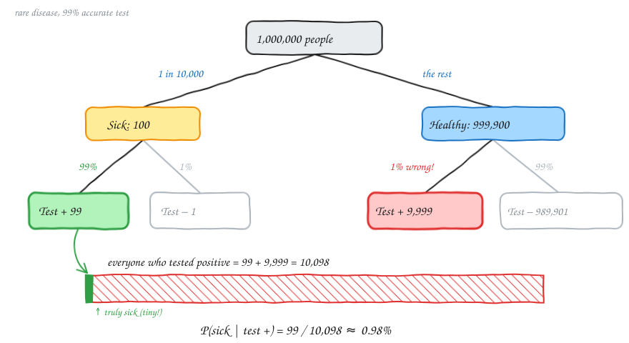
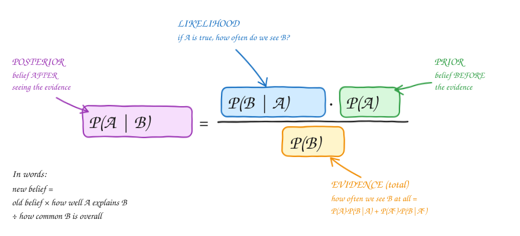
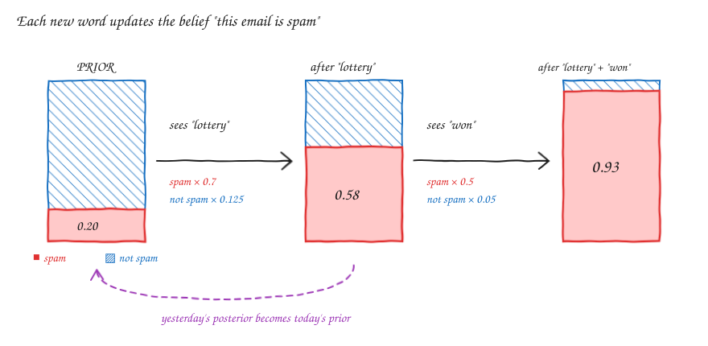

# Probability — v1.2: Bayes' Theorem

Builds on [v1.1](Statv1.1.md) (conditional probability and the multiplication rule).
Bayes' theorem answers one question: **"I've seen some evidence. How should I update what I believe?"**

---

## 1. The motivating example: a rare disease and a good test

- 1 in 10,000 people have the disease.
- The test is **99% accurate**. It says "sick" for 99% of sick people and "healthy" for 99% of healthy people.
- You test **positive**. What is the chance you are actually sick?

Most people guess 99%. Let's **count** using an imaginary group of 1,000,000 people:

| | Test + | Test − | Total |
|---|---|---|---|
| **Sick** | 99 | 1 | 100 |
| **Healthy** | 9,999 | 989,901 | 999,900 |
| **Total** | **10,098** | 989,902 | 1,000,000 |

Once we know the test was positive, we only look at the **Test +** column:

$$P(\text{sick} \mid +) = \frac{99}{99 + 9{,}999} = \frac{99}{10{,}098} \approx 0.0098 \approx \mathbf{1\%}$$

> **In plain English:** the test is very good, but the disease is so rare that healthy people far outnumber sick people. Even 1% of a *huge* healthy group (9,999 people) swamps 99% of a *tiny* sick group (99 people). Most positive results are false alarms.

---

## 2. Deriving the formula

The multiplication rule from v1.1 can start from **either** event:

$$P(A \cap B) = P(A) \cdot P(B \mid A) \qquad\text{and}\qquad P(A \cap B) = P(B) \cdot P(A \mid B)$$

> **In plain English:** "A and B both happen" = "A happens, then B happens given A", or equivalently "B happens, then A happens given B". It's the same overlap reached from two sides.

Both expressions equal the same thing, so set them equal and divide by P(B):

$$\boxed{P(A \mid B) = \frac{P(A) \cdot P(B \mid A)}{P(B)}}$$

> **In plain English:** to flip a conditional around (from *B given A* to *A given B*), multiply by P(A) and divide by P(B).

| Piece | Name | Meaning | Disease example |
|---|---|---|---|
| P(A) | **Prior** | what you believed *before* the evidence | P(sick) = 0.0001 |
| P(B \| A) | **Likelihood** | how often the evidence appears *if A is true* | P(+ \| sick) = 0.99 |
| P(B) | **Evidence** | how often the evidence appears *at all* | P(+) = 0.010098 |
| P(A \| B) | **Posterior** | what you believe *after* the evidence | P(sick \| +) ≈ 0.0098 |

### Where does P(B) come from? (Law of total probability)

B can happen in two ways: A is true and B happens, **or** A is false and B happens. These don't overlap, so add them:

$$P(B) = P(A) \cdot P(B \mid A) + P(A^c) \cdot P(B \mid A^c)$$

> **In plain English:** "How many positive tests are there in total?" = (sick people who test positive) + (healthy people who test positive).

**Disease:** P(+) = 0.0001 × 0.99 + 0.9999 × 0.01 = 0.000099 + 0.009999 = **0.010098**

⚠️ **Correction to my original notes.** I had written `P(B) = P(B)*P(B|A) + P(A')*P(B|A')`. The first term must be **P(A)** · P(B|A), not P(B) · P(B|A). Each term is "probability of a scenario × probability of the evidence in that scenario".

### So the full working form is

$$P(A \mid B) = \frac{P(A)\,P(B \mid A)}{P(A)\,P(B \mid A) + P(A^c)\,P(B \mid A^c)} = \frac{\text{term}_1}{\text{term}_1 + \text{term}_2}$$

> **In plain English:** the posterior is the **share** of the evidence that came from scenario A. term₁ is the "true positives" and term₂ is the "false alarms".

---

## 3. "Why do we need Bayes if we can count directly?"

Good question. **The counting method *is* Bayes' theorem.** The 1,000,000-people table is the formula written with whole numbers instead of decimals:

| Counting step | Formula piece |
|---|---|
| 1,000,000 × 1/10,000 = 100 sick | P(A) |
| 100 × 99% = 99 sick and positive | P(A) · P(B \| A) = term₁ |
| 999,900 × 1% = 9,999 healthy and positive | P(Aᶜ) · P(B \| Aᶜ) = term₂ |
| 99 / (99 + 9,999) | term₁ / (term₁ + term₂) |

So why learn the formula?

1. **The data you're given is usually the "wrong way round".** Labs report P(positive | sick), the test accuracy. Patients want P(sick | positive). You can't count P(sick | positive) directly unless someone hands you the full table. Bayes builds that table from the prior and the likelihoods.
2. **Counting needs a convenient population size.** With P = 0.0000137 or ugly decimals, picking "an imaginary 1,000,000 people" gets messy. The formula works with any numbers.
3. **Updating step by step.** When new evidence arrives (a second test, a second word in an email), the formula lets the old posterior become the new prior. See section 5.
4. **It scales to computers.** Spam filters and ML classifiers multiply thousands of likelihoods. You can't draw a tree for that, but the formula handles it easily.

> **Rule of thumb:** on paper, use the counting table, because it's intuitive and hard to get wrong. Use the formula when the numbers are ugly, when there are many pieces of evidence, or when you're writing code.

---

## 4. Example: spam filter with one word

An email contains the word **"lottery"**. Is it spam?

| Given | Value | In plain English |
|---|---|---|
| P(spam) | 0.2 | 20% of all emails are spam (**prior**) |
| P(not spam) | 0.8 | 80% are normal |
| P(lottery \| spam) | 0.7 | 70% of spam emails contain "lottery" |
| P(lottery \| not spam) | 0.125 | 12.5% of normal emails contain "lottery" |

$$\text{term}_1 = P(\text{spam}) \cdot P(\text{lottery} \mid \text{spam}) = 0.2 \times 0.7 = 0.14$$

> Spam emails that contain "lottery" make up 14% of all emails.

$$\text{term}_2 = P(\text{not spam}) \cdot P(\text{lottery} \mid \text{not spam}) = 0.8 \times 0.125 = 0.10$$

> Normal emails that contain "lottery" make up 10% of all emails.

$$P(\text{spam} \mid \text{lottery}) = \frac{0.14}{0.14 + 0.10} = \frac{0.14}{0.24} \approx \mathbf{0.583}$$

> **In plain English:** of all the emails that contain "lottery" (24% of all emails), 14 out of 24 are spam. Seeing the word moved our belief from **20% → 58%**.

**Prior → Evidence → Posterior**

| Prior | Evidence (event) | Posterior |
|---|---|---|
| P(spam) = 0.2 | the email contains "lottery" | P(spam \| lottery) ≈ 0.583 |

The posterior lives in a *different (smaller) space*: only the emails that contain "lottery".

---

## 5. Combining two words: "lottery" and "won" (Naive Bayes)

Now the email contains **both** "lottery" and "won". Add the extra likelihoods:

| Given | Value |
|---|---|
| P(won \| spam) | 0.5 |
| P(won \| not spam) | 0.05 |

**Assumption (the "naive" part):** within each class, words appear **independently** of each other:

$$P(\text{lottery} \cap \text{won} \mid \text{spam}) = P(\text{lottery} \mid \text{spam}) \cdot P(\text{won} \mid \text{spam})$$

> **In plain English:** if we already know an email is spam, seeing "lottery" doesn't change the chance of also seeing "won". This isn't exactly true in real life, but it works surprisingly well and keeps the maths simple.

Then each term just gets one more factor:

$$\text{term}_1 = P(\text{spam}) \cdot P(\text{lottery} \mid \text{spam}) \cdot P(\text{won} \mid \text{spam}) = 0.2 \times 0.7 \times 0.5 = 0.07$$

$$\text{term}_2 = P(\text{not spam}) \cdot P(\text{lottery} \mid \text{not spam}) \cdot P(\text{won} \mid \text{not spam}) = 0.8 \times 0.125 \times 0.05 = 0.005$$

$$P(\text{spam} \mid \text{lottery} \cap \text{won}) = \frac{0.07}{0.07 + 0.005} = \frac{0.07}{0.075} \approx \mathbf{0.933}$$

> **In plain English:** each word acts like a new piece of evidence. "Lottery" pushed spam from 20% to 58%, and "won" pushed it further to **93%**.

**Same answer, two ways.** You can do it all at once (above) or one word at a time, using the posterior after "lottery" (0.583) as the new prior:

$$\frac{0.583 \times 0.5}{0.583 \times 0.5 + 0.417 \times 0.05} = \frac{0.2917}{0.2917 + 0.0208} \approx 0.933 \;\checkmark$$

**General pattern for n words:**

$$P(\text{spam} \mid w_1, \dots, w_n) = \frac{P(\text{spam}) \prod_i P(w_i \mid \text{spam})}{P(\text{spam}) \prod_i P(w_i \mid \text{spam}) + P(\text{not spam}) \prod_i P(w_i \mid \text{not spam})}$$

---

## Formula cheat sheet

| Idea | Formula | Plain English |
|---|---|---|
| Multiplication rule | P(A ∩ B) = P(A)·P(B\|A) = P(B)·P(A\|B) | the same overlap, reached from either side |
| Total probability | P(B) = P(A)·P(B\|A) + P(Aᶜ)·P(B\|Aᶜ) | add up every way B can happen |
| Bayes' theorem | P(A\|B) = P(A)·P(B\|A) / P(B) | flip the condition around |
| Working form | term₁ / (term₁ + term₂) | the share of the evidence explained by A |
| Naive Bayes | multiply the likelihoods of each feature | assumes the features are independent within each class |

**Common traps**

- P(A | B) ≠ P(B | A). "Most spam contains 'lottery'" is not the same as "most 'lottery' emails are spam".
- **Ignoring the prior (base-rate fallacy).** A 99% test for a 1-in-10,000 disease still gives only ~1% P(sick | +).
- In P(B), each term is **scenario probability × likelihood**, never P(B) × something.

---

## Revision questions

Try each question first, then expand it to check your answer.

<b>Q1.</b> A disease affects 1% of people. A test catches 90% of sick people and gives a false positive for 5% of healthy people. You test positive. What is P(sick)?

term₁ = 0.01 × 0.90 = 0.009 · term₂ = 0.99 × 0.05 = 0.0495
P = 0.009 / 0.0585 ≈ **0.154 (15.4%)**
Counting version: out of 10,000 people, 90 are true positives and 495 are false positives, so 90/585.

<b>Q2.</b> In Q1 you test positive <i>again</i> on an independent second test. What is P(sick) now?

Use 0.154 as the new prior.
term₁ = 0.154 × 0.90 = 0.1385 · term₂ = 0.846 × 0.05 = 0.0423
P ≈ 0.1385 / 0.1808 ≈ **0.766 (≈ 77%)**. A second positive is far more convincing than the first.

<b>Q3.</b> For the disease in section 1 (1 in 10,000, 99% accurate), what is P(healthy | test −)?

Test − column: 1 sick and 989,901 healthy.
P = 989,901 / 989,902 ≈ **0.999999**. A negative result is extremely reassuring.

<b>Q4.</b> Box 1 has 3 red and 1 blue ball. Box 2 has 1 red and 3 blue. You pick a box at random and draw a red ball. What is P(it came from Box 1)?

term₁ = 0.5 × 3/4 = 0.375 · term₂ = 0.5 × 1/4 = 0.125
P = 0.375 / 0.5 = **0.75**

<b>Q5.</b> 30% of emails are spam. "Free" appears in 60% of spam and 10% of normal emails. What is P(spam | "free")?

term₁ = 0.3 × 0.6 = 0.18 · term₂ = 0.7 × 0.1 = 0.07
P = 0.18 / 0.25 = **0.72**

<b>Q6.</b> Continuing Q5: "click" appears in 40% of spam and 5% of normal emails. An email contains both "free" and "click". What is P(spam)? (Assume naive independence.)

term₁ = 0.3 × 0.6 × 0.4 = 0.072 · term₂ = 0.7 × 0.1 × 0.05 = 0.0035
P = 0.072 / 0.0755 ≈ **0.954**

<b>Q7.</b> A factory has machine A (60% of output, 2% defective) and machine B (40% of output, 5% defective). A random item is defective. What is P(it came from B)?

term_B = 0.4 × 0.05 = 0.02 · term_A = 0.6 × 0.02 = 0.012
P(B | defective) = 0.02 / 0.032 = **0.625**
B makes less of the output but more of the defects.

<b>Q8.</b> It rains on 20% of days. When it rains, the forecast said "rain" 80% of the time. When it doesn't rain, the forecast said "rain" 10% of the time. The forecast says rain. What is P(rain)?

term₁ = 0.2 × 0.8 = 0.16 · term₂ = 0.8 × 0.1 = 0.08
P = 0.16 / 0.24 = **2/3 ≈ 0.667**

<b>Q9.</b> True or false: if P(B | A) = 0.99, then P(A | B) must be high.

**False.** It depends on the prior P(A) and on P(B | Aᶜ). In the disease example P(+ | sick) = 0.99, but P(sick | +) ≈ 0.01.

<b>Q10.</b> In a spam filter, what happens to the posterior if a word appears <b>equally often</b> in spam and in normal emails?

The likelihood factor is the same in both terms, so it cancels out. The posterior **equals the prior**, because the word carries no information.

<b>Q11.</b> Why is Naive Bayes called "naive"? Give an example of where the assumption fails.

It assumes the words are independent *within each class*. In reality, words like "lottery" and "won", or "New" and "York", tend to appear together, so multiplying their likelihoods over-counts the evidence.

<b>Q12.</b> Write P(A | B) using only P(A), P(B | A) and P(B | Aᶜ).

$$P(A \mid B) = \frac{P(A)\,P(B \mid A)}{P(A)\,P(B \mid A) + (1 - P(A))\,P(B \mid A^c)}$$

