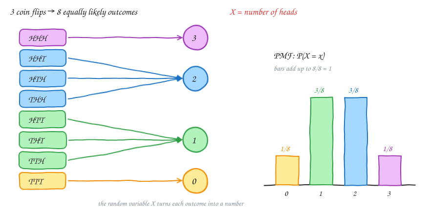
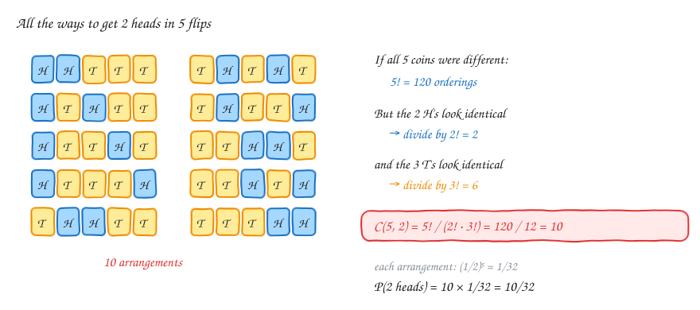
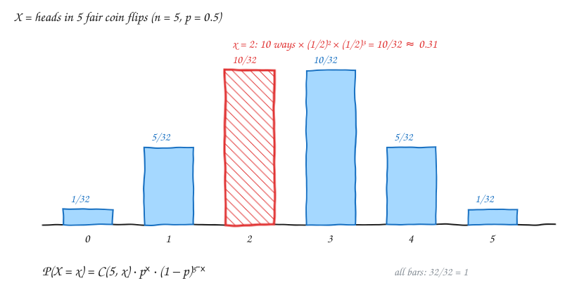
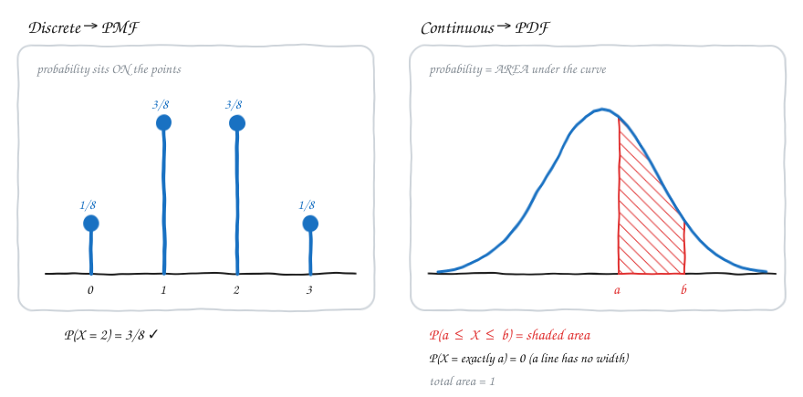
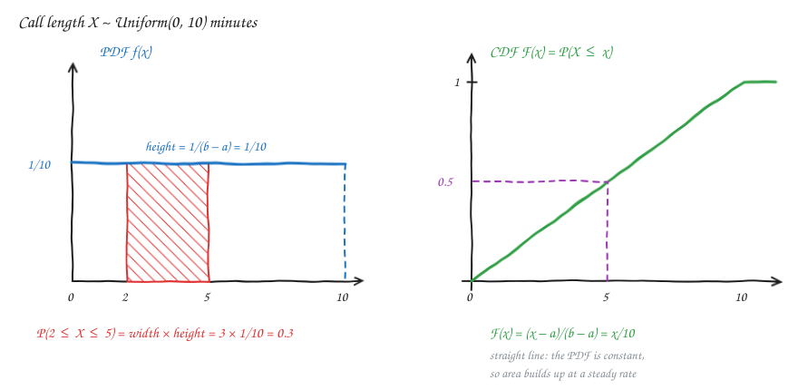
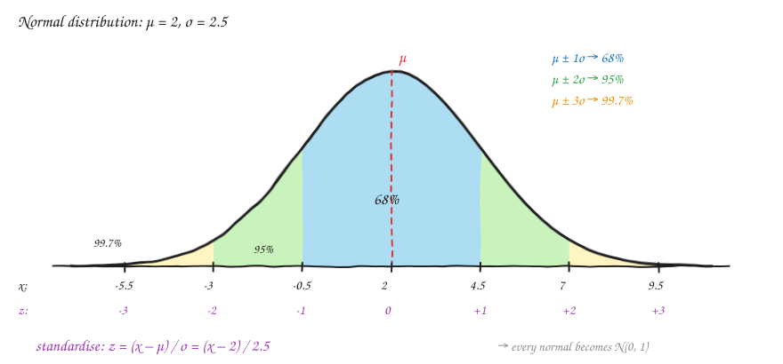
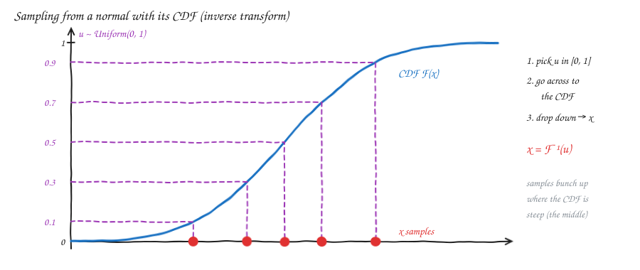

# Probability — v1.3: Random Variables & Distributions

Builds on [v1.1](Statv1.1.md) (basics, counting) and [v1.2](Statv1.2.md) (Bayes).
This part answers: **"How do we describe *all* the possible outcomes of an experiment and how likely each one is?"**

---

## 1. Random variable

A **random variable X** is a rule that turns each outcome of an experiment into a **number**.

- Flip one coin, with X = number of heads, so X ∈ {0, 1}. P(X = 0) = 0.5 and P(X = 1) = 0.5.
- Flip 10 coins, with X = number of heads, so X ∈ {0, 1, …, 10}.



> **In plain English:** the coin doesn't "know" numbers. X is the label we stick on each outcome so that we can do maths with it (add, average, plot).

### Discrete vs continuous

| | Discrete | Continuous |
|---|---|---|
| Values | **countable**: you can list them (0, 1, 2, …) | **uncountable**: any value in a range (1.2, 1.22, 1.222…) |
| Examples | number of heads, dice roll, emails per hour | height, time a call lasts, temperature |
| Described by | **PMF**, the probability of each value | **PDF**, a density curve |

---

## 2. Probability distribution (PMF)

A **distribution** lists every value X can take together with its probability.

**Three coins**, with X = number of heads:

| Outcomes | X | Count | P(X = x) |
|---|---|---|---|
| TTT | 0 | 1 | 1/8 |
| HTT, THT, TTH | 1 | 3 | 3/8 |
| HHT, HTH, THH | 2 | 3 | 3/8 |
| HHH | 3 | 1 | 1/8 |

For a discrete X this table is the **Probability Mass Function (PMF)**:

$$p_X(x) = P(X = x), \qquad p_X(x) \ge 0, \qquad \sum_x p_X(x) = 1$$

> **In plain English:** the PMF tells you how much probability "mass" sits on each value. All the mass together must add up to exactly 1, because *something* always happens.

---

## 3. Bernoulli distribution: one yes/no trial

A **single** trial with two outcomes: success (1) with probability p, failure (0) with probability 1 − p.

$$P(X = 1) = p, \qquad P(X = 0) = 1 - p$$

- One coin toss (p = 0.5)
- Does this email get clicked? (p = 0.03)
- Is this part defective? (p = 0.01)

| | |
|---|---|
| Mean | p |
| Variance | p(1 − p) |

> **In plain English:** Bernoulli is the "atom". The binomial distribution is just **n Bernoulli trials added up**.

---

## 4. Binomial distribution: how many successes in n trials?

### Step 1: probability of *one specific* arrangement

The chance of the exact sequence **H H T T T** (with P(H) = p) is

$$p \cdot p \cdot (1-p) \cdot (1-p) \cdot (1-p) = p^2 (1-p)^3$$

> **Why multiply?** The flips are independent (v1.1), so the probability of "this AND this AND this…" is the product. If p were 1 the factor would be 1 and change nothing. Because p = 0.5, every flip "costs" a factor of 0.5.

### Step 2: count how many arrangements give the same result

2 heads in 5 flips can happen in **10** different orders, and each has the same probability (1/2)⁵ = 1/32.



$$\binom{n}{x} = \frac{n!}{x!\,(n-x)!}$$

- **n!** counts the orderings if all n items were different.
- **÷ x!** because the x heads are identical, so swapping two heads gives the same sequence.
- **÷ (n − x)!** because the tails are identical too.

**Small check with 3 symbols "1 2 2":** 3! = 6 orderings (122, 122, 212, 221, 212, 221), but only **3** are different: 122, 212, 221.
Formula: 3! / (1! · 2!) = 6 / 2 = **3** ✅ (the 1! for the single "1" is just 1, but it belongs in the formula).

### Step 3: put them together

$$\boxed{P(X = x) = \binom{n}{x}\, p^x\, (1-p)^{n-x}}, \qquad x = 0, 1, \dots, n$$

> **In plain English:** (number of ways to arrange x successes) × (probability of any one such arrangement).



**Examples (fair coin)**

| Question | Working | Answer |
|---|---|---|
| 2 heads in 5 flips | C(5,2) · (½)⁵ = 10/32 | ≈ 0.313 |
| 10 heads in 10 flips | C(10,10) · (½)¹⁰ = 1/1024 | ≈ 0.001 |
| 9 heads in 10 flips | C(10,9) · (½)⁹ · (½)¹ = 10/1024 | ≈ 0.0098 |

⚠️ **Correction to my original notes.** For 9 heads I had only `0.5 × 0.5⁹`. That is **one** arrangement. The single tail can be in any of the 10 positions, so multiply by C(10,9) = 10.

| | |
|---|---|
| Mean | n·p |
| Variance | n·p·(1 − p) |

```python
from math import comb
def binom_pmf(x, n, p):
    return comb(n, x) * p**x * (1 - p)**(n - x)

binom_pmf(2, 5, 0.5)   # 0.3125
```

---

## 5. Continuous random variables and the PDF

For a continuous X, the probability of hitting **one exact value** is **0**.
For example, P(a call lasts *exactly* 1.000000… minutes) = 0, because there are infinitely many possible values sharing the probability.

So instead of probability *at a point* we use **probability over an interval = area under a curve**.



The curve f(x) is the **Probability Density Function (PDF)**:

$$f(x) \ge 0 \text{ for all } x, \qquad \int_{-\infty}^{\infty} f(x)\,dx = 1, \qquad P(a \le X \le b) = \int_a^b f(x)\,dx$$

> **In plain English:** "density" = probability **per unit of length**, just like physical density is mass per unit of volume. To get actual probability you multiply density by a width, i.e. take the area.

| | PMF (discrete) | PDF (continuous) |
|---|---|---|
| Gives | the actual probability P(X = x) | density, *not* a probability |
| Single point | can be > 0 | always 0 |
| Can a value exceed 1? | no | **yes** (e.g. Uniform(0, 0.5) has height 2) |
| Total | sum = 1 | area = 1 |

### CDF: cumulative distribution function

$$F(x) = P(X \le x)$$

- It always rises from 0 to 1 and never goes down.
- For continuous X: **F′(x) = f(x)**. The PDF is the slope of the CDF.
- P(a ≤ X ≤ b) = F(b) − F(a).

---

## 6. Uniform distribution: every value equally likely

X ~ Uniform(a, b) means every value in [a, b] is equally likely:

$$f(x) = \frac{1}{b-a} \;\text{ for } a \le x \le b, \qquad F(x) = \frac{x-a}{b-a}$$

**Example:** a call ends at a random moment within 10 minutes, so X ~ Uniform(0, 10).

- P(call ends between minute 2 and minute 5) = (5 − 2)/10 = **0.3**
- P(call ends in the first minute) = 1/10 = **0.1**
- P(call ends at exactly minute 5) = **0**



> **Why is the CDF a straight line?** Its slope is the PDF, and the PDF is constant (1/10). Area piles up at the same rate everywhere.

| | |
|---|---|
| Mean | (a + b)/2 |
| Variance | (b − a)²/12 |

---

## 7. Normal (Gaussian) distribution

$$f(x) = \frac{1}{\sigma\sqrt{2\pi}}\; e^{-\frac{(x-\mu)^2}{2\sigma^2}}$$

- **μ (mean)** is the centre of the bell.
- **σ (standard deviation)** is the width of the bell.

⚠️ **Correction to my original notes.** I had written `1/sqrt(2π·std) · e^(−0.5·(x−μ)²/2)`. The correct version has **σ√(2π)** in front, with σ outside the root, and **2σ²** at the bottom of the exponent. The exponent is −½·((x − μ)/σ)².

### The 68–95–99.7 rule



| Range | Probability |
|---|---|
| μ ± 1σ | ≈ 68% |
| μ ± 2σ | ≈ 95% |
| μ ± 3σ | ≈ 99.7% |

### Standard normal and standardisation (z-scores)

The **standard normal** is N(0, 1), with μ = 0 and σ = 1. Any normal can be converted to it:

$$z = \frac{x - \mu}{\sigma}$$

> **In plain English:** z = "how many standard deviations away from the mean is x?"
> Example with μ = 2 and σ = 2.5: x = 7 gives z = (7 − 2)/2.5 = **2**, i.e. 2 standard deviations above average.

### "Is standardisation used to check whether two distributions are the same?"

**Not quite.** Standardisation doesn't *test* whether two distributions are the same. It **removes the differences in centre (μ) and spread (σ)** so that values from different scales become comparable. After standardising, *any* two normal distributions look identical, N(0, 1). To check whether data actually *is* normal, or whether two datasets share a shape, use a **Q-Q plot** or a test such as **Kolmogorov–Smirnov**.

**Where standardisation is used:**

| Use case | How z helps |
|---|---|
| **Comparing scores across exams** | Maths 80 (μ 70, σ 5) gives z = 2. Physics 85 (μ 75, σ 10) gives z = 1. The maths score is *relatively* better even though the number is lower. |
| **Probability lookups** | Every normal question becomes a question about N(0, 1), so a single z-table (or `norm.cdf`) answers them all. |
| **Outlier detection** | Flag points with \|z\| > 3, which happens only 0.3% of the time by chance. |
| **Machine learning feature scaling** | Height in cm and salary in ₹ get the same scale, so no feature dominates gradient descent or k-NN distances. |
| **Growth charts and percentiles** | A child's height or weight is reported as a z-score or percentile for their age. |
| **IQ** | Defined as μ = 100, σ = 15, so IQ 130 = z of 2 = top ~2.3%. |
| **Quality control (Six Sigma)** | A process is "in control" if measurements stay within μ ± 3σ. |

**Where the normal distribution shows up:** heights, weights, IQ, measurement errors, exam scores, sensor noise. Through the *Central Limit Theorem*, averages of many random things are also approximately normal.

---

## 8. Sampling: generating random numbers from a distribution

**Goal:** a computer gives you **uniform** random numbers u in [0, 1]. How do you turn them into samples from *any* distribution, such as a normal?

**Inverse transform sampling:**

1. Pick u ~ Uniform(0, 1).
2. Find the x where the CDF equals u, i.e. go **across** from u to the CDF curve, then **down** to the x-axis.
3. That x = F⁻¹(u) is your sample.



> **Why does it work?** The CDF is steep where the PDF is high, so lots of u values land on a small range of x. That's exactly where samples *should* bunch up.

For the uniform distribution F⁻¹(u) = a + u(b − a), which is easy. For the **normal distribution** the CDF has **no closed-form formula**, so F⁻¹ is computed numerically (that's what `scipy.stats.norm.ppf` does). In practice libraries use faster tricks such as the Box–Muller transform:

```python
import numpy as np
from scipy.stats import norm

u = np.random.rand(5)
x = norm.ppf(u, loc=2, scale=2.5)   # inverse CDF → samples from N(2, 2.5²)

# or simply
x = np.random.normal(2, 2.5, size=5)
```

---

## Use cases at a glance

| Distribution | Type | Models | Real examples |
|---|---|---|---|
| **Bernoulli(p)** | discrete | a single yes/no event | click or no click, pass or fail, defective or OK |
| **Binomial(n, p)** | discrete | number of successes in n independent yes/no trials | defectives in a batch of 100, heads in 10 flips, conversions out of 1000 visitors, A/B tests |
| **Uniform(a, b)** | continuous | "no idea, anything in the range is equally likely" | random arrival within a time window, rounding error, random number generators |
| **Normal(μ, σ)** | continuous | values clustering around an average | heights, IQ, measurement noise, exam scores, errors in ML models |

---

## Formula cheat sheet

| Idea | Formula | Plain English |
|---|---|---|
| PMF | p(x) = P(X = x), Σ p(x) = 1 | the probability on each value |
| PDF | P(a ≤ X ≤ b) = ∫ₐᵇ f(x) dx | probability = area |
| CDF | F(x) = P(X ≤ x), F′ = f | probability accumulated so far |
| Bernoulli | P(1) = p, P(0) = 1 − p | one yes/no trial |
| Binomial | C(n,x) pˣ (1−p)ⁿ⁻ˣ | ways × probability of one way |
| Binomial coefficient | n! / (x!(n−x)!) | arrangements ÷ identical swaps |
| Uniform | f = 1/(b−a) | flat, so probability = width/(b − a) |
| Normal | (1/σ√2π) e^(−(x−μ)²/2σ²) | a bell centred at μ with width σ |
| z-score | z = (x − μ)/σ | number of standard deviations from the mean |
| Inverse transform | x = F⁻¹(u) | uniform u → any distribution |

---

## Revision questions

Try each question first, then expand it to check your answer.

<details>
<summary><b>Q1.</b> Classify each as discrete or continuous: (a) the number of cars passing in an hour, (b) the time until the next car, (c) a shoe size, (d) the exact weight of an apple.</summary>

(a) discrete · (b) continuous · (c) discrete (sizes come in fixed steps) · (d) continuous
</details>

<details>
<summary><b>Q2.</b> Two dice are rolled and X = their sum. Write P(X = 7) and P(X = 12). Do all the P(X = x) values add up to 1?</summary>

P(X = 7) = 6/36 = 1/6 · P(X = 12) = 1/36. Yes, the 11 values (2…12) add up to 36/36 = 1.
</details>

<details>
<summary><b>Q3.</b> Compute C(6, 3) and explain in words why you divide by 3! twice.</summary>

C(6,3) = 720/(6·6) = **20**. There are 6! orderings of 6 items. The 3 heads are interchangeable (÷3!) and so are the 3 tails (÷3!).
</details>

<details>
<summary><b>Q4.</b> What is P(exactly 3 heads in 6 fair coin flips)?</summary>

C(6,3)·(½)⁶ = 20/64 = **0.3125**
</details>

<details>
<summary><b>Q5.</b> 10% of parts are defective and you pick 10. What is P(no defective)? What is P(at least one defective)?</summary>

P(0) = 0.9¹⁰ ≈ **0.349**. P(≥ 1) = 1 − 0.349 ≈ **0.651** (complement trick from v1.1).
</details>

<details>
<summary><b>Q6.</b> A Binomial(n = 20, p = 0.3) variable. What are its mean and variance?</summary>

Mean = 20·0.3 = **6**. Variance = 20·0.3·0.7 = **4.2** (σ ≈ 2.05).
</details>

<details>
<summary><b>Q7.</b> How is the Bernoulli distribution related to the binomial distribution?</summary>

Bernoulli is the binomial with n = 1. A binomial is the sum of n independent Bernoulli(p) trials.
</details>

<details>
<summary><b>Q8.</b> Why is P(X = 3.0) = 0 for a continuous X, even though 3.0 is possible?</summary>

Probability is the area under the PDF. A single point has width 0, so its area is 0. There are infinitely many values sharing the total probability of 1.
</details>

<details>
<summary><b>Q9.</b> A PDF has value f(x) = 2 at some point. Is that a mistake?</summary>

**No.** Density is not probability. For example, Uniform(0, 0.5) has f = 2 everywhere on its range, and the area is 0.5 × 2 = 1 ✅. Only the *area* must be ≤ 1.
</details>

<details>
<summary><b>Q10.</b> A bus comes every 15 minutes and you arrive at a random time. What is P(you wait at most 5 minutes)? What is the average wait?</summary>

Wait ~ Uniform(0, 15). P(≤ 5) = 5/15 = **1/3**. Mean = (0 + 15)/2 = **7.5 min**.
</details>

<details>
<summary><b>Q11.</b> Heights are N(μ = 170 cm, σ = 10 cm). Roughly what share of people are between 150 and 190 cm? And above 190 cm?</summary>

150–190 is μ ± 2σ, so **≈ 95%**. Above 190 cm is half of the remaining 5%, so **≈ 2.5%**.
</details>

<details>
<summary><b>Q12.</b> You scored 80 in Maths (class μ = 70, σ = 5) and 85 in Physics (μ = 75, σ = 10). In which subject did you do relatively better?</summary>

z_maths = (80−70)/5 = **2**. z_physics = (85−75)/10 = **1**. **Maths** is better relative to the class, even though the raw score is lower.
</details>

<details>
<summary><b>Q13.</b> IQ ~ N(100, 15). What z-score is an IQ of 130, and roughly what share of people score higher?</summary>

z = (130 − 100)/15 = **2**, so above it is ≈ (100% − 95%)/2 = **≈ 2.5%** (exact: 2.28%).
</details>

<details>
<summary><b>Q14.</b> True or false: standardising two datasets and getting the same mean (0) and standard deviation (1) proves they come from the same distribution.</summary>

**False.** Standardising *always* gives mean 0 and SD 1, whatever the shape. It only removes differences in location and scale. To compare shapes, use a Q-Q plot or a KS test.
</details>

<details>
<summary><b>Q15.</b> Using inverse transform sampling with X ~ Uniform(0, 10), what sample do you get for u = 0.37?</summary>

F(x) = x/10 = 0.37, so **x = 3.7**.
</details>

<details>
<summary><b>Q16.</b> In inverse transform sampling for a normal, why do most samples land near μ?</summary>

The CDF is steepest around μ, where the PDF is highest. A wide band of u values maps onto a narrow band of x values there, so samples pile up near μ.
</details>
