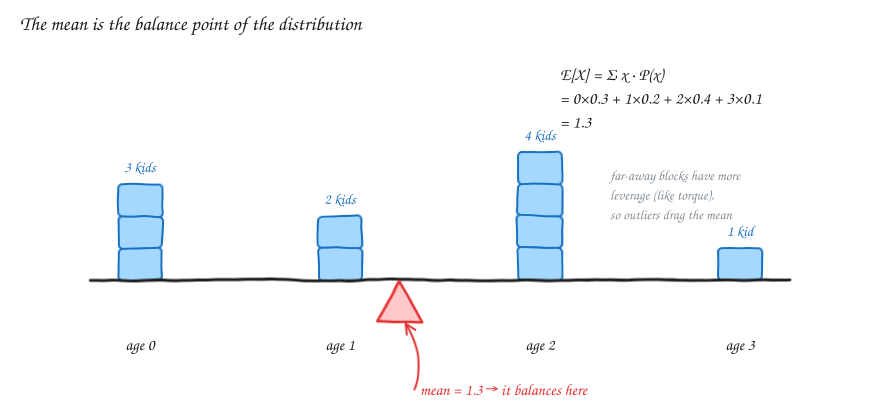
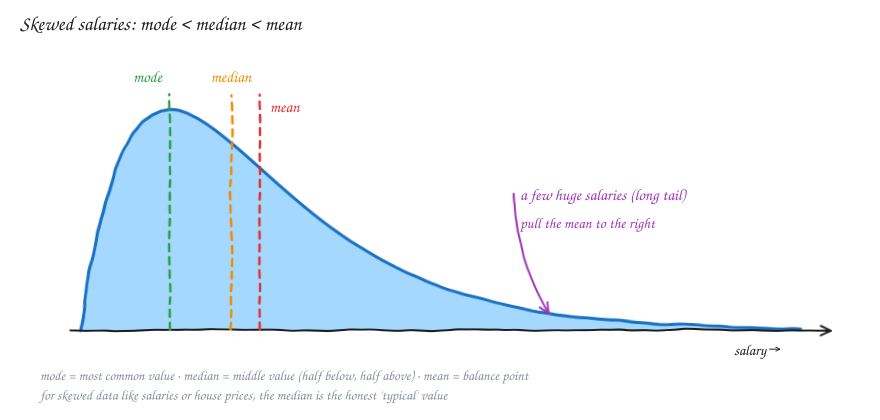
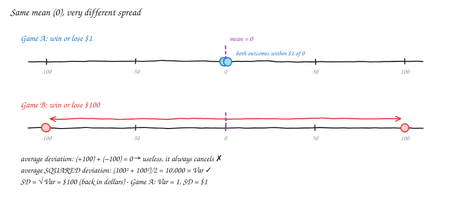
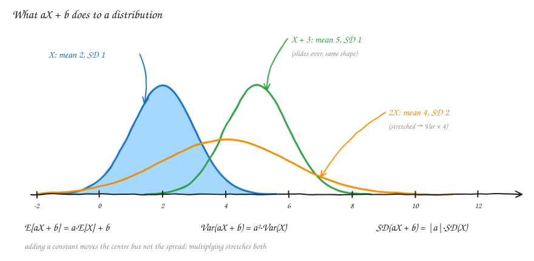
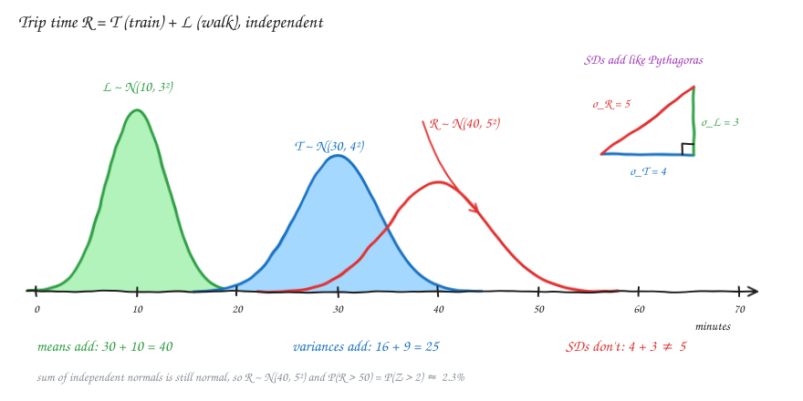
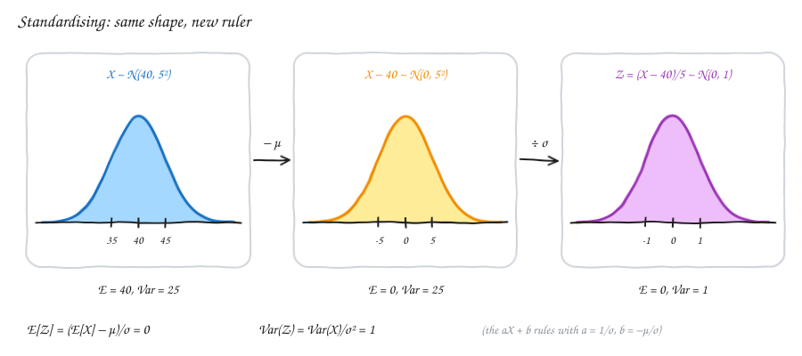

# Probability — v2.1: Expected Value, Median, Mode & Variance

Builds on [v1.3](Statv1.3.md) (random variables and distributions).
v1.x was about *which* outcomes can happen. This part asks: **where is the centre of a distribution, and how spread out is it?**

---

## 1. Expected value (the mean)

The **expected value E[X]** (also written μ) is the long-run average of X, i.e. its **centre of mass**.

**Example:** the ages of 10 kids are: 3 kids aged 0, 2 aged 1, 4 aged 2 and 1 aged 3.

Plain average:

$$\frac{0+0+0+1+1+2+2+2+2+3}{10} = \frac{13}{10} = 1.3$$

The same thing as a **weighted average**, where each value is weighted by its probability:

$$\tfrac{3}{10}\cdot 0 + \tfrac{2}{10}\cdot 1 + \tfrac{4}{10}\cdot 2 + \tfrac{1}{10}\cdot 3 = 1.3$$

$$E[X] = \sum_x x \cdot P(X = x) \qquad\qquad E[X] = \int_{-\infty}^{\infty} x \, f(x)\, dx$$

> **In plain English:** multiply each value by how likely it is, then add everything up. For a continuous X, "add up" becomes an integral.

⚠️ **Correction to my original notes.** The continuous version uses the **PDF f(x)**, not the CDF F(x).

**Moving weight moves the mean.** Shift probability towards bigger values and the mean goes up. Shift it towards smaller values and the mean goes down. A block far from the centre has more **leverage**, like torque on a seesaw, so one extreme value can drag the mean a long way.

### Expected value as a "fair price"

You win **$10 on heads** and **$0 on tails**:

$$E[\text{win}] = 10 \times 0.5 + 0 \times 0.5 = \$5$$

> **In plain English:** if you play many times, you average $5 per game. Paying up to $5 to play is fair, and paying more loses money in the long run.

### Sum of expectations (linearity)

Flip a coin and win $1 on heads, then roll a die and win the number rolled:

$$E[\text{coin} + \text{die}] = E[\text{coin}] + E[\text{die}] = 0.5 + 3.5 = \$4$$

$$E[X + Y] = E[X] + E[Y]$$

> **In plain English:** the average of a total = the total of the averages. This works **always**, even when X and Y are *dependent*. Variance is pickier, as section 3 shows.

---

## 2. Median and mode

| Measure | Definition | How to find it |
|---|---|---|
| **Mean** | balance point | Σ x·P(x) |
| **Median** | middle value: half the data below, half above | sort the data. For odd n take the middle one, for even n average the two middle ones |
| **Mode** | most likely or most common value | the peak of the PMF or PDF |

**Salary example:** 9 people earn ₹20,000 and 1 earns ₹20,00,000.

- Mean = (9 × 20,000 + 20,00,000) / 10 = **₹2,18,000**. Nobody actually earns this.
- Median = **₹20,000**, the typical person.

⚠️ **Correction to my original notes.** I wrote "the mean is the correct measure" here. For **skewed** data like salaries or house prices, the **median** is the better "typical" value, because one huge value drags the mean but barely moves the median. The mean gives every point weight 1/N *and* uses its distance from the centre. The median only cares about order.

> **Rule of thumb:**
> - Symmetric data: mean ≈ median ≈ mode, and any of them is fine.
> - Right-skewed data (long tail of big values): mode < median < mean, so report the median.

**Multimodal** distributions have more than one peak, e.g. the heights of a mixed group of adults and children. A single "centre" can mislead here, so plot the data.

---

## 3. Variance and standard deviation

Two games, both with **mean 0**:

- **Game A:** win or lose $1
- **Game B:** win or lose $100

Same centre, very different risk. We need a number for **spread**.

**Attempt 1: average deviation x − E[X].**
For B, (+100 − 0) and (−100 − 0) average to 0. Deviations **always cancel** to 0, so this is useless.

**Attempt 2: average absolute deviation |x − E[X]|.**
This works, but |·| is awkward for calculus and algebra.

**What we use: the average *squared* deviation**

$$\text{Var}(X) = E\big[(X - \mu)^2\big] = \sum_x (x - \mu)^2 P(x)$$

$$\text{SD}(X) = \sigma = \sqrt{\text{Var}(X)}$$

> **In plain English:** variance = "on average, how far from the mean, squared". Squaring makes every deviation positive and punishes big misses more. Variance comes out in **units²** (dollars²), so we take the square root to get the standard deviation back in **dollars**.

| | Game A | Game B |
|---|---|---|
| Var | (1² + 1²)/2 = **1** | (100² + 100²)/2 = **10,000** |
| SD | **$1** | **$100** |

**Shortcut formula** (often easier to compute):

$$\text{Var}(X) = E[X^2] - (E[X])^2$$

Ages example: E[X²] = 0·0.3 + 1·0.2 + 4·0.4 + 9·0.1 = 2.7, so Var = 2.7 − 1.3² = **1.01** and SD ≈ **1.005**.

**Link to the normal distribution (v1.3):** for a normal, about 68% of values lie within μ ± 1σ, 95% within μ ± 2σ and 99.7% within μ ± 3σ. The SD is the natural ruler for spread.

---

## 4. Linear functions: what happens to E and Var for aX + b?

Take Y = aX + b, e.g. converting °C to °F (Y = 1.8X + 32) or a salary to a salary after a raise.

$$E[aX + b] = a\,E[X] + b \qquad \text{Var}(aX + b) = a^2\,\text{Var}(X) \qquad \text{SD}(aX + b) = |a|\,\text{SD}(X)$$

**Why?**

- **+ b** slides every value by the same amount. The centre moves, but the distances from the centre don't change, so **variance is unchanged**.
- **× a** stretches every distance from the centre by a. Variance is a *squared* distance, so it scales by **a²**.

> **In plain English:** adding a constant moves the distribution but doesn't widen it. Doubling every value doubles the spread (SD × 2), which quadruples the variance (× 4).

**Example:** temperatures in °C have mean 20 and SD 5. In °F, the mean = 1.8·20 + 32 = **68** and the SD = 1.8·5 = **9**. The +32 doesn't affect the spread.

---

## 5. Sum of Gaussians: why Var(T + L) = Var(T) + Var(L)

**Setup:** your trip time is **R = T + L**, where

- T = train time ~ N(30, 4²) minutes
- L = walk time ~ N(10, 3²) minutes
- T and L are **independent**

### The rules

$$E[R] = E[T] + E[L] = 30 + 10 = 40$$

$$\text{Var}(R) = \text{Var}(T) + \text{Var}(L) = 16 + 9 = 25 \;\Rightarrow\; \text{SD}(R) = 5$$

and, a special property of the normal: **a sum of independent normals is itself normal**, so R ~ N(40, 5²).

### Why do the *variances* add, and not the SDs?

Expand the definition:

$$\text{Var}(T + L) = E\big[(T - \mu_T + L - \mu_L)^2\big] = \text{Var}(T) + \text{Var}(L) + 2\,\underbrace{E\big[(T-\mu_T)(L-\mu_L)\big]}_{\text{Cov}(T,\,L)}$$

- The cross term is the **covariance**, which measures whether T and L tend to be high or low *together*.
- If T and L are **independent**, Cov = 0, so the cross term vanishes and the variances simply add.

> **In plain English:** sometimes the train is late while the walk is quick, so the errors **partly cancel**. Because of that, the total is *less* spread out than "worst case + worst case" (4 + 3 = 7). Independent deviations combine like the sides of a right triangle: √(4² + 3²) = 5. That's why SDs add like **Pythagoras**, and their squares (the variances) add normally.

### Things that trip people up

| Situation | Variance | Why |
|---|---|---|
| T + L (independent) | Var T + Var L | the cross term is 0 |
| T − L (independent) | Var T **+** Var L | Var(−L) = (−1)²·Var L. Subtracting still *adds* uncertainty |
| T + L (dependent) | Var T + Var L + 2 Cov(T, L) | e.g. a rainy day slows both, so Cov > 0 and the spread is bigger |
| 2X (one variable doubled) | 4 Var X | the same randomness is counted twice and can never cancel |
| X₁ + X₂ (two independent copies) | 2 Var X | the two copies partly cancel |
| average of n independent copies | Var X / n | averaging shrinks the spread, so SD = σ/√n |

**Using it:** P(trip takes more than 50 min) = P(R > 50) = P(Z > (50 − 40)/5) = P(Z > 2) ≈ **2.3%**.

---

## 6. Standardisation of a distribution

Section 4's rules explain the z-score from v1.3:

$$Z = \frac{X - \mu}{\sigma}$$

This is just aX + b with a = 1/σ and b = −μ/σ, so:

$$E[Z] = \frac{E[X] - \mu}{\sigma} = 0 \qquad\qquad \text{Var}(Z) = \frac{\text{Var}(X)}{\sigma^2} = 1$$

> **In plain English:**
> 1. Subtract the mean, which slides the centre to 0.
> 2. Divide by the SD, which changes the units to "number of SDs".
>
> The **shape stays the same**, only the ruler changes. If X is normal, Z is the standard normal N(0, 1).

**What it's good for:**

- **Comparing things on different scales.** A trip of 50 min is z = +2, unusually slow. A test score of 80 when μ = 70 and σ = 5 is also z = +2, equally unusual.
- **One table for every normal.** Any normal probability becomes a lookup in N(0, 1).
- **Spotting outliers.** Flag points with |z| > 3.
- **Machine learning.** Features measured in different units get the same scale.

Standardising works for *any* distribution: it always gives mean 0 and SD 1. But it **doesn't** turn a skewed distribution into a normal one, because the shape is kept.

---

## Formula cheat sheet

| Idea | Formula | Plain English |
|---|---|---|
| Expected value | E[X] = Σ x·P(x) or ∫ x f(x) dx | weighted average, the balance point |
| Linearity | E[X + Y] = E[X] + E[Y] | always true, even for dependent X and Y |
| Variance | Var(X) = E[(X − μ)²] = E[X²] − μ² | average squared distance from the mean |
| Standard deviation | σ = √Var(X) | spread in the original units |
| Linear function | E[aX+b] = aE[X]+b, Var(aX+b) = a²Var(X) | shifting moves, scaling stretches |
| Sum (independent) | Var(X ± Y) = Var(X) + Var(Y) | variances add, SDs don't |
| Sum (general) | Var(X+Y) = Var X + Var Y + 2Cov(X,Y) | the cross term measures moving together |
| Sum of normals | N(μ₁,σ₁²) + N(μ₂,σ₂²) = N(μ₁+μ₂, σ₁²+σ₂²) | if independent |
| Standardise | Z = (X − μ)/σ | E = 0, Var = 1, same shape |

---

## Revision questions

Try each question first, then expand it to check your answer.

<b>Q1.</b> What is the expected value of one roll of a fair die? What is its variance?

E = (1+2+3+4+5+6)/6 = **3.5**.
E[X²] = (1+4+9+16+25+36)/6 = 91/6 ≈ 15.17, so Var = 15.17 − 3.5² = **35/12 ≈ 2.92**.

<b>Q2.</b> A game costs $3 to play. You roll a die and win $1 per pip. Is it worth playing?

E[win] = $3.5 and the cost is $3, so the expected profit is **+$0.50 per game**. In the long run it's worth playing.

<b>Q3.</b> The house prices on a street are 40, 45, 50, 55 and 500 (lakhs). Find the mean and the median. Which one describes a typical house?

Mean = 690/5 = **138**. Median = **50**. The median is the typical value, because the mean is dragged up by the one mansion.

<b>Q4.</b> Why do we square deviations instead of just averaging x − μ?

The raw deviations always add up to 0, because positives and negatives cancel. Squaring makes them all positive (and weights big misses more), and it's easy to work with algebraically.

<b>Q5.</b> X has mean 10 and SD 2. What are the mean and SD of Y = 3X − 4?

E[Y] = 3·10 − 4 = **26**. SD(Y) = |3|·2 = **6** (Var = 36). The −4 doesn't affect the spread.

<b>Q6.</b> X has variance 9. What is Var(−X)? What is Var(X + 100)?

Var(−X) = (−1)²·9 = **9**. Var(X + 100) = **9**. Neither flipping nor shifting changes the spread.

<b>Q7.</b> T ~ N(30, 4²) and L ~ N(10, 3²) are independent. What is the distribution of T − L?

E = 30 − 10 = 20, Var = 16 + 9 = 25, so **T − L ~ N(20, 5²)**. The variances still add when you subtract.

<b>Q8.</b> Why is Var(2X) ≠ Var(X₁ + X₂), where X₁ and X₂ are independent copies of X?

Var(2X) = 4 Var X: one source of randomness, doubled, so it can't cancel itself out.
Var(X₁ + X₂) = 2 Var X: two independent sources, whose ups and downs partly cancel.

<b>Q9.</b> A box holds 100 items, each weighing N(50 g, 2²) independently. What is the distribution of the total weight?

Mean = 100·50 = 5000 g. Var = 100·4 = 400, so SD = **20 g**. The total is **N(5000, 20²)**. Note that the SD grows like √n, not n.

<b>Q10.</b> In Q9, what is the SD of the <i>average</i> weight of the 100 items?

Var(average) = Var(X)/n = 4/100 = 0.04, so SD = **0.2 g** (σ/√n = 2/10).

<b>Q11.</b> Is Var(X + Y) = Var X + Var Y always true? Give a case where it fails.

**No, it needs Cov(X, Y) = 0** (independence is enough). Example: Y = X gives Var(2X) = 4 Var X, not 2 Var X. Another: the morning and evening commute on the same rainy day are both slow, so Cov > 0.

<b>Q12.</b> Your trip R ~ N(40, 5²). What is P(R < 35)? What is P(30 < R < 50)?

P(R < 35) = P(Z < −1) ≈ **16%**. P(30 < R < 50) = P(−2 < Z < 2) ≈ **95%**.

<b>Q13.</b> After standardising any dataset, what are its mean and SD? Does it become normal?

The mean is **0** and the SD is **1**, always. It does **not** become normal, because the shape (skew, number of peaks) is unchanged.

<b>Q14.</b> Ravi scored 72 in a test with μ = 60 and σ = 8. Priya scored 88 in a test with μ = 80 and σ = 4. Who did relatively better?

z_Ravi = 12/8 = **1.5**. z_Priya = 8/4 = **2**. **Priya** did relatively better.

<b>Q15.</b> E[X + Y] = E[X] + E[Y] holds even for dependent X and Y, but the variance rule needs independence. Why the difference?

Expectation is linear: averaging a sum never involves products of X and Y. Variance squares the sum, (X + Y)², which creates the cross term 2XY. That term only averages to zero when Cov(X, Y) = 0.

