# Probability — v2.2: Skewness, Kurtosis, Quantiles, Box Plots, KDE, Violin & Q–Q Plots

Builds on [v2.1](Statv2.1.md) (mean, variance, standardisation).
The mean tells you where the **centre** of the data is. The SD (standard deviation) tells you how **wide** it is. But neither tells you if the data is **lopsided**, or if it sometimes has **rare, extreme values**. This part adds two numbers for that (skewness and kurtosis). Then it gives some tools for **looking** at real data: quantiles, box plots, KDE, violin plots and Q–Q plots.

**Symbols used in this part:**
- **X** = a random variable (a number that comes out of a random experiment).
- **μ (mu)** = the mean of X.
- **σ (sigma)** = the standard deviation of X. **σ²** = the variance.
- **E[ ... ]** = "the expected value of", i.e. the long-run average of whatever is inside.
- **P(x)** = the probability that X equals x.

---

## 1. Moments: one family of summary numbers

You already know two summary numbers: the mean and the variance. They are the first two members of a family called **moments**.

The k-th moment is simply "the average of X raised to the power k". Using power 1, 2, 3 or 4 tells you a different thing about the shape:

| Name | Formula | What it measures |
|---|---|---|
| 1st raw moment | E[X] = Σ x·P(x) | **location**: the mean μ |
| 2nd central moment | E[(X − μ)²] | **spread**: the variance σ² |
| 3rd standardised moment | E[((X − μ)/σ)³] | **lopsidedness**: the skewness |
| 4th standardised moment | E[((X − μ)/σ)⁴] | **tail weight**: the kurtosis |

(Σ means "add up over all values of x".)

The three words in the "Name" column mean:
- **raw** = use X as it is.
- **central** = first subtract the mean (X − μ). Now it doesn't matter *where* the data sits.
- **standardised** = also divide by σ. Now it doesn't matter what the units are or how wide the data is.

> **Simple idea:** after standardising, skew and kurtosis are plain numbers with no units. They only describe the **shape** of the data, not its position or size.

⚠️ **Correction to my original notes.** I wrote the first moment as p(x₁) + p(x₂) + … That just adds up to 1, because all probabilities add to 1. Each probability must be **multiplied by its value**: **E[X] = x₁·p₁ + x₂·p₂ + …**. In the same way, the second moment is x₁²·p₁ + x₂²·p₂ + …

---

## 2. Skewness: the third moment

### Lottery vs insurance

Two bets:

- **Lottery ticket (you buy it):** you pay $1.
  - 1% chance you win $100, so you are up **+$99**.
  - 99% chance you win nothing, so you are down **−$1**.
- **Insurance (you sell it):** a client pays you $1.
  - 99% chance nothing happens, so you are up **+$1**.
  - 1% chance you must pay out $100, so you are down **−$99**.

These two bets are mirror images. Let's compare their moments. (The mean is 0, so E[X²] is the variance and E[X³] is the third central moment.)

| | Lottery | Insurance |
|---|---|---|
| Mean | 0.99·(−1) + 0.01·99 = **0** | 0.99·1 + 0.01·(−99) = **0** |
| Variance E[X²] | 0.99·1 + 0.01·9801 = **99** | **99** |
| SD = √99 | **≈ 9.95** | **≈ 9.95** |
| E[X³] | −0.99 + 0.01·970,299 = **+9702** | **−9702** |
| Skew = E[X³]/σ³ | 9702 / 985 ≈ **+9.85** | **−9.85** |

(Step check: 99² = 9801, 99³ = 970,299, and σ³ = 9.95³ ≈ 985.)

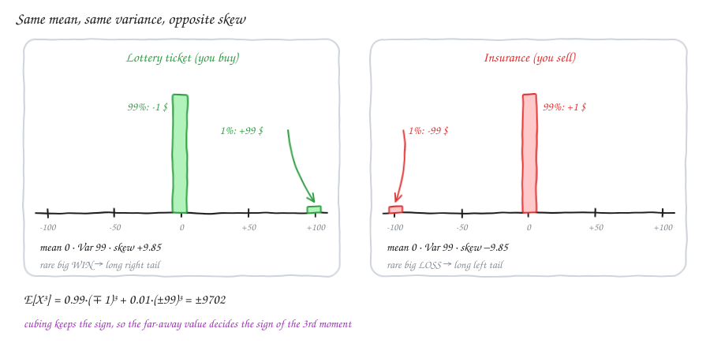

- The mean, the variance and the SD are **the same** for both.
- But the bets feel totally different:
  - **Lottery:** you lose a little, often. Rarely you get a big **win**.
  - **Insurance:** you gain a little, often. Rarely you get a big **loss**.
- Only the **third** moment can tell them apart.

**Why does the power 3 work?** Cubing **keeps the sign** (+ or −).
- A big gap to the right: (+99)³ = a huge **positive** number.
- A big gap to the left: (−99)³ = a huge **negative** number.
- Squaring would make both positive, so you could no longer tell left from right.

$$\text{skew} = E\left[\left(\frac{X-\mu}{\sigma}\right)^3\right]$$

> **Simple idea:** skew tells you which side the rare far-away values are on.
> - Far values mostly on the **right** (long right tail) → skew is **positive**.
> - Far values mostly on the **left** → skew is **negative**.
> - Same on both sides (symmetric) → skew is **0**.

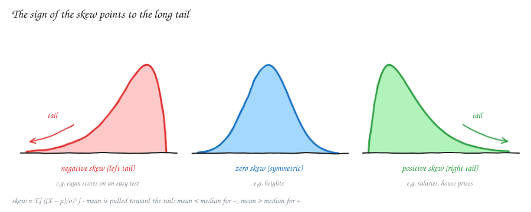

| Skew | Shape | Mean vs median | Examples |
|---|---|---|---|
| > 0 | long **right** tail | mean > median | salaries, house prices, waiting times |
| = 0 | symmetric | mean = median | heights, measurement errors |
| < 0 | long **left** tail | mean < median | scores on an easy exam, age at retirement |

This links to v2.1: the long tail **pulls the mean** towards it. The median (the middle value) barely moves. Think of salaries: a few millionaires push the average salary up, but the "typical" middle person earns the same.

---

## 3. Kurtosis: the fourth moment

### Which game is riskier?

- **Game 1:** win $1 with probability 1/2, lose $1 with probability 1/2.
- **Game 2:**
  - win 10¢ with probability 100/202, lose 10¢ with probability 100/202;
  - win $10 with probability 1/202, lose $10 with probability 1/202.

Game 2 is almost always tiny wins and losses. But once in a while there is a big $10 swing.

| Moment | Game 1 | Game 2 |
|---|---|---|
| Mean | 0 | 0 |
| Variance | 1 | 2·(100/202)·0.01 + 2·(1/202)·100 = **1** |
| Skew | 0 (symmetric) | 0 (symmetric) |
| E[X⁴] = kurtosis (σ = 1) | **1** | 2·(100/202)·0.0001 + 2·(1/202)·10,000 ≈ **99** |

(Step check for Game 2: 0.1² = 0.01 and 10² = 100. The variance is 1/202 + 200/202 = 202/202 = 1. Then 0.1⁴ = 0.0001 and 10⁴ = 10,000, giving about 0.0001 + 99.0 ≈ 99.)

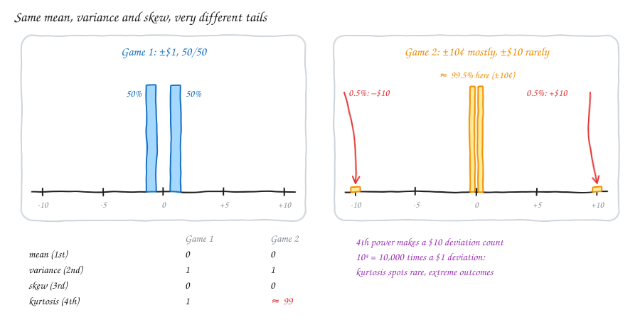

- The first three moments are **the same**.
- But Game 2 hides rare **$10 swings**.
- The power 4 makes big gaps count enormously: a $10 gap counts **10⁴ = 10,000 times** as much as a $1 gap.
- So those rare, extreme outcomes take over the 4th moment.

$$\text{kurtosis} = E\left[\left(\frac{X-\mu}{\sigma}\right)^4\right]$$

> **Simple idea:** kurtosis asks "does the spread come from many medium values, or from a few rare, extreme ones?" High kurtosis = **fat tails** = usually calm, but now and then wild.

Two things to remember:
- A **normal** (bell-curve) distribution has kurtosis **3**. Many software libraries report **excess kurtosis** = kurtosis − 3, so that the normal scores 0. Check which one you're reading: `scipy.stats.kurtosis` returns the excess by default.
- Kurtosis is about the **tails** (the far ends), **not** about how pointy the peak is. "Kurtosis = peakedness" is a common myth.

### Where kurtosis is useful

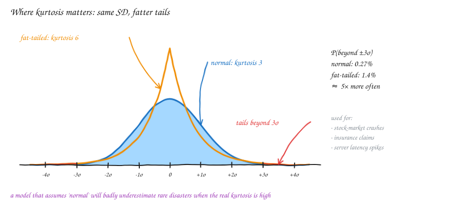

- Both curves have the **same mean and SD**.
- The orange one (a Laplace distribution, kurtosis 6) lands beyond ±3σ about **5× more often** than the normal does.
- So if you model **stock returns, insurance claims or server response times** as normal, you will badly underestimate how often disasters happen.
- A high kurtosis in your data is the warning sign.

---

## 4. Quantiles

**Everyday example:** "You scored in the 90th percentile" means 90% of people scored lower than you.

The **q-quantile** is the value that has a fraction q of the data **below** it. (q is a number between 0 and 1.)

- The **median** is the 0.5-quantile: half the data is below it, half above.
- The **quartiles** cut the data into four parts with equal counts:
  - **Q1** = 25% below,
  - **Q2** = the median = 50% below,
  - **Q3** = 75% below.
- **Percentiles** use hundredths (the 90th percentile = the 0.9-quantile).

### Newspaper budget example

The sorted data is 8.7, 14.2, 18.3, 18.4 (n = 4 values).

- **Median:** n is even, so take the two middle values (positions 2 and 3) and average them: (14.2 + 18.3)/2 = 32.5/2 = **16.25**.
- **Q1:** a quarter of 4 values is exactly 1 value. So 8.7 is the natural "lowest 25%".
  - But software usually **interpolates**: it picks a point part-way between two neighbours.
  - NumPy's default gives Q1 = 8.7 + 0.75·(14.2 − 8.7) = 8.7 + 0.75·5.5 = 8.7 + 4.125 = **12.825**.

⚠️ **Note on my original notes.** "Q1 = 8.7" is one valid rule. With so few points, the different rules disagree a lot. With hundreds of points, they all give almost the same answer. Always say which tool or rule you used.

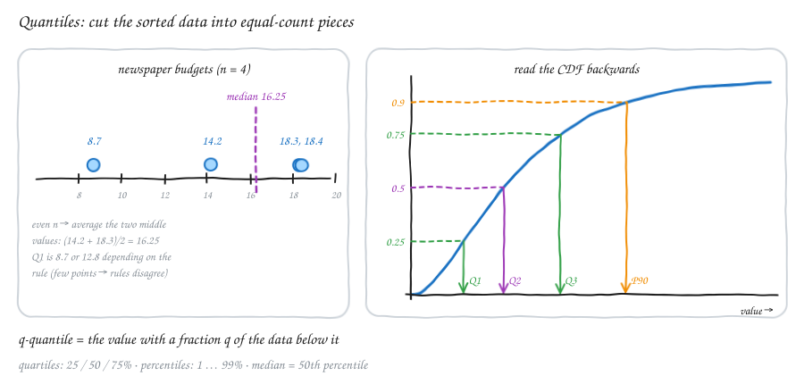

**For a distribution (not just a list of data):** a quantile reads the **CDF backwards**. (The CDF, F(x), is the chance of getting a value ≤ x.)
- Start at 0.25 on the y-axis.
- Go across until you hit the curve.
- Drop straight down. That x is Q1.

In symbols, Q(q) = F⁻¹(q), where F⁻¹ means "the inverse of F" (run F backwards). This is the same inverse CDF that v1.3 used for inverse-transform sampling.

**Why quantiles are useful:** like the median, they are **robust**, which means one strange value can't push them around. One crazy value can move the mean and the SD a long way. It barely moves Q1, the median or Q3.

> **Simple idea:** a quantile answers "what value has this share of the data below it?"

---

## 5. IQR and the box plot

**IQR (inter-quartile range) = Q3 − Q1.** It is the width of the **middle 50%** of the data.

For a bell-shaped (normal) distribution:
- The middle 50% sits in the centre, with 25% in each tail.
- Q1 and Q3 sit at **μ ± 0.67σ** (0.67 standard deviations either side of the mean).
- So the **IQR ≈ 2 × 0.67σ ≈ 1.35σ**.

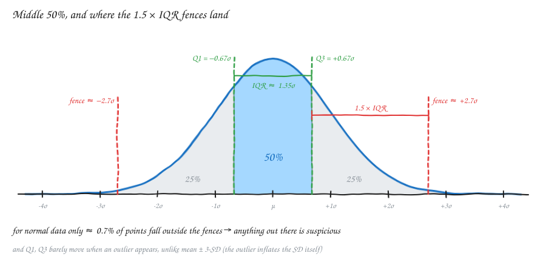

### Building a box plot

Data (n = 11): 2, 4, 5, 6, 7, 8, 9, 10, 11, 13, 30

1. **Quartiles** (NumPy's rule): Q1 = **5.5**, median = **8**, Q3 = **10.5**. So IQR = 10.5 − 5.5 = **5**.
2. **Box:** draw a box from Q1 to Q3, with a line at the median.
3. **Fences:** these are invisible limits. First, 1.5·IQR = 1.5·5 = 7.5.
   - lower fence = Q1 − 1.5·IQR = 5.5 − 7.5 = **−2**
   - upper fence = Q3 + 1.5·IQR = 10.5 + 7.5 = **18**
4. **Whiskers:** lines that go out to the **most extreme real data point that is still inside the fences**. Here that is 2 on the left and 13 on the right.
5. **Outliers:** any point beyond a fence is drawn as its own dot. Here that is **30**.

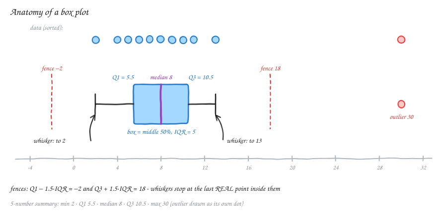

⚠️ **Correction to my original notes.** I wrote that the whisker ends are min(Q3 + 1.5·IQR, x_max) and max(Q1 − 1.5·IQR, x_min). The idea is right, but a whisker always stops **on a real data point**, never in empty space:

- upper whisker = the largest x with x ≤ Q3 + 1.5·IQR;
- lower whisker = the smallest x with x ≥ Q1 − 1.5·IQR.

So in the example the upper whisker stops at 13, not at the fence value 18.

### Why is a box plot useful?

- **Five numbers in one glance:** min, Q1, median, Q3 and max. You see the centre, the spread and any skew.
  - A median that is off-centre in the box, or one whisker much longer than the other, means skew.
- **Outliers are marked for you.**
- **Great for comparing groups:** draw 10 box plots side by side (e.g. salaries per department) and differences jump out.

### Why 1.5 × IQR?

It's a rule of thumb from John Tukey. It is chosen so that it **rarely raises a false alarm on normal data**:

- The upper fence is at Q3 + 1.5·IQR ≈ 0.67σ + 1.5·1.35σ ≈ 0.67σ + 2.03σ ≈ **2.7σ** above the mean.
- Only about **0.7%** of normal data lies beyond ±2.7σ. So anything out there is truly unusual.
- A multiplier of 1 would flag about 4.3% of perfectly normal data (too many false alarms). A multiplier of 3 would miss real problems.

**Why not just use mean ± 3·SD?** Because the outlier **makes the SD bigger**, and the SD is the very thing that is supposed to catch it.
- In the data above, the mean is 9.5 and the SD is 7.2.
- So mean + 3·SD ≈ 9.5 + 21.6 ≈ **31**, and **30 would not be flagged**.
- Q1 and Q3 hardly notice the 30, so the IQR fence (18) still catches it.

> **Simple idea:** the box is where the typical middle half of the data lives. A point more than one-and-a-half box-widths past the box is suspicious.

---

## 6. Kernel density estimation (KDE)

**The problem:** we have a list of data points. We want a **smooth curve** (a PDF, probability density function) that shows where the data is crowded.
- A histogram is a blocky answer.
- Its shape also changes depending on where you put the bin edges.
- KDE is the smooth version.

**The recipe:**

1. Put a small **bump** on **every data point**, centred on it. The bump is called a **kernel**. It is usually a tiny normal curve.
2. Give every bump the same area, **1/n** (n = number of data points). Then the total area is n × 1/n = 1, just as a PDF needs.
3. **Add up all the bumps.**
   - Where many points are close together, the bumps stack up into a high peak.
   - A lonely point gives a small, low hump.

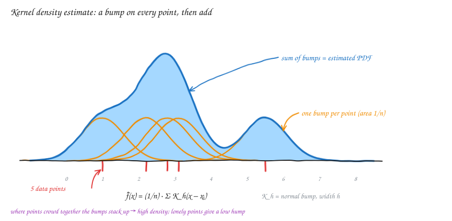

$$\hat f(x) = \frac{1}{n}\sum_{i=1}^{n} K_h(x - x_i) = \frac{1}{n\,h}\sum_{i=1}^{n} K\!\left(\frac{x - x_i}{h}\right)$$

Symbols:
- **f̂(x)** ("f-hat") = our estimated density at the point x.
- **xᵢ** = the i-th data point.
- **K** = the kernel (the bump shape).
- **h** = the **bandwidth**, the width of each bump. K_h is the bump stretched to width h.

> **Simple idea:** to get the height of the curve at x, look at every data point and ask "how close is it to x?" A nearby point adds a lot. A far one adds almost nothing. Average those amounts.

⚠️ **Correction to my original notes.** I wrote "multiply them by the value of the points". The bumps are **not** multiplied by the data values. Each bump is **centred on** a data point and scaled by **1/n**, so every point gets an equal vote. (In a *weighted* KDE you could give some points more weight, but that's an extra choice, not the default.)

### The one knob: the bandwidth h

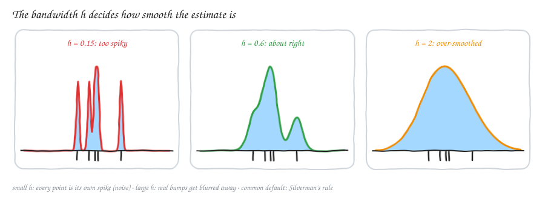

| h | Result |
|---|---|
| too small | a spike on each point: you're drawing the noise |
| about right | the real bumps show and the noise is smoothed out |
| too large | everything blurs into one hump, and real structure (like two groups) disappears |

- The common default is **Silverman's rule**: h ≈ 1.06·σ̂·n^(−1/5), where σ̂ ("sigma-hat") is the SD of your data.
- It works well for roughly normal data. It over-smooths data with several peaks.
- Seaborn's `kdeplot` and SciPy's `gaussian_kde` pick h automatically. You can change it (`bw_adjust` in seaborn).

---

## 7. Violin plots

**A violin plot = a box plot + a KDE.**
- The KDE curve is drawn **mirrored on both sides** of the box.
- The **width of the violin at any height shows how much data sits at that value**.

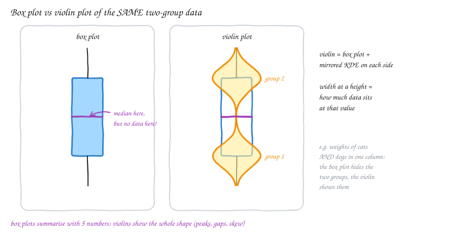

**Why bother?** A box plot only keeps five numbers, so it can hide the shape completely.

Example: the data is really two separate groups (think: weights of cats *and* dogs in one column).
- The box plot looks like one ordinary hump. Its **median even lands in the gap where there is no data at all**.
- The violin shows the two groups straight away.

> **Simple idea (rule of thumb):** use box plots to compare many groups quickly. Use violin plots when the **shape** matters (several peaks, gaps, skew).

---

## 8. Q–Q plots: "is my data normal?"

Many methods assume your data is normal (bell-shaped). A **Q–Q (quantile–quantile) plot** is a quick picture to check that.

It compares the quantiles of your data with the quantiles of a reference distribution, usually the **standard normal** (mean 0, SD 1).

**How it's made:**

1. **Standardise** the data, z = (x − mean)/SD, and **sort** it from smallest to largest.
2. The i-th smallest value is the data's (i − 0.5)/n quantile. Its value is the **y-coordinate**.
3. The **x-coordinate** is where a **perfect normal** would put that same quantile: Φ⁻¹((i − 0.5)/n). (Φ, "phi", is the standard normal CDF, and Φ⁻¹ reads it backwards.)
4. Plot the points and add the line y = x.

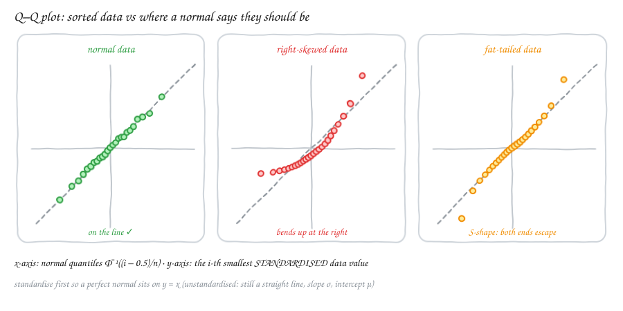

**How to read it:**

| Pattern | Meaning |
|---|---|
| points on the line | data ≈ normal ✓ |
| curve bending **up** on the right (and flat on the left) | right-skewed: the big values are bigger than a normal allows |
| curve bending **down** on the left | left-skewed |
| **S-shape**: low end below the line, high end above it | **fat tails** (high kurtosis): both extremes are more extreme than normal |
| inverted S | thin tails (fewer extremes than normal) |

**Why standardise first?** After standardising, perfect normal data lands exactly on **y = x**, so you only check against one line. Without standardising, normal data still forms a **straight** line, just with slope σ and intercept μ. What matters is that the line is **straight**.

> **Simple idea:** line up your sorted data against where a normal distribution says each value should be. If every point is where it should be, the dots form a straight line. Wherever the dots leave the line, that part of your data isn't normal.

Q–Q plots are the standard check before using methods that assume normality: t-tests, linear-regression residuals, z-score outlier rules. In Python: `scipy.stats.probplot(data, plot=plt)` or `statsmodels.api.qqplot(data, line="45")`.

---

## Formula cheat sheet

| Idea | Formula | Simple meaning |
|---|---|---|
| k-th raw moment | E[Xᵏ] = Σ xᵏ·P(x) | average of X to the k-th power |
| Skewness | E[((X − μ)/σ)³] | its sign shows which side the long tail is on |
| Kurtosis | E[((X − μ)/σ)⁴] | how much of the spread comes from rare extremes; normal = 3 |
| Excess kurtosis | kurtosis − 3 | normal = 0, fat tails > 0 |
| q-quantile | Q(q) = F⁻¹(q) | value with a fraction q of the data below it |
| IQR | Q3 − Q1 | width of the middle 50%; ≈ 1.35σ for normal data |
| Outlier fences | Q1 − 1.5·IQR, Q3 + 1.5·IQR | ≈ ±2.7σ for normal data; only 0.7% beyond |
| KDE | f̂(x) = (1/n) Σ K_h(x − xᵢ) | a bump of area 1/n on each point, added up |
| Silverman's h | 1.06·σ̂·n^(−1/5) | default bump width |
| Q–Q point | (Φ⁻¹((i − 0.5)/n), z₍ᵢ₎) | dots on the line y = x means normal |

---

## Revision questions

Try each question first, then expand it to check your answer.

<b>W1.</b> Is the median of 2, 5, 9 the same as the 0.5-quantile?

**Yes.** Both mean "the value with half the data below it". Here that is **5**.

<b>W2.</b> A distribution has a long tail on the left. Is its skew positive or negative?

**Negative.** The sign of the skew points to the side of the long tail.

<b>W3.</b> Q1 = 20 and Q3 = 32. What is the IQR?

IQR = 32 − 20 = **12**. The middle half of the data spans 12 units.

<b>Q1.</b> What do the 1st, 2nd, 3rd and 4th moments measure?

1st: location (mean). 2nd (central): spread (variance). 3rd (standardised): lopsidedness (skew). 4th (standardised): tail weight (kurtosis).

<b>Q2.</b> X = −1 with probability 0.9 and X = 9 with probability 0.1. Find the mean and the sign of the skew.

Mean = 0.9·(−1) + 0.1·9 = −0.9 + 0.9 = **0**. E[X³] = 0.9·(−1) + 0.1·729 = −0.9 + 72.9 = **+72**, so the skew is **positive**: a rare big value on the right, like a lottery.

<b>Q3.</b> Why can't the 2nd moment tell a lottery from insurance, but the 3rd can?

Squaring makes every gap positive, so (+99)² and (−99)² look the same. Cubing keeps the sign, so a rare big win gives a large + and a rare big loss gives a large −.

<b>Q4.</b> What is the skew of any symmetric distribution, and why?

**0.** For every gap +d there is an equally likely −d, and (+d)³ + (−d)³ = 0. They cancel out.

<b>Q5.</b> Salaries are right-skewed. Which is bigger, the mean or the median?

The **mean**. The long right tail of very high salaries pulls the mean up. The median stays with the typical person.

<b>Q6.</b> Games 1 and 2 (section 3) have the same mean, variance and skew. Which has the higher kurtosis, and what does that mean in real life?

**Game 2** (≈ 99 vs 1). Most of its spread comes from rare $10 swings. So it is usually calm but now and then hits you hard. That is called tail risk.

<b>Q7.</b> Is kurtosis a measure of how "pointy" a distribution is?

**No.** That's a common myth. Kurtosis is driven by the **tails**, i.e. how much probability sits far from the mean. Two distributions can have similar peaks and very different kurtosis.

<b>Q8.</b> A library reports kurtosis = 0 for your data. Is the data flat?

Probably not. Most libraries (e.g. SciPy) report **excess** kurtosis = kurtosis − 3. A value of 0 means the tails are like a **normal** distribution's.

<b>Q9.</b> Find the median of 3, 7, 1, 9, 4. Then find it again after adding 100 to the list.

Sorted: 1, 3, 4, 7, 9, so the median is **4**.
With 100 added: 1, 3, 4, 7, 9, 100, so the median is (4 + 7)/2 = **5.5**. The median barely moved, even though 100 is extreme.

<b>Q10.</b> For the data 1, 2, 3, 4, 5, 6, 7, 8, 9, 40, use Q1 = 3.25 and Q3 = 7.75. Find the IQR, the fences, the whiskers and any outliers.

IQR = 7.75 − 3.25 = 4.5, so 1.5·IQR = 6.75.
Fences: 3.25 − 6.75 = **−3.5** and 7.75 + 6.75 = **14.5**.
Whiskers: **1** and **9** (the last real points inside the fences).
Outlier: **40**.

<b>Q11.</b> Why is the multiplier 1.5 and not 1 or 3?

For normal data the 1.5·IQR fences sit at about ±2.7σ, so only about **0.7%** of truly normal points get flagged. A multiplier of 1 flags about 4% (too many false alarms). A multiplier of 3 sits near ±4.7σ and misses real outliers.

<b>Q12.</b> Why can the "mean ± 3·SD" rule miss an outlier that the IQR rule catches?

The outlier itself pushes up the mean and, even more, the SD. That widens the very limits meant to catch it. Quartiles are robust: one extreme point barely moves Q1 or Q3. In section 5, 30 is inside mean + 3·SD ≈ 31 but outside the IQR fence of 18.

<b>Q13.</b> In a KDE, why does each bump have area 1/n? What happens when h gets very small (h → 0) and very large (h → ∞)?

n bumps of area 1/n add up to a total area of **1**, which a PDF must have.
As **h → 0**, you get a spike at each data point, which just copies the data (noise).
As **h → ∞**, you get one wide, flat hump that hides all structure.

<b>Q14.</b> What does a KDE give you that a histogram doesn't?

A **smooth** curve that doesn't depend on where you put the bin edges. You still have to choose a bandwidth, which plays the role of the bin width.

<b>Q15.</b> When can a box plot mislead you, and what fixes it?

When the data has **several peaks or gaps**. The box plot only keeps five numbers, so two clusters can look like one hump, with the median in an empty gap. A **violin plot** (or a KDE or histogram) shows the real shape.

<b>Q16.</b> On a Q–Q plot against the normal, the points follow the line in the middle but go above it on the right and below it on the left (an S-shape). What does that tell you?

The data has **fat tails** (high kurtosis). Both extremes are more extreme than a normal would give. This is typical of stock returns.

<b>Q17.</b> Your data isn't standardised, but its Q–Q plot is a straight line with slope 4 and intercept 10. Is it normal? What are μ and σ?

**Yes, it's roughly normal.** A straight line is what matters. The intercept gives **μ ≈ 10** and the slope gives **σ ≈ 4**.

