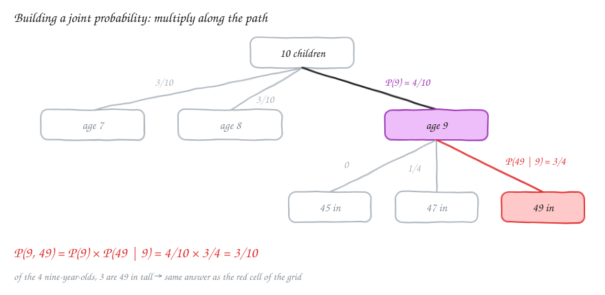
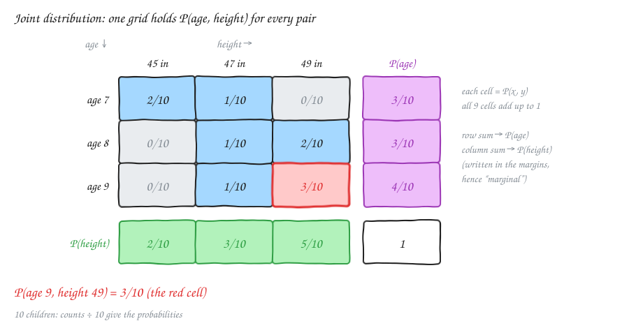
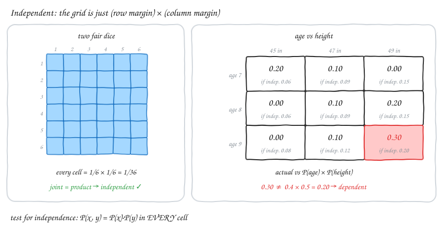
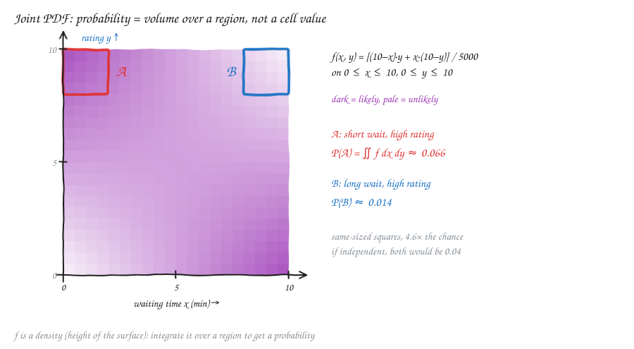
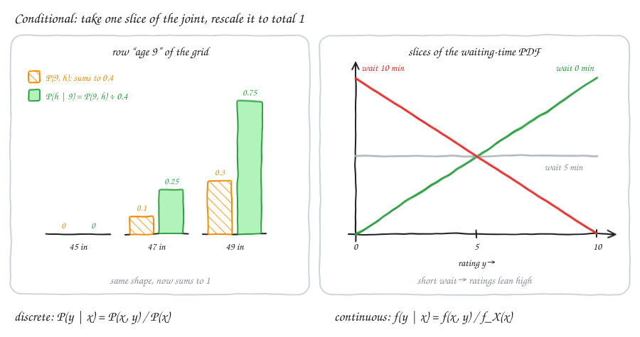

# Probability — v2.3: Joint, Marginal & Conditional Distributions

Builds on [v1.2](Statv1.2.md) (conditional probability, independence, trees) and [v1.3](Statv1.3.md) (PMF, PDF).
Until now, every distribution was about **one** thing at a time. Real questions are often about **two things at once**: a child's age *and* height, or how long a caller waited *and* how they rated the call. This part shows how to handle two variables together.

Three new words, in one line each:
- **Joint** distribution: both variables **together** ("age 9 **and** 49 in tall").
- **Marginal** distribution: **one** variable on its own, ignoring the other ("age 9, any height").
- **Conditional** distribution: one variable **when the other is fixed** ("height, among 9-year-olds only").

---

## 1. Joint distribution (discrete)

"Discrete" means the values can be listed one by one, like ages 7, 8, 9.

### The age and height example

We have 10 children. For each child we write down two things:
- **X** = the age (7, 8 or 9 years).
- **Y** = the height (45, 47 or 49 inches).

**Question:** we pick one child at random. What is P(age 9 **and** 49 in tall)?

**Way 1: two steps (my original approach)**

- 4 of the 10 children are 9 years old. So P(age 9) = **4/10**.
- Of those 4 nine-year-olds, 3 are 49 in tall. So P(49 | age 9) = **3/4**. (The bar "|" means "given". Read it as "49 in tall, given that the child is 9".)
- Multiply: P(9, 49) = 4/10 × 3/4 = 12/40 = **3/10**.



**Way 2: one lookup**

Doing two steps for every question is tiring. Instead, we work out the answer for **every pair** once and put it in a grid. That grid **is** the joint distribution.



| | 45 in | 47 in | 49 in |
|---|---|---|---|
| **age 7** | 2/10 | 1/10 | 0 |
| **age 8** | 0 | 1/10 | 2/10 |
| **age 9** | 0 | 1/10 | **3/10** |

- Each cell is **P(X = x, Y = y)**: the chance that *both* things are true.
- The comma means "and".
- Now P(9, 49) is just a lookup: row "age 9", column "49 in" → **3/10**.

A joint table is valid if it follows the same two rules as any PMF (probability mass function, the list of probabilities from v1.3):

1. No cell is negative (every cell ≥ 0).
2. All the cells together add up to **1**.

Check: 2 + 1 + 0 + 0 + 1 + 2 + 0 + 1 + 3 = 10, so the total is 10/10 = 1 ✓.

> **Simple idea:** the joint distribution is a lookup table. Pick a row (age) and a column (height). The cell tells you how likely that exact pair is.

### Independent vs dependent

The two-step calculation above has a name: the **chain rule** (the multiplication rule from v1.2):

$$P(x, y) = P(x)\cdot P(y \mid x)$$

- This rule **always** works, whether X and Y are linked or not.
- **Independent** means knowing x tells you nothing about y. Then P(y | x) is just P(y), and the rule gets simpler:

$$P(x, y) = P(x)\cdot P(y) \qquad \text{(independent only)}$$



**Two examples:**

- **Two dice:** every cell is 1/6 × 1/6 = 1/36. Every cell equals "row chance × column chance". So the dice are **independent**. (Knowing the first die tells you nothing about the second.)
- **Age and height:**
  - P(9) × P(49) = 0.4 × 0.5 = **0.20**.
  - But the real cell is **0.30**.
  - They don't match. Older children tend to be taller. So age and height are **dependent**.

**How to test:**
- To show independence, the product rule must work in **every** cell.
- To show dependence, **one** failing cell is enough.

⚠️ **Correction to my original notes.** I wrote "P(x)·P(y) for independent, P(x)·P(y/x) for dependent". Two fixes:
- Write **P(y | x)** with a straight bar ("y given x"), not P(y/x). A slash looks like division.
- P(x)·P(y | x) is not only for dependent variables. It is **always** true. For independent variables, P(y | x) happens to equal P(y), so it shrinks to P(x)·P(y).

---

## 2. Joint distribution (continuous)

"Continuous" means the values can be any number in a range, like 3.27 minutes.

### Waiting time and customer rating

A call centre records two things for every call:
- **X** = the waiting time (0 to 10 minutes).
- **Y** = the customer's rating (0 to 10 points).

Both can be any number, so a table won't work. Instead we use a **joint PDF** (probability density function), written f(x, y).

Picture it as a **surface (like a blanket) floating over a floor**:
- The floor has x along one side and y along the other.
- The blanket is **high** above common pairs and **low** above rare pairs.

Our working example:

$$f(x, y) = \frac{(10-x)\,y + x\,(10-y)}{5000}, \qquad 0 \le x \le 10,\ 0 \le y \le 10$$

What the two parts mean:
- **(10 − x)·y** is big when x is small and y is big: **short wait, high rating**.
- **x·(10 − y)** is big when x is big and y is small: **long wait, low rating**.
- Dividing by 5000 makes the total come out to 1.



**Important:** the height of f is **not** a probability (same as for a single PDF). The probability is the **volume** under the surface above a patch of floor:

$$P\big((X, Y) \in R\big) = \iint_R f(x, y)\,dx\,dy$$

For a rectangle patch (x from a to b, y from c to d):

$$P(a \le X \le b,\ c \le Y \le d) = \int_a^b \int_c^d f(x, y)\,dy\,dx$$

Here R = the region (patch) we care about, and ∬ (double integral) means "add up over both x and y".

The rules are the 2-D version of the 1-D rules:
- f(x, y) ≥ 0 everywhere.
- Total volume ∬ f dx dy = 1.

> **Simple idea:** with one variable, probability = **area** under a curve. With two variables, probability = **volume** under a surface. Pick a patch of floor. The amount of "blanket stuffing" above it is the chance of landing in that patch.

⚠️ **Note on my original notes.** My draft linked a formula image (`JointDistro.png`) from a folder on my own computer, so it doesn't show up in the repo. The two formulas above replace it.

### Worked example: region A

**A** = short wait (x from 0 to 2) **and** high rating (y from 8 to 10).

We integrate in two steps: first over y, then over x.

**Step 1 — inner integral, over y** (treat x as a fixed number):

Two small pieces first:
- ∫₈¹⁰ y dy = (10² − 8²)/2 = (100 − 64)/2 = **18**
- ∫₈¹⁰ (10 − y) dy = (10 × 2) − 18 = 20 − 18 = **2**

So:
∫₈¹⁰ [(10 − x)·y + x·(10 − y)] dy = (10 − x)·18 + x·2 = 180 − 18x + 2x = **180 − 16x**

**Step 2 — outer integral, over x:**
∫₀² (180 − 16x) dx = 180 × 2 − 8 × 2² = 360 − 32 = **328**

**Step 3 — divide by 5000:**
P(A) = 328/5000 ≈ **0.066** (about 6.6%).

**Region B** = long wait (x from 8 to 10) **and** high rating (y from 8 to 10). Step 1 is the same. Step 2 changes:
∫₈¹⁰ (180 − 16x) dx = 180 × 2 − 8 × (10² − 8²) = 360 − 288 = **72**
P(B) = 72/5000 ≈ **0.014** (about 1.4%).

**Compare:** both patches are the same size (2 × 2). But 328/72 ≈ **4.6**, so a high rating is **4.6 times** as likely after a short wait. Waiting time and rating are clearly **dependent**.

---

## 3. Marginal distributions

**Marginal** = one variable on its own, **ignoring** the other.

How to get it: add up the joint over every value of the other variable.
- Discrete: add (Σ means "sum").
- Continuous: integrate (∫).

$$P(x) = \sum_y P(x, y) \qquad\qquad f_X(x) = \int f(x, y)\,dy$$

(f_X(x) means "the PDF of X on its own".)

**In the age and height grid:**

- **P(age 9)** = add the **age-9 row**: 0 + 1/10 + 3/10 = **4/10**.
- **P(height 49)** = add the **49-in column**: 0 + 2/10 + 3/10 = **5/10**.

**Why "marginal"?** Because these totals are written in the **margins** (edges) of the table. In the grid diagram above, they are the purple column and the green row.

> **Simple idea:** to forget about one variable, add across all its values. Adding up a row means "age 9, whatever the height".

**Continuous example.** For the call-centre PDF, integrate y away:

$$f_X(x) = \int_0^{10} \frac{(10-x)\,y + x\,(10-y)}{5000}\,dy = \frac{50\,(10-x) + 50\,x}{5000} = \frac{1}{10}$$

(We used ∫₀¹⁰ y dy = 50 and ∫₀¹⁰ (10 − y) dy = 50. Then 50·(10 − x) + 50·x = 500, and 500/5000 = 1/10.)

So the waiting time on its own is **uniform** (flat) from 0 to 10. By the same logic, so is the rating. Yet we saw they are strongly linked. This leads to a key lesson:

⚠️ **The marginals do not tell you the joint.**
- If X and Y were independent, the joint would be f_X · f_Y = 1/10 × 1/10 = 1/100: a flat surface.
- Our surface is not flat at all.
- So two variables can each look perfectly ordinary on their own and still be tightly linked. You only see the link in the joint.

**About my original note:** I wrote "P(50) is just the sum of the age column of 50". The idea is right. More precisely: the marginal for **height 50** is the sum over **all ages** in the height-50 column.

---

## 4. Conditional distributions

**Conditional** = the distribution of Y, looking **only at the cases where X = x**.

Everyday example: "What heights do 9-year-olds have?" We throw away all the 7- and 8-year-olds and look only at the 9-year-olds.

$$P(y \mid x) = \frac{P(x, y)}{P(x)} \qquad\qquad f(y \mid x) = \frac{f(x, y)}{f_X(x)}$$

> **Simple idea:** take one slice of the joint (one row of the table, or one cut through the surface). The slice has the right *shape*, but it doesn't add up to 1. So divide it by its own total. That total is exactly the marginal P(x).



### Discrete: height given age 9

- The age-9 row is (0, 1/10, 3/10).
- Its total is P(age 9) = 4/10.
- Divide each cell by 4/10:

| height | 45 in | 47 in | 49 in |
|---|---|---|---|
| P(h \| age 9) | 0 | (1/10)/(4/10) = **1/4** | (3/10)/(4/10) = **3/4** |

Check: 0 + 1/4 + 3/4 = 1 ✓. This matches the tree: 3 of the 4 nine-year-olds are 49 in tall.

### Discrete: age given height 49 (the other way round)

Now use the **column** instead of the row.
- The 49-in column is (0, 2/10, 3/10).
- Its total is 5/10.
- Divide:
  - P(age 7 | 49) = 0
  - P(age 8 | 49) = (2/10)/(5/10) = **2/5**
  - P(age 9 | 49) = (3/10)/(5/10) = **3/5**

**Notice:** P(49 | 9) = 3/4, but P(9 | 49) = 3/5. They are **not the same**. "Given" works in one direction only. This is the same lesson as Bayes' theorem (v1.2). In fact, Bayes comes straight out of the table:

$$P(9 \mid 49) = \frac{P(49 \mid 9)\,P(9)}{P(49)} = \frac{0.75 \times 0.4}{0.5} = \frac{0.3}{0.5} = 0.6 \;✓$$

And 0.6 = 3/5, which matches.

### Continuous: rating given waiting time

We found f_X(x) = 1/10. So divide the joint by 1/10 (the same as multiplying by 10):

$$f(y \mid x) = \frac{f(x, y)}{1/10} = \frac{(10-x)\,y + x\,(10-y)}{500}$$

Try three waiting times:

| Wait | f(y \| x) | Shape | Meaning |
|---|---|---|---|
| 0 min | (10·y + 0)/500 = **y/50** | rises steeply | high ratings are likely |
| 5 min | (5y + 50 − 5y)/500 = **1/10** | flat | every rating equally likely |
| 10 min | (0 + 10·(10 − y))/500 = **(10 − y)/50** | falls | low ratings are likely |

Each slice has area 1 ✓. For example: ∫₀¹⁰ y/50 dy = (100/2)/50 = 50/50 = 1.

### Conditional expectation

A conditional distribution has its own average (mean). We write it **E[Y | X = x]**: "the expected Y, given X = x".

**Height:**
- E[height | age 9] = 47 × (1/4) + 49 × (3/4) = 11.75 + 36.75 = **48.5 in**.
- E[height | age 7]: the age-7 children are 45, 45, 47. So (45 × 2 + 47 × 1)/3 = 137/3 ≈ **45.7 in**.

**Rating:**
- E[Y | X = x] = ∫ y·f(y | x) dy = **6.67 − x/3**.
- No wait (x = 0): expected rating **6.67**.
- 10-minute wait (x = 10): 6.67 − 3.33 = **3.33**.

> **Simple idea:** E[Y | X = x] is your best guess for Y once you know X. Drawing this guess against x is exactly what **regression** does: predict one variable from another.

**Independence, one more way to see it:** X and Y are independent exactly when every slice looks the same, i.e. P(y | x) = P(y) for every x.
- Dice grid: every row is the same flat 1/6. → independent.
- Age grid: the rows have different shapes. → dependent.

---

## 5. In Python

```python
import pandas as pd

df = pd.DataFrame({"age":    [7, 7, 7, 8, 8, 8, 9, 9, 9, 9],
                   "height": [45, 45, 47, 47, 49, 49, 47, 49, 49, 49]})

joint    = pd.crosstab(df.age, df.height, normalize="all")    # P(age, height)
marg_age = joint.sum(axis=1)                                   # P(age): row sums
cond     = pd.crosstab(df.age, df.height, normalize="index")  # P(height | age): each row / its total
```

- `normalize="all"` divides every count by the grand total (10) → joint.
- `normalize="index"` divides each row by its own total → conditional on age.
- `normalize="columns"` gives P(age | height) instead.

---

## Formula cheat sheet

| Idea | Discrete | Continuous | Simple meaning |
|---|---|---|---|
| Joint | P(x, y) | f(x, y) | how likely the pair (x, y) is |
| Valid | P ≥ 0, Σ Σ P = 1 | f ≥ 0, ∬ f = 1 | nothing negative, total is 1 |
| Probability of a region | Σ of the cells in R | ∬_R f dx dy | add the cells / volume under the surface |
| Marginal | P(x) = Σ_y P(x, y) | f_X(x) = ∫ f(x, y) dy | add up (or integrate) the other variable away |
| Conditional | P(y \| x) = P(x, y)/P(x) | f(y \| x) = f(x, y)/f_X(x) | take one slice, rescale it to total 1 |
| Chain rule | P(x, y) = P(x)·P(y \| x) | f(x, y) = f_X(x)·f(y \| x) | always true |
| Independence | P(x, y) = P(x)·P(y) everywhere | f(x, y) = f_X(x)·f_Y(y) | the joint is just row total × column total |
| Conditional mean | E[Y \| x] = Σ y·P(y \| x) | ∫ y·f(y \| x) dy | best guess for Y once x is known |

---

## Revision questions

Try each question first, then expand it to check your answer.

<details>
<summary><b>W1.</b> In one sentence each, what do "joint", "marginal" and "conditional" mean?</summary>

**Joint:** both variables together ("age 9 and 49 in"). **Marginal:** one variable on its own, ignoring the other ("age 9, any height"). **Conditional:** one variable when the other is fixed ("heights among 9-year-olds only").
</details>

<details>
<summary><b>W2.</b> Using the age and height table, find P(age 7, height 45).</summary>

Look up row "age 7", column "45 in": **2/10**.
</details>

<details>
<summary><b>Q1.</b> What does one cell P(x, y) of a joint table mean? What must all the cells add up to?</summary>

The chance that X = x **and** Y = y are both true. All the cells add up to **1**.
</details>

<details>
<summary><b>Q2.</b> Using the age and height table, find P(age 8, height 49) and P(age 7, height 49).</summary>

**2/10** and **0**. No 7-year-old in the data is 49 in tall.
</details>

<details>
<summary><b>Q3.</b> Find P(height 47) from the table. What kind of probability is this?</summary>

Add the 47-in column: 1/10 + 1/10 + 1/10 = **3/10**. It's a **marginal** probability.
</details>

<details>
<summary><b>Q4.</b> Find P(height | age 7) for all three heights.</summary>

The age-7 row is (2/10, 1/10, 0), with total 3/10. Divide each by 3/10: **(2/3, 1/3, 0)**.
</details>

<details>
<summary><b>Q5.</b> Why is P(49 | 9) = 3/4 but P(9 | 49) = 3/5?</summary>

Both start from the same cell (3/10), but divide by **different totals**. P(49 | 9) divides by the age-9 row total (4/10). P(9 | 49) divides by the 49-in column total (5/10). "Given" picks a different slice each time.
</details>

<details>
<summary><b>Q6.</b> Is P(x, y) = P(x)·P(y | x) only for dependent variables?</summary>

**No.** It is always true (the chain rule). For independent variables P(y | x) = P(y), so it shrinks to P(x)·P(y).
</details>

<details>
<summary><b>Q7.</b> A joint table has P(A, B) = 0.12, P(A) = 0.3 and P(B) = 0.4. Could A and B be independent?</summary>

0.3 × 0.4 = 0.12, so this cell passes. In general one cell is **not enough**: the product rule must work in **every** cell. (But for two yes/no events, if it works for one cell it also works for the other three, so here the answer is yes.)
</details>

<details>
<summary><b>Q8.</b> For a joint PDF, is f(1, 2) = 0.3 a probability? How do you get a probability?</summary>

**No.** It's a density: the height of the surface. It can even be bigger than 1. To get a probability, **integrate f over a region**: find the volume under the surface.
</details>

<details>
<summary><b>Q9.</b> Show that the call-centre f(x, y) has a total volume of 1.</summary>

First part: ∬ (10 − x)·y dy dx = (∫₀¹⁰ (10 − x) dx) × (∫₀¹⁰ y dy) = 50 × 50 = 2500. The second part gives 2500 too (by symmetry). Total = 5000, and 5000/5000 = **1** ✓.
</details>

<details>
<summary><b>Q10.</b> Waiting time and rating are each uniform (flat) on their own. Does that make them independent?</summary>

**No.** Independence needs f(x, y) = f_X(x)·f_Y(y) = 1/100 everywhere: a flat surface. The real f varies a lot (from 0 to 0.02). The marginals throw away exactly the information about how the two are linked.
</details>

<details>
<summary><b>Q11.</b> Using f(y | x) = [(10 − x)·y + x·(10 − y)]/500, find P(Y ≥ 8 | X = 0).</summary>

f(y | 0) = y/50. ∫₈¹⁰ y/50 dy = 18/50 = **0.36**. With no wait, there's a 36% chance of a rating of 8 or more (compared with 20% if ratings were flat).
</details>

<details>
<summary><b>Q12.</b> Find E[height | age 8] from the table.</summary>

The age-8 row is (0, 1/10, 2/10), total 3/10. So the conditional is (0, 1/3, 2/3). E = 47 × (1/3) + 49 × (2/3) = **48.33 in**.
</details>

<details>
<summary><b>Q13.</b> How can you tell from a joint table that two variables are dependent, without working out the marginals?</summary>

Look at the **shape of each row**. If the variables are independent, every row is a scaled copy of the same pattern, so after rescaling, every P(y | x) is the same. In the age table, the age-7 row leans to short heights and the age-9 row leans to tall ones, so they are dependent. (Quick giveaway: a 0 in a cell whose row and column are both non-zero.)
</details>
