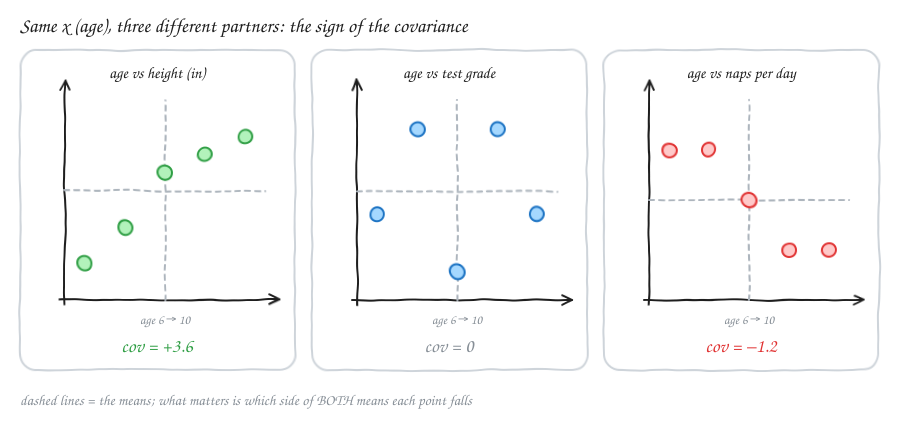
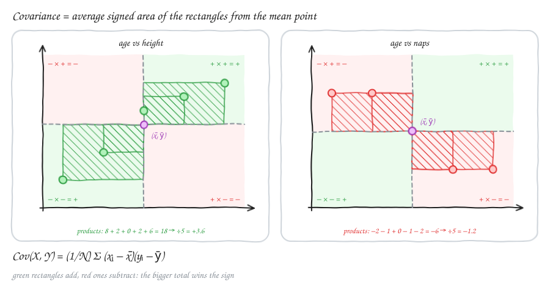
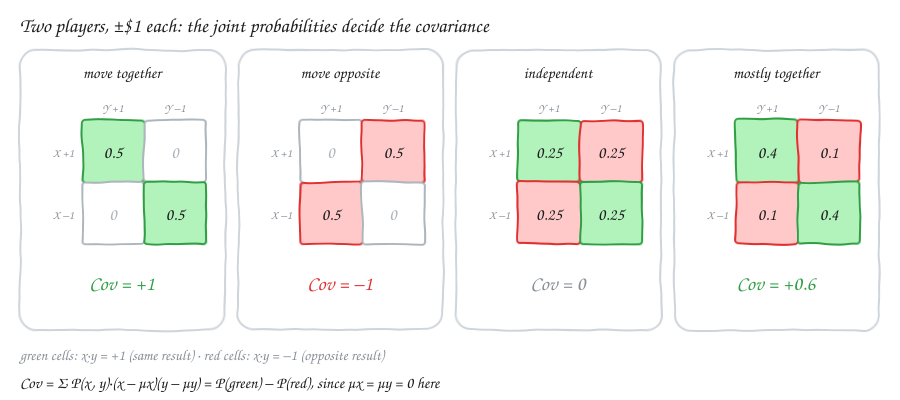
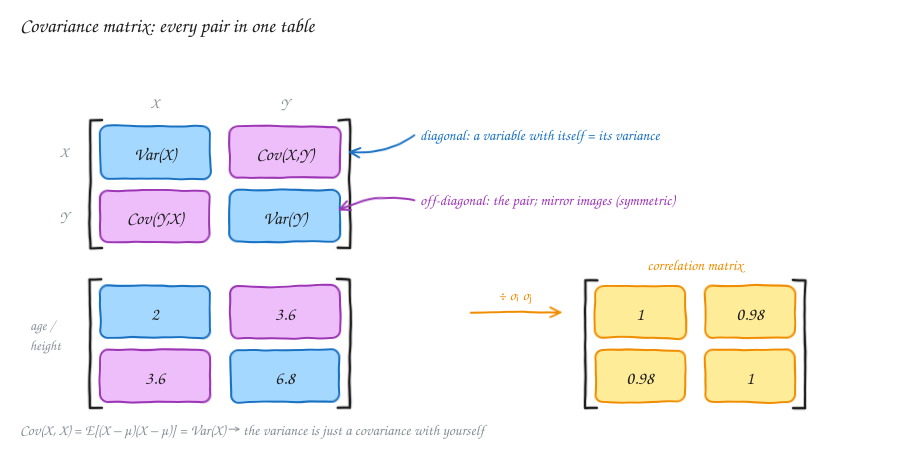
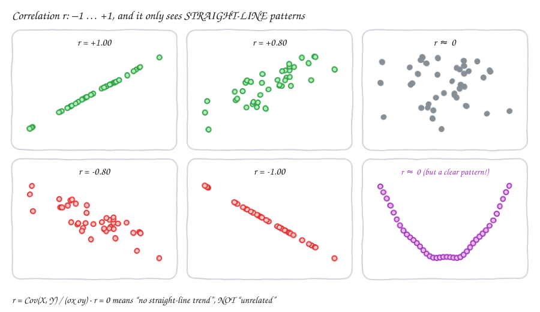

# Probability — v2.4: Covariance, Covariance Matrix & Correlation

Builds on [v2.3](Statv2.3.md) (joint, marginal and conditional distributions) and [v2.1](Statv2.1.md) (mean and variance).
A joint distribution holds **everything** about how two variables relate. That's often too much. We want **one number** that answers: when X goes up, does Y tend to go up, go down, or not care? That number is the **covariance**, and its unit-free version is the **correlation**.

> **Note on my original notes.** The first half of the v2.4 draft (joint, continuous joint, marginal and conditional distributions) repeats v2.3. Those topics are written up in full in [Statv2.3.md](Statv2.3.md), so this file starts at covariance.

---

## 1. Covariance: do two variables move together?

### Age vs height, grades and naps

Take X = the **age** of a child (6 to 10) and three possible partners:

| | age 6 | 7 | 8 | 9 | 10 | mean |
|---|---|---|---|---|---|---|
| Y₁ height (in) | 44 | 46 | 49 | 50 | 51 | 48 |
| Y₂ test grade | 70 | 85 | 60 | 85 | 70 | 74 |
| Y₃ naps per day | 3 | 3 | 2 | 1 | 1 | 2 |



| Pair | Pattern | Covariance |
|---|---|---|
| age vs height | older → taller (grows along) | **> 0** |
| age vs grades | no trend (not related) | **≈ 0** |
| age vs naps | older → fewer naps (decreases along) | **< 0** |

### How to compute it

$$\text{Cov}(X, Y) = \frac{1}{N}\sum_{i=1}^{N} (x_i - \bar x)(y_i - \bar y)$$

1. Find the means x̄ and ȳ.
2. For each point, multiply **how far x is from its mean** by **how far y is from its mean**.
3. Average those products.

⚠️ **Correction to my original notes.** I wrote "mx = 0, my = 0". The means are **not** assumed to be 0. You subtract the actual means, x̄ and ȳ. (If the data happens to be centred already, the means are 0 and the formula simplifies to the average of xᵢ·yᵢ.)

### Why the sign works: the four quadrants

Draw lines through the mean point (x̄, ȳ). They split the plot into four quadrants:

- **top-right**: x above its mean, y above its mean, so (+)·(+) = **+**;
- **bottom-left**: both below, so (−)·(−) = **+**;
- **top-left** and **bottom-right**: one above, one below, so the product is **−**.



Each product is the **signed area of a rectangle** from the mean point to the data point. Covariance is the average of those areas.

**Worked example: age vs height** (x̄ = 8, ȳ = 48)

| age | x − 8 | height | y − 48 | product |
|---|---|---|---|---|
| 6 | −2 | 44 | −4 | +8 |
| 7 | −1 | 46 | −2 | +2 |
| 8 | 0 | 49 | +1 | 0 |
| 9 | +1 | 50 | +2 | +2 |
| 10 | +2 | 51 | +3 | +6 |
| | | | **sum** | **18** |

Cov = 18/5 = **+3.6**. All the rectangles are green, so the covariance is clearly positive.

For naps (ȳ = 2), the products are −2, −1, 0, −1, −2, so Cov = −6/5 = **−1.2**. For grades the products are +8, −11, 0, +11, −8: they **cancel** to exactly **0**.

> **In plain English:** covariance asks, "when one variable is above its average, is the other usually above its average too?" Mostly yes gives a positive number. Mostly the opposite gives a negative number. No pattern means the pluses and minuses cancel, giving about 0.

**N or N − 1?** Dividing by N gives the covariance of exactly these points (the *population* version). When the data is a **sample** and you want to estimate the covariance of a bigger population, divide by **N − 1** instead: 18/4 = 4.5. This is the same correction as for the sample variance. `np.cov` uses N − 1 by default; pass `bias=True` for N.

---

## 2. Covariance of a probability distribution

With a joint distribution instead of a list of data points, each pair is **weighted by its probability** (instead of everyone counting 1/N):

$$\text{Cov}(X, Y) = \sum_{x}\sum_{y} P(x, y)\,(x - \mu_X)(y - \mu_Y) = E\big[(X - \mu_X)(Y - \mu_Y)\big]$$

### Two players, ±$1 each

Each player either wins $1 (+1) or loses $1 (−1). Each player wins half the time, so μ_X = μ_Y = 0, and the product (x − 0)(y − 0) is +1 when they get the **same** result and −1 when they get **opposite** results.



**Game 1: they always move together.** Both win (prob ½) or both lose (prob ½).

Cov = ½·(1·1) + ½·((−1)·(−1)) = ½ + ½ = **+1**

**Game 2: they always move opposite.** X wins and Y loses (½), or vice versa (½).

Cov = ½·(1·(−1)) + ½·((−1)·1) = **−1**

**Game 3: independent coin flips.** All four outcomes have probability ¼.

Cov = ¼(+1) + ¼(+1) + ¼(−1) + ¼(−1) = **0**

⚠️ **Correction to my original notes.** I wrote (−1·−1) + (1·1) = **2** and (−1·1) + (−1·1) = **−2**. Each product has to be **multiplied by its probability** (½ here), so the answers are **+1** and **−1**. Adding the products without weights only works by accident, and only when all outcomes are equally likely and you then divide by the count.

### Unequal probabilities

Suppose the players are **mostly** in sync:

| | Y wins (+1) | Y loses (−1) |
|---|---|---|
| **X wins (+1)** | 0.4 | 0.1 |
| **X loses (−1)** | 0.1 | 0.4 |

The marginals are still 50/50, so both means are still 0. Using P(x, y)·(x − μx)(y − μy) for each cell:

Cov = 0.4·(+1) + 0.1·(−1) + 0.1·(−1) + 0.4·(+1) = **+0.6**

This is positive, but less than the +1 of Game 1, because they sometimes split.

### The age and height table from v2.3

Using the joint table from [v2.3](Statv2.3.md):

- **Means:** μ_age = 7·0.3 + 8·0.3 + 9·0.4 = **8.1**, and μ_height = 45·0.2 + 47·0.3 + 49·0.5 = **47.6**.
- **Shortcut formula:** Cov = E[XY] − μ_X·μ_Y.
- **E[XY]** = Σ P(x, y)·x·y = 63 + 32.9 + 37.6 + 78.4 + 42.3 + 132.3 = **386.5**.
- **Cov** = 386.5 − 8.1 × 47.6 = 386.5 − 385.56 = **+0.94**: older children tend to be taller.

> **In plain English:** the shortcut E[XY] − μ_X·μ_Y is "average of the product minus product of the averages". It's the 2-variable version of Var(X) = E[X²] − μ², and it is usually less work by hand.

### Useful facts

- **Cov(X, X) = Var(X).** A variable's covariance with itself is its variance.
- **Symmetric:** Cov(X, Y) = Cov(Y, X).
- **Independent ⇒ Cov = 0**, because then P(x, y) = P(x)·P(y) and E[XY] = E[X]·E[Y].
- ⚠️ **But Cov = 0 does NOT mean independent.** Let X be −1, 0 or 1 with equal probability, and Y = X². Y is completely determined by X, yet Cov = E[X³] − E[X]·E[X²] = 0 − 0 = **0**. Covariance only detects **straight-line** relationships.
- **Variance of a sum:** Var(X + Y) = Var(X) + Var(Y) + **2·Cov(X, Y)**. In v2.1 we used Var(X + Y) = Var(X) + Var(Y) for independent Gaussians. This is the general version: the covariance term vanishes only when Cov = 0.

---

## 3. The covariance matrix

With two (or more) variables, put every pair's covariance into a table:

$$\Sigma = \begin{bmatrix} \text{Var}(X) & \text{Cov}(X, Y) \\ \text{Cov}(Y, X) & \text{Var}(Y) \end{bmatrix}$$



- The **diagonal** holds each variable with itself, which is its **variance**.
- The **off-diagonal** holds the covariance of each pair. Cov(X, Y) = Cov(Y, X), so the matrix is **symmetric**.

For the 5 children (age, height): Var(age) = 2, Var(height) = 6.8 and Cov = 3.6, so

$$\Sigma = \begin{bmatrix} 2 & 3.6 \\ 3.6 & 6.8 \end{bmatrix}$$

⚠️ **Correction to my original notes.** I wrote M = [[x, xy], [yx, y]]. The diagonal entries are the **variances** Var(X) and Var(Y) (i.e. Cov(X, X) and Cov(Y, Y)), not x and y themselves. The off-diagonal entries are Cov(X, Y), not the product xy.

With k variables the matrix is k × k: entry (i, j) is Cov(Xᵢ, Xⱼ). This matrix is the starting point for multivariate normal distributions and for **PCA** (principal component analysis), which finds the directions in which the data spreads most.

---

## 4. Correlation: covariance without units

**The problem with covariance:** its size depends on the units. Measure height in **centimetres** instead of inches and every height deviation is 2.54 times bigger, so the covariance jumps from 3.6 to **9.14**. Nothing about the relationship changed. You can't tell from Cov = 9.14 alone whether the link is strong or weak.

**The fix:** divide by both standard deviations. This is the **correlation coefficient**:

$$r = \rho_{XY} = \frac{\text{Cov}(X, Y)}{\sigma_X\,\sigma_Y}$$

- Age vs height: r = 3.6 / (√2 · √6.8) = 3.6 / 3.69 ≈ **0.98**. In centimetres: 9.14 / (√2 · 2.54·√6.8) ≈ **0.98**, unchanged ✓.
- Age vs naps: r = −1.2 / (√2 · √0.8) ≈ **−0.95**.
- Age vs grades: r = **0**.
- The v2.3 table: r = 0.94 / (√0.69 · √2.44) ≈ **0.72**.

> **In plain English:** correlation is covariance after both variables have been standardised (turned into z-scores, as in v2.1). It's a pure number between −1 and +1: the sign gives the direction, and the size gives how close the points are to a straight line.



| r | Meaning |
|---|---|
| +1 | perfect rising straight line |
| around +0.8 | strong upward trend, with scatter |
| 0 | no **straight-line** trend |
| around −0.8 | strong downward trend |
| −1 | perfect falling straight line |

The same sign rule as covariance applies: r > 0 means they rise together, r < 0 means one falls as the other rises. Correlation and covariance always have the **same sign**; only the scale differs.

### Two big warnings

1. **r = 0 doesn't mean "unrelated".** The U-shaped panel above has r ≈ 0, yet y is almost a perfect function of x. Correlation only measures **linear** association. Always **plot** the data.
2. **Correlation is not causation.** Ice-cream sales and drowning deaths are positively correlated, because both go up in summer. A hidden third variable (temperature) drives both. Correlation can't tell you which variable, if either, causes the other.

### The correlation matrix

Divide each entry Σᵢⱼ of the covariance matrix by σᵢσⱼ. The diagonal becomes all **1s** (every variable is perfectly correlated with itself), and the off-diagonal entries are the pairwise r values. For age and height:

$$R = \begin{bmatrix} 1 & 0.98 \\ 0.98 & 1 \end{bmatrix}$$

Correlation heatmaps of many variables, e.g. `df.corr()` in pandas, are one of the first plots people make in data analysis.

---

## 5. In Python

```python
import numpy as np
import pandas as pd

age    = np.array([6, 7, 8, 9, 10])
height = np.array([44, 46, 49, 50, 51])

np.cov(age, height)              # [[2.5, 4.5], [4.5, 8.5]]  (divides by N − 1)
np.cov(age, height, bias=True)   # [[2.0, 3.6], [3.6, 6.8]]  (divides by N)
np.corrcoef(age, height)         # [[1, 0.976], [0.976, 1]]  (same either way)

df = pd.DataFrame({"age": age, "height": height, "naps": [3, 3, 2, 1, 1]})
df.corr()                        # full correlation matrix
```

The N vs N − 1 choice changes the covariance but **not** the correlation, because the same factor appears on the top and on the bottom.

---

## Formula cheat sheet

| Idea | Formula | Plain English |
|---|---|---|
| Sample covariance | (1/N) Σ (xᵢ − x̄)(yᵢ − ȳ) | average product of the deviations; use N − 1 for a sample estimate |
| Covariance of a distribution | Σ Σ P(x, y)(x − μx)(y − μy) | the same, weighted by probability |
| Shortcut | Cov = E[XY] − μx μy | average of the product minus product of the averages |
| With itself | Cov(X, X) = Var(X) | variance is a special case |
| Independence | independent ⇒ Cov = 0 | the converse is false (e.g. Y = X²) |
| Sum | Var(X + Y) = Var X + Var Y + 2 Cov(X, Y) | covariance corrects the variance of a sum |
| Covariance matrix | Σᵢⱼ = Cov(Xᵢ, Xⱼ) | variances on the diagonal, symmetric |
| Correlation | r = Cov(X, Y) / (σx σy) | unit-free, between −1 and +1 |
| Correlation matrix | Rᵢⱼ = Σᵢⱼ / (σᵢ σⱼ) | 1s on the diagonal |

---

## Revision questions

Try each question first, then expand it to check your answer.

<details>
<summary><b>Q1.</b> What does the sign of the covariance tell you? What does it not tell you?</summary>

The sign gives the **direction**: positive means they tend to move together, negative means they move in opposite directions. The **size** of the covariance does not tell you how strong the link is, because it depends on the units.
</details>

<details>
<summary><b>Q2.</b> A data point is above the mean in x and below the mean in y. Does it push the covariance up or down?</summary>

**Down.** (+)·(−) is negative: the point is in the top-left or bottom-right quadrant.
</details>

<details>
<summary><b>Q3.</b> Compute the covariance (÷N) of x = 1, 2, 3 and y = 2, 4, 6.</summary>

x̄ = 2 and ȳ = 4. The deviations are (−1, 0, 1) and (−2, 0, 2), so the products are 2, 0, 2. The sum is 4, and Cov = 4/3 ≈ **1.33**.
</details>

<details>
<summary><b>Q4.</b> Find r for the data in Q3.</summary>

σx = √(2/3) and σy = √(8/3), so σx·σy = √(16/9) = 4/3. r = (4/3)/(4/3) = **1**. The points lie exactly on the line y = 2x.
</details>

<details>
<summary><b>Q5.</b> Why is (−1·−1) + (1·1) = 2 the wrong covariance for "both win or both lose, 50/50"?</summary>

Each product must be weighted by its **probability**: ½·1 + ½·1 = **1**. Covariance is an expectation (a probability-weighted average), not a plain sum.
</details>

<details>
<summary><b>Q6.</b> Two players: P(both win) = 0.3, P(both lose) = 0.3, P(split) = 0.4 in total (0.2 each way). Each wins half the time. Find Cov.</summary>

The means are 0. Cov = 0.3 + 0.3 − 0.2 − 0.2 = **+0.2**. They are slightly in sync.
</details>

<details>
<summary><b>Q7.</b> X and Y are independent. What is Cov(X, Y)? If Cov(X, Y) = 0, are X and Y independent?</summary>

Independent ⇒ **Cov = 0**. The converse is **not** true. For example, X ∈ {−1, 0, 1} and Y = X² have Cov = 0 but are completely dependent.
</details>

<details>
<summary><b>Q8.</b> What are the diagonal entries of a covariance matrix, and why is the matrix symmetric?</summary>

The diagonal holds the **variances** (Cov of each variable with itself). It is symmetric because Cov(X, Y) = Cov(Y, X): multiplication doesn't care about order.
</details>

<details>
<summary><b>Q9.</b> Var(X) = 4, Var(Y) = 9, Cov(X, Y) = 3. Write the covariance matrix and find r.</summary>

Σ = [[4, 3], [3, 9]]. r = 3/(2·3) = **0.5**.
</details>

<details>
<summary><b>Q10.</b> Using the numbers from Q9, find Var(X + Y).</summary>

4 + 9 + 2·3 = **19**. If they were independent it would be 13. The positive covariance makes the sum more spread out.
</details>

<details>
<summary><b>Q11.</b> You convert height from inches to centimetres. What happens to Cov(age, height) and to r?</summary>

Cov is multiplied by **2.54**. r **doesn't change**, because σ_height also grows by 2.54 and the factor cancels.
</details>

<details>
<summary><b>Q12.</b> A dataset has r = 0. A friend says "so X and Y are unrelated". What should you check?</summary>

**Plot it.** r = 0 only rules out a **straight-line** trend. A U-shape, a circle or another curved pattern can have r ≈ 0 and still be a strong relationship.
</details>

<details>
<summary><b>Q13.</b> Cities with more firefighters have more fire damage (r > 0). Do firefighters cause damage?</summary>

**No.** Correlation is not causation. A third variable, the **size of the fire**, causes both more firefighters to be sent and more damage.
</details>

<details>
<summary><b>Q14.</b> Why do np.cov(x, y) and np.cov(x, y, bias=True) give different numbers, while np.corrcoef gives the same r either way?</summary>

The default divides by **N − 1** (a sample estimate), and bias=True divides by **N**. In r the same factor appears in the covariance on top and in both variances underneath, so it cancels.
</details>
