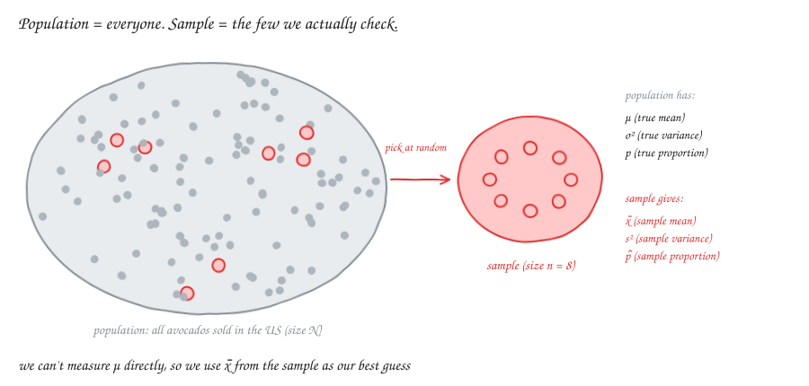
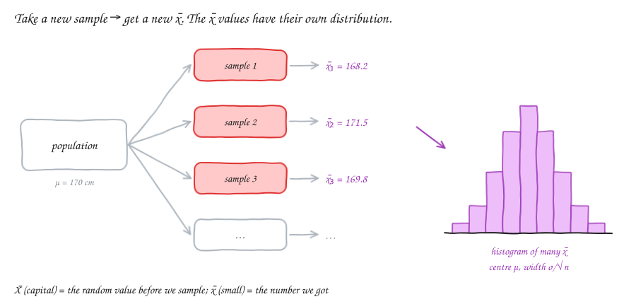
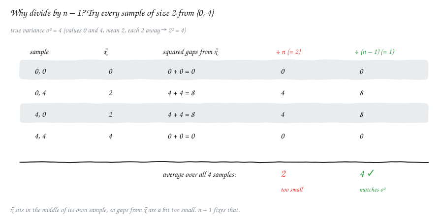
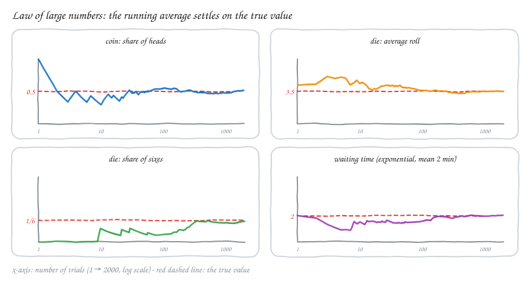
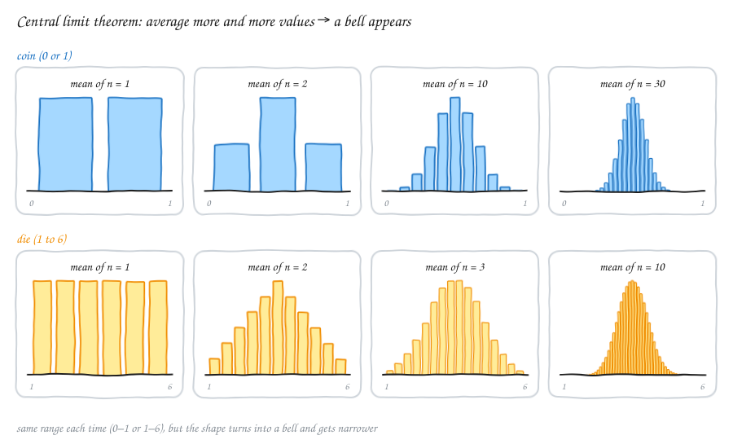
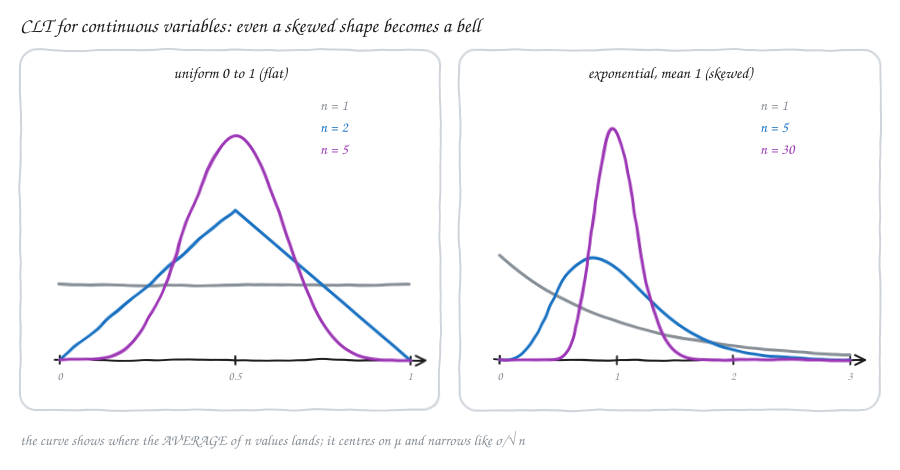

# Statistics — v3.1: Samples, the Law of Large Numbers & the Central Limit Theorem

Builds on [v2.1](Statv2.1.md) (mean, variance, sums of variables) and [v1.3](Statv1.3.md) (binomial, normal).
Until now we always **knew** the distribution. In real life we don't. We only see some data and have to **guess** the truth from it. This part is about how good those guesses are, and why the bell curve shows up almost everywhere.

---

## 1. Population and sample

- The **population** is **everyone** (or everything) we care about.
- A **sample** is the **small group** we actually look at.

We use a sample because checking everyone is too slow, too expensive or impossible.

**Example:**
- **Population:** every avocado sold in the US. That's millions, so we can't check them all.
- **Sample:** the avocados sold in 4 shops that we picked.

| | Population | Sample |
|---|---|---|
| Size | **N** (big N) | **n** (small n) |
| Mean | **μ** (true mean) | **x̄** (sample mean) |
| Variance | **σ²** (true variance) | **s²** (sample variance) |
| Proportion | **p** (true proportion) | **p̂** (sample proportion, "p-hat") |

**Two new words:**
- A **parameter** is a number about the population (μ, σ², p). It's fixed, but we usually don't know it.
- A **statistic** is a number we calculate from the sample (x̄, s², p̂). We know it, but it changes from sample to sample.

> **Simple idea:** we use the statistic (which we *can* calculate) as our best guess for the parameter (which we *want*).

⚠️ **The sample must be random.** If all 4 shops are in one rich area, avocado prices in our sample will be too high. More data won't fix that. A random sample gives every member of the population a fair chance of being picked.

---

## 2. Sample mean

The **sample mean** is the ordinary average of the sample:

$$\bar x = \frac{x_1 + x_2 + \dots + x_n}{n}$$

**Example:** we pick 6 people at random and measure their heights: 165, 170, 175, 160, 180 and 170 cm.

x̄ = (165 + 170 + 175 + 160 + 180 + 170) / 6 = 1020 / 6 = **170 cm**.

### Big X̄ and small x̄

If we repeat the experiment with 6 **new** random people, we get a **different** average, maybe 168.2 or 171.5. So the sample mean is itself **random**.

- **X̄ (capital)** is the sample mean **before** we pick the people. It's a random variable that can take many values.
- **x̄ (small)** is the actual number we **got** after picking, e.g. 170.

If we repeat the sample many times and draw a histogram of all the x̄ values, we get the **sampling distribution** of the mean. Two facts about it, both from v2.1 (sums of variables):

| Fact | Formula | Simple meaning |
|---|---|---|
| Centre | E[X̄] = μ | on average, the sample mean is right; it doesn't lean high or low |
| Spread | Var(X̄) = σ²/n, so SD(X̄) = σ/√n | bigger samples give x̄ values closer together |

**Why σ²/n?** The sum of n independent values has variance n·σ² (from v2.1). Dividing by n divides the variance by n², so n·σ²/n² = σ²/n.

The number **σ/√n** is called the **standard error**. It tells you how far x̄ is typically off from μ.

> **Simple idea:** one person's height can be far from the average. The average of 100 people is almost never far from the true average. To halve the error, you need **4 times** as many people (because of the √n).

---

## 3. Sample proportion

The **sample proportion** is the share of the sample that has some feature:

$$\hat p = \frac{\text{number with the feature}}{n}$$

**Example:** we ask 10 people, and 3 own a car, so p̂ = 3/10 = **0.3**. It's our guess for the true proportion p of car owners in the whole population, just as a frequency was our guess for a probability in v1.1.

**Useful trick:** write "has a car" as **1** and "no car" as **0**. Then p̂ is just the **mean** of those 0s and 1s: (1 + 0 + 0 + 1 + 0 + 0 + 1 + 0 + 0 + 0)/10 = 0.3. So everything we learn about the sample mean also works for proportions, with μ = p and σ² = p(1 − p):

$$E[\hat p] = p, \qquad \text{SD}(\hat p) = \sqrt{\frac{p(1-p)}{n}}$$

---

## 4. Sample variance: why n − 1?

For a **sample**, we divide by **n − 1** instead of n:

$$s^2 = \frac{1}{n-1}\sum_{i=1}^{n}(x_i - \bar x)^2$$

**Height example:** the gaps from x̄ = 170 are −5, 0, 5, −10, 10, 0. The squares are 25, 0, 25, 100, 100, 0, which add up to 250.
- s² = 250 / (6 − 1) = **50**, so s ≈ **7.07 cm**.
- Dividing by n would give 250/6 ≈ 41.7, which is too small.

### Why dividing by n is too small: a tiny example

The population has just two values, **0 and 4**. Its mean is 2 and each value is 2 away, so the **true variance σ² = 4**.

Take every possible sample of size 2 (with replacement) and compute the variance both ways:

On average, dividing by n gives **2** (wrong), while dividing by n − 1 gives **4** (exactly right).

**The reason in simple words:** we measure the gaps from **x̄**, not from the real μ. x̄ is calculated from the same sample, so it always sits right in the middle of that sample. That makes the gaps a bit **smaller** than the gaps from the real μ would be. Dividing by a slightly smaller number (n − 1) makes the answer a bit bigger and fixes this.

> **Rule:**
> - **Population** (you have everyone): divide by **N**.
> - **Sample** (you're estimating): divide by **n − 1**.
>
> For big n the difference is tiny.

This is the same N vs N − 1 choice we saw for covariance in [v2.4](Statv2.4.md).

---

## 5. Law of large numbers (LLN)

> **The law of large numbers:** if you take more and more **random** samples, the sample average gets closer and closer to the true mean μ.

$$\bar X_n \to \mu \quad \text{as } n \to \infty$$

It works for anything you can average. That includes probabilities, because a proportion is an average of 0s and 1s (section 3).

**Examples** (each one is a panel in the picture):

| Experiment | What we average | Settles on |
|---|---|---|
| Flip a coin | share of heads | **0.5** |
| Roll a die | the number rolled | **3.5** = (1 + 2 + … + 6)/6 |
| Roll a die | share of sixes | **1/6 ≈ 0.167** (frequency → probability) |
| Waiting time (continuous, exponential with mean 2 min) | the average wait | **2 minutes** |

At the start (few trials) the line jumps around a lot. After hundreds of trials it hardly moves.

**LLN also explains earlier ideas:**
- **Probability as frequency (v1.1):** "P(six) = 1/6" means that in the long run, about 1/6 of rolls are sixes. That is the LLN.
- **Expected value (v2.1):** E[X] is the long-run average. If you play a game many times, your average win per game gets close to E[X].
- **Histograms → PMF or PDF (v1.3):** with lots of data, a histogram looks more and more like the true distribution.
- **Sample variance → σ²**, and the sample correlation → the true correlation (v2.4).

⚠️ **The LLN is not the gambler's fallacy.** After 5 heads in a row, the next flip is **still** 50/50. The coin doesn't "owe" you tails. The average gets close to 0.5 because the early streak is **diluted** by thousands of later flips, not because tails start coming more often.

⚠️ **Correction to my original notes.** I wrote "the value of the mean is going to be the same as the population". It gets **close to** μ and keeps getting closer. It's never guaranteed to be exactly equal for a finite sample.

---

## 6. Central limit theorem (CLT)

> **The central limit theorem:** take the **average** (or the sum) of many **independent** random values. Its distribution is close to a **normal (bell) curve**, whatever the shape of the original distribution.

$$\bar X \approx N\!\left(\mu,\ \frac{\sigma^2}{n}\right) \qquad\text{and}\qquad X_1 + \dots + X_n \approx N\!\left(n\mu,\ n\sigma^2\right)$$

**LLN vs CLT:**
- The **LLN** says *where* the average ends up: at μ.
- The **CLT** says *what shape* the leftover randomness has (a bell) and *how wide* it is (σ/√n).

### Example 1: coins (from my notes)

Heads = 1, tails = 0.

- **1 flip:** the average is 0 or 1, each with probability ½. Two bars of equal height, nothing like a bell.
- **2 flips:** the average is
  - 1 (HH) with probability 1/4,
  - ½ (HT or TH) with probability 1/2,
  - 0 (TT) with probability 1/4.

  The middle bar is now the tallest.
- **10 flips:** the average follows a binomial divided by 10 (v1.3). It already looks like a bell.
- **30 flips:** very close to a normal curve, centred at 0.5.

### Example 2: a die

- **1 roll:** flat. Each of 1 to 6 has probability 1/6.
- **Average of 2 rolls:** a triangle. A middle value like 3.5 (sum 7) can happen 6 ways out of 36, while 1 (sum 2) happens only 1 way.
- **Average of 3 rolls:** already rounded, like a bell.
- **Average of 10 rolls:** a clear bell around 3.5.

**Why it happens:** extreme averages need **all** the values to be extreme at the same time (all sixes), which is very rare. Middle averages can be made in **many** ways (high and low values cancel out). So the middle gets crowded and the ends get thin.

### Example 3: continuous variables

- **Uniform from 0 to 1 (flat):** the average of 2 is a triangle, and the average of 5 is already a bell around 0.5.
- **Exponential with mean 1 (very skewed, long right tail):** the average of 5 is still a bit lopsided. The average of 30 is almost a perfect bell around 1.

**Link to skewness (v2.2):** the skew of the average shrinks like **skew/√n**. The exponential has skew 2, so the average of 30 values has skew 2/√30 ≈ **0.37**. More lopsided data needs a bigger n before it looks normal.

### Using the CLT: real calculations

**Die example.** One roll has μ = 3.5 and σ² = 35/12 ≈ 2.92, so σ ≈ 1.71. You roll 30 dice. What's the chance their average is above 4?

1. **Standard error:** σ/√n = 1.71/√30 ≈ **0.31**.
2. **z-score (v1.3):** z = (4 − 3.5)/0.31 ≈ **1.6**.
3. **Normal table:** P(Z > 1.6) ≈ **0.055**, so about a **5%** chance.

**Poll example.** The true share of car owners is p = 0.3, and we ask n = 100 random people. What's the chance our sample says 40% or more?

1. **Standard error:** SD(p̂) = √(0.3 × 0.7 / 100) ≈ **0.046**.
2. **z-score:** z = (0.4 − 0.3)/0.046 ≈ **2.2**.
3. **Normal table:** P(Z > 2.2) ≈ **0.015**, so about **1.5%**. A 40% result would be quite surprising.

The original distribution (die rolls, yes/no answers) is **not** normal at all, yet we can use the normal table. That's the power of the CLT.

### When to trust it

- **Rule of thumb:** n ≥ 30 is usually enough. For nearly symmetric data, much less is fine (the die looked good at n = 3). For very skewed data you need more.
- The values must be **independent** (a random sample) with a **finite variance**.
- For proportions, check that n·p and n·(1 − p) are both at least about 10.

⚠️ **Correction to my original notes.** "Flip a coin, you get 0.5 as an average" is the **expected** value. A single flip gives 0 or 1, never 0.5. Your 2-flip table (1/4, 1/2, 1/4 for HH, HT/TH, TT) is exactly right: it's the distribution of the average of 2 flips.

---

## 7. How it all connects

| Earlier idea | What this part adds |
|---|---|
| Probability = long-run frequency (v1.1) | That's the LLN for proportions |
| Binomial (v1.3) | A sum of coin flips; by the CLT it looks normal for large n |
| Normal and z-scores (v1.3, v2.1) | Used with standard error σ/√n to answer questions about averages |
| Var(X + Y) = Var X + Var Y (v2.1) | Gives Var(X̄) = σ²/n |
| Skewness (v2.2) | The skew of an average shrinks like 1/√n, so averages become symmetric |
| N vs N − 1 (v2.4) | The sample variance s² uses n − 1 |

---

## Formula cheat sheet

| Idea | Formula | Simple meaning |
|---|---|---|
| Sample mean | x̄ = Σ xᵢ / n | average of the sample |
| Sample proportion | p̂ = count / n | share with the feature (= mean of 0s and 1s) |
| Sample variance | s² = Σ (xᵢ − x̄)² / (n − 1) | n − 1 corrects for using x̄ |
| Centre of x̄ | E[X̄] = μ | right on average |
| Standard error | SD(X̄) = σ/√n | typical error of x̄; 4× the data → half the error |
| SE of a proportion | √(p(1 − p)/n) | typical error of p̂ |
| LLN | X̄ → μ as n → ∞ | big samples land on the truth |
| CLT | X̄ ≈ N(μ, σ²/n) | averages are bell-shaped |
| z for an average | z = (x̄ − μ) / (σ/√n) | how many standard errors away |

---

## Revision questions

Try each question first, then expand it to check your answer.

<b>Q1.</b> What is the difference between a parameter and a statistic? Give one of each.

A **parameter** describes the population and is usually unknown, e.g. μ = the true average avocado price. A **statistic** is calculated from the sample, e.g. x̄ = the average price in our 4 shops.

<b>Q2.</b> What is the difference between X̄ and x̄?

**X̄** is the sample mean as a random variable, before we sample. It can take many values. **x̄** is the actual number we got from our sample.

<b>Q3.</b> Find x̄ and s² for the sample 2, 4, 6.

x̄ = 4. The gaps are −2, 0, 2, and their squares add up to 8. s² = 8/(3 − 1) = **4**.

<b>Q4.</b> Why do we divide by n − 1 for a sample variance?

We measure gaps from x̄, which sits in the middle of its own sample, so the gaps come out a bit too small. Dividing by n − 1 instead of n makes the result slightly bigger and correct on average. In the {0, 4} example: ÷n averages 2, ÷(n − 1) averages 4 = σ².

<b>Q5.</b> 45 out of 150 people surveyed own a dog. What is p̂, and what is its standard error (use p̂ in place of p)?

p̂ = 45/150 = **0.3**. SE = √(0.3 × 0.7/150) = √0.0014 ≈ **0.037**.

<b>Q6.</b> The SD of a population is 20. What is the standard error of x̄ for n = 25? For n = 100?

20/√25 = **4**. 20/√100 = **2**. Four times the data gives half the error.

<b>Q7.</b> You flip a fair coin and get 6 heads in a row. Is tails more likely next? What does the LLN really say?

**No.** It's still 50/50. The LLN says the *average* over many flips gets close to 0.5, because early streaks get diluted by many later flips, not because the coin corrects itself.

<b>Q8.</b> You survey 10,000 people, but only through a website for car fans, to estimate the share of car owners. Does the LLN guarantee a good answer?

**No.** The sample isn't random, so p̂ settles on the share among *car fans*, not in the whole population. More biased data just gives you a more confident wrong answer.

<b>Q9.</b> What does the CLT say, in one sentence? How is it different from the LLN?

**CLT:** the average of many independent values is roughly normal, N(μ, σ²/n), whatever the original shape. **LLN:** the average gets close to μ. The LLN gives the *destination*; the CLT gives the *shape and width* of the randomness around it.

<b>Q10.</b> List the possible averages of 2 dice rolls that equal 1, 3.5 and 6, and their probabilities. Why is the middle most likely?

Average 1 (1+1): **1/36**. Average 3.5 (sum 7): **6/36**. Average 6 (6+6): **1/36**. The middle can be made in many ways (1+6, 2+5, 3+4, …), while the extremes need both dice to be extreme.

<b>Q11.</b> Waiting times are exponential with mean 4 min and SD 4 min. For 64 customers, what is the rough chance the average wait is more than 5 min?

SE = 4/√64 = 0.5. z = (5 − 4)/0.5 = **2**. P(Z > 2) ≈ **0.023**, about 2%. The single waiting times are very skewed, but the average of 64 is close enough to normal.

<b>Q12.</b> Why does a binomial distribution with large n look like a bell curve?

A binomial is a **sum of n independent coin flips** (0s and 1s). By the CLT, a sum of many independent values is roughly normal, so it looks like a bell.

<b>Q13.</b> An exponential distribution has skew 2. What is roughly the skew of the average of 100 such values?

2/√100 = **0.2**, which is nearly symmetric. Averaging removes most of the lopsidedness.

<b>Q14.</b> Is the CLT about the data itself becoming normal?

**No.** The individual data points keep their original shape: a die is still flat and waiting times are still skewed. It's the **average** (or sum) of many of them whose distribution becomes normal.

