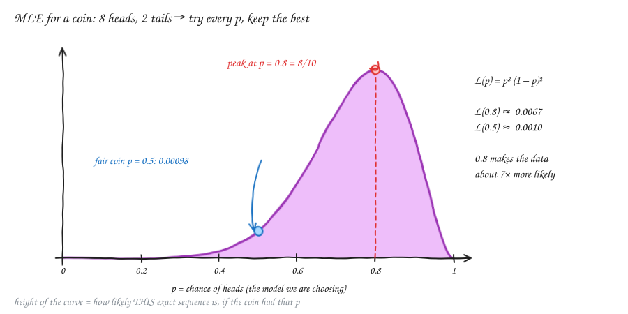
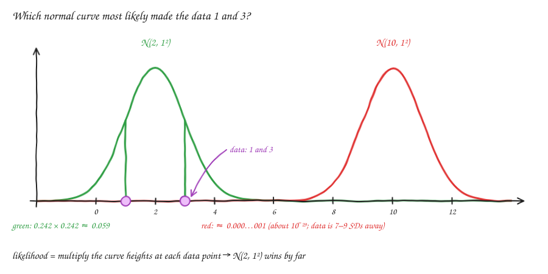
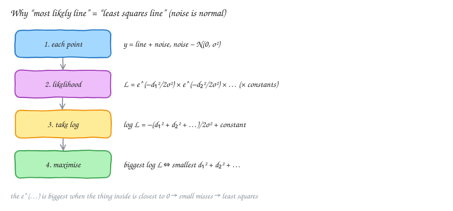
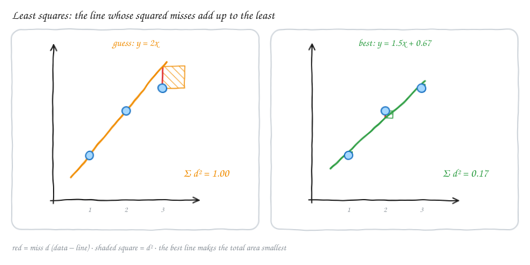
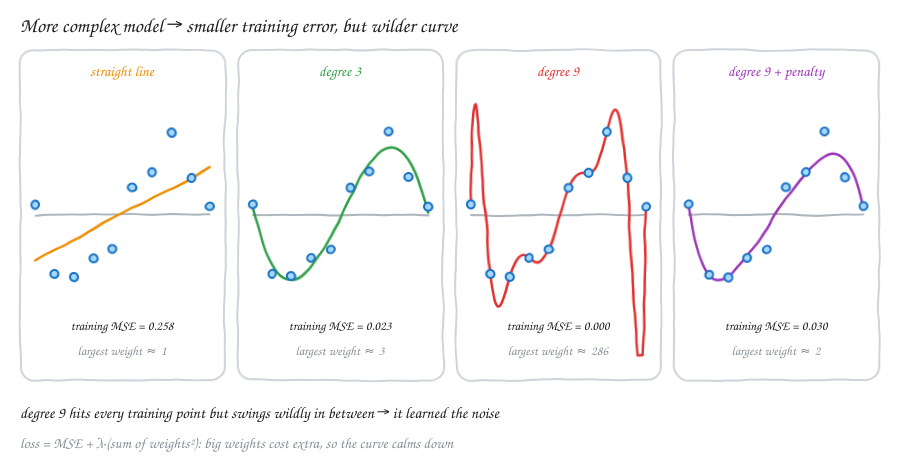
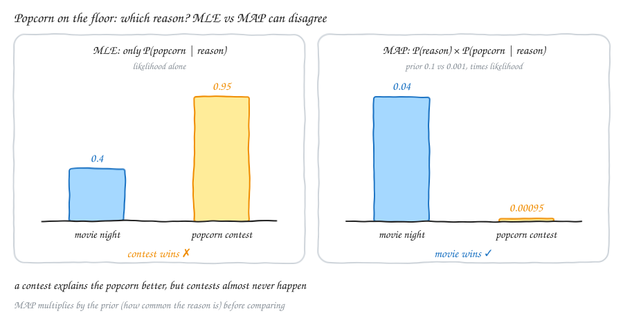
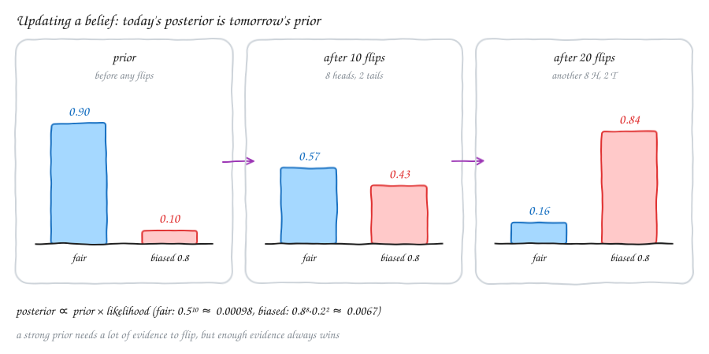

# Statistics — v3.2: Point Estimation, MLE, Least Squares, Regularization & MAP

Builds on [v1.2](Statv1.2.md) (Bayes' theorem), [v1.3](Statv1.3.md) (normal distribution) and [v3.1](Statv3.1.md) (samples).
In v3.1 we guessed simple numbers like μ from a sample. Now we go one step further: we have some **data**, and several possible **models** (explanations) that could have made it. Which model do we pick? This one question leads to MLE, least squares, regularization and MAP.

---

## 1. The big idea: from evidence back to the reason

You walk into a room and see **popcorn on the floor**. That's the **evidence**. What happened?

- **Reason 1:** someone watched a movie.
- **Reason 2:** someone was dancing.

"Movie" is the better guess, because a movie night **makes popcorn on the floor much more likely** than dancing does:

$$P(\text{popcorn} \mid \text{movie}) \;>\; P(\text{popcorn} \mid \text{dancing})$$

(Recall from v1.2: the bar "|" means "given". So P(popcorn | movie) = "the chance of popcorn, **if** there was a movie".)

In statistics we do exactly the same thing with **data** and **models**:

$$P(\text{data} \mid \text{model 1}) \quad\text{vs}\quad P(\text{data} \mid \text{model 2}) \quad\text{vs}\quad \dots$$

- P(data | model) is called the **likelihood** of the model. It answers: *if this model were true, how likely is the data we actually saw?*
- **Point estimation** means picking **one** best value (one "point") for the unknown thing, like the chance of heads of a coin, or the slope of a line.

> **Simple idea:** try each possible explanation, ask "how well does it explain what I saw?", and keep the best one.

---

## 2. Maximum likelihood estimation (MLE)

**MLE:** pick the model that makes the observed data **most likely**.

### Example 1: a coin

We flip a coin 10 times and get **H H H H H H H H T T**: 8 heads and 2 tails. The model is p = the chance of heads. Which p fits best?

**Step 1: write the likelihood.** The flips are independent, so we multiply:

$$L(p) = \underbrace{p \cdot p \cdots p}_{8\text{ heads}} \cdot \underbrace{(1-p)(1-p)}_{2\text{ tails}} = p^8\,(1-p)^2$$

**Step 2: try some values of p.**

| p | L(p) = p⁸(1 − p)² |
|---|---|
| 0.5 (fair coin) | 0.5¹⁰ ≈ **0.00098** |
| 0.6 | ≈ 0.0027 |
| **0.8** | 0.168 × 0.04 ≈ **0.0067** (the biggest) |
| 0.9 | ≈ 0.0043 |

**Step 3: find the peak exactly.**

1. Products are awkward to work with, so take the **log** first. The log turns products into sums and powers into multipliers, and the peak stays in the same place:
   log L(p) = 8·log(p) + 2·log(1 − p).
2. At the top of a hill the slope is 0, so set the **derivative** to 0:
   8/p − 2/(1 − p) = 0.
3. Solve: 8(1 − p) = 2p, so 8 = 10p, so **p̂ = 8/10 = 0.8**.

So the MLE is just "heads ÷ flips". It's the common-sense answer, now with a reason behind it.

⚠️ **Corrections to my original notes.**
- The sequence HHHHHHHTT has 7 heads and 2 tails, but the formula p⁸(1 − p)² needs **8 heads and 2 tails**: HHHHHHHHTT.
- The tails factor is **(1 − p)**, not (p − 1). The chance of tails is 1 − p.
- 8·log(p) + 2·log(1 − p) is the **log-likelihood**, not its derivative. The derivative is 8/p − 2/(1 − p), and *that* is what we set to 0.

> **Simple idea:** MLE slides p from 0 to 1 and stops where the data would be most likely to happen.

### Example 2: two normal curves

We observe two numbers: **1 and 3**. Which model made them more likely?

- **Model A:** N(2, 1²), a bell curve centred at 2 with SD 1.
- **Model B:** N(10, 1²), a bell curve centred at 10 with SD 1.

For continuous data, the likelihood is the **height of the curve** (the PDF) at each data point, multiplied together:

- **Model A:** both points are just 1 SD from the centre. Each height is 0.242, so L = 0.242 × 0.242 ≈ **0.059**.
- **Model B:** the points are 7 and 9 SDs away, where the curve is basically flat at 0. L ≈ **0.000…001** (about 10⁻²⁹).

So **N(2, 1²) wins by a huge margin**. If we let the mean μ be anything (not just 2 or 10), the MLE turns out to be the **sample mean**: (1 + 3)/2 = 2. That's the x̄ from v3.1, now justified by MLE.

### Real-world case: picking the best homography (RANSAC)

In image stitching (see [LA1.1](../LA/LA1.1.md)), we match points between two photos and want the **homography**, the 3 × 3 matrix that maps one photo onto the other. RANSAC works like this:

1. Pick **4 random matches** and compute a homography H from them (4 point pairs are enough for one H).
2. Repeat many times. Now we have many **candidate models**: H₁, H₂, H₃, …
3. **Score each candidate:** map every point through H and measure how far it lands from its match. That distance is the **reprojection error** d.
4. Keep the H with the best score.

**Where MLE comes in:** if good matches have small normal (Gaussian) noise, then P(data | H) is biggest when the squared errors d² are smallest. That's exactly the least squares idea of the next section.

**Why RANSAC counts inliers instead:** some matches are just **wrong** (outliers). One bad match with d = 300 pixels would add d² = 90,000 and wreck the score. So RANSAC caps each error: a match counts as an **inlier** (good) if d is below a threshold, and otherwise it adds a fixed penalty no matter how wrong it is. Picking "the most inliers" is a tough-skinned version of MLE. In fact, the RANSAC variant **MLESAC** scores candidates by a real likelihood: Gaussian noise for inliers, plus a flat chance for outliers.

> **Simple idea:** RANSAC makes lots of guesses at the model, then asks of each one: "how well does this explain all the data?" That's MLE, with protection against garbage points.

---

## 3. Linear regression = MLE = least squares

We have points (x, y) and want the line y = w·x + b that fits best. Think of each line as a model: model 1, model 2, model 3, … Which line makes the data most likely?

**Assumption:** each point is on the line plus some normal noise: y = (w·x + b) + noise, with noise ~ N(0, σ²).

Let **dᵢ** = yᵢ − (w·xᵢ + b) be the **miss** (residual) of point i: how far it is above or below the line.

### Step by step

1. **One point.** The chance of a miss of size d₁ is the height of the normal curve at d₁:
   $$\frac{1}{\sqrt{2\pi}\,\sigma}\, e^{-d_1^2/2\sigma^2}$$
2. **All points.** The points are independent, so multiply:
   $$L = \frac{1}{\sqrt{2\pi}\sigma}e^{-d_1^2/2\sigma^2} \times \frac{1}{\sqrt{2\pi}\sigma}e^{-d_2^2/2\sigma^2} \times \cdots$$
3. **Take the log.** The constants turn into one constant number, and each e^(…) leaves just the "…":
   $$\log L = \text{constant} - \frac{1}{2\sigma^2}\left(d_1^2 + d_2^2 + \dots + d_n^2\right)$$
4. **Maximise.** The only part that depends on the line is −(d₁² + d₂² + …). To make log L **as big as possible**, we need d₁² + d₂² + … to be **as small as possible**.

$$\text{most likely line} \;=\; \text{line with the smallest } \sum d_i^2 \;=\; \textbf{least squares}$$

Your intuition was right: e^(−½·d²) is biggest when d² is small, so small misses mean high likelihood. Doing this for all points at once gives least squares.

### A tiny example

Data: (1, 2), (2, 4), (3, 5).

| Line | Misses d | Σ d² | Likelihood ∝ e^(−Σd²/2) (σ = 1) |
|---|---|---|---|
| guess y = 2x | 0, 0, −1 | **1.00** | e^(−0.5) ≈ 0.61 |
| best y = 1.5x + 0.67 | −0.17, +0.33, −0.17 | **0.17** | e^(−0.08) ≈ 0.92 |

**Where the best line comes from:**
- **Slope:** w = Σ(x − x̄)(y − ȳ) / Σ(x − x̄)² = Cov(x, y)/Var(x). This is the covariance from [v2.4](Statv2.4.md). Here x̄ = 2 and ȳ = 11/3, which gives w = 3/2 = **1.5**.
- **Intercept:** b = ȳ − w·x̄ = 11/3 − 3 ≈ **0.67**.

> **Simple idea:** if the noise is normal, "the line that most likely made the data" and "the line with the smallest total squared miss" are the **same line**. That's why least squares is everywhere.

---

## 4. Polynomial regression and regularization

Instead of a straight line, we can fit curves: y = w₀ + w₁x + w₂x² + … + w₉x⁹. More powers means a more flexible model.

Fit 10 noisy points with models of growing complexity:

| Model | Training error (MSE) | What happened |
|---|---|---|
| straight line | 0.258 | too simple; misses the wave (**underfitting**) |
| degree 3 | 0.023 | follows the real shape |
| degree 9 | **0.000** | passes through every point, but swings wildly in between (**overfitting**) |
| degree 9 + penalty | 0.030 | smooth again, close to degree 3 |

(MSE = mean squared error = the average of the d² values.)

The degree-9 model has the **lowest** training error but is the **worst** model. It memorised the noise. On a new point it would be badly wrong. Its weights are huge (up to about 286), with big positive and negative terms fighting each other.

**The fix: regularization.** Don't only minimise the error. Add a **penalty** for big weights:

$$\text{loss} = \underbrace{\text{MSE}}_{\text{fit the data}} + \underbrace{\lambda\,(w_1^2 + w_2^2 + \dots)}_{\text{keep weights small}}$$

- **λ (lambda)** is a knob. λ = 0 means no penalty. A big λ means the weights are forced close to 0 (an almost flat line).
- With a small λ (0.05 here), the largest weight drops from about 286 to about 2 and the curve calms down. The training error goes up a little (0.000 → 0.030), but the model is much more believable.
- This w² penalty is called **ridge** or **L2 regularization**.

> **Simple idea:** a model that bends wildly to hit every point is "too good to be true". The penalty says: fit the data well, but stay simple.

(Section 6 shows that this penalty is actually a **prior** in disguise.)

---

## 5. Back to Bayes: the popcorn contest (MAP)

Now add a third reason for popcorn on the floor: **a popcorn-throwing contest**. A contest makes popcorn on the floor almost certain, much more than a movie:

| Reason | Prior P(reason) (how often it happens) | Likelihood P(popcorn \| reason) |
|---|---|---|
| movie night | 0.1 | 0.4 |
| popcorn contest | 0.001 | 0.95 |

- **MLE (likelihood only):** 0.95 > 0.4, so MLE picks **contest**. That feels wrong, because contests almost never happen.
- **MAP (prior × likelihood):** movie 0.1 × 0.4 = **0.04**; contest 0.001 × 0.95 = **0.00095**. So MAP picks **movie** ✓.

This is just Bayes' theorem from v1.2:

$$P(\text{reason} \mid \text{popcorn}) = \frac{P(\text{popcorn} \mid \text{reason})\cdot P(\text{reason})}{P(\text{popcorn})}$$

The bottom, P(popcorn), is the same for every reason, so to **compare** reasons we only need the top: **prior × likelihood**.

**MAP = maximum a posteriori:** pick the reason (model) with the highest **posterior** P(model | data), i.e. the biggest prior × likelihood.

> **Simple idea:** MLE asks "which reason explains the evidence best?" MAP also asks "and how common is that reason in the first place?"

⚠️ **Note on my original notes.** The inequality P(contest)·P(popcorn | contest) < P(movies)·P(popcorn | movies) is exactly right. It's the MAP comparison, with the shared bottom P(popcorn) cancelled out.

---

## 6. Frequentists vs Bayesians

| | Frequentist | Bayesian |
|---|---|---|
| What is probability? | long-run frequency (v1.1, v3.1) | a degree of **belief** |
| The unknown (e.g. p of a coin) | one fixed number; we just don't know it | uncertain, so we give it a probability distribution |
| Starting point | only the data | a **prior** belief + the data |
| Typical estimate | MLE | MAP (or the whole posterior) |

### Updating a belief: an example

A friend hands you a coin. You think: "it's probably fair, but they do own a trick coin that lands heads 80% of the time".

- **Prior:** P(fair) = 0.9, P(biased) = 0.1.

**Day 1: you flip 10 times and get 8 H and 2 T.**

| | Prior | Likelihood of 8H 2T | Prior × likelihood | Posterior (÷ total) |
|---|---|---|---|---|
| fair (p = 0.5) | 0.9 | 0.5¹⁰ ≈ 0.00098 | 0.00088 | **0.57** |
| biased (p = 0.8) | 0.1 | 0.8⁸·0.2² ≈ 0.0067 | 0.00067 | **0.43** |

The total is 0.00088 + 0.00067 = 0.00155. Your belief in "biased" jumped from 10% to 43%, but "fair" is still slightly ahead because the prior was strong.

**Day 2: the posterior becomes the new prior.** You flip 10 more and again get 8 H and 2 T.

- fair: 0.57 × 0.00098 ≈ 0.00055
- biased: 0.43 × 0.0067 ≈ 0.0029
- Posterior: fair ≈ **0.16**, biased ≈ **0.84**. Now you're fairly sure it's the trick coin.

$$\underbrace{P(A \mid B)}_{\text{new belief}} = \underbrace{P(B \mid A)}_{\text{how well A explains B}} \times \frac{\overbrace{P(A)}^{\text{old belief}}}{P(B)}$$

> **Simple idea:** start with a belief, look at evidence, adjust. Strong beliefs need more evidence to change, but enough evidence always wins.

### MAP with a "pretend data" prior

A neat way to give a coin a prior is to **pretend you've already seen** a few flips. Say you believe "probably fair", like having seen 4 extra heads and 4 extra tails. With 8 H and 2 T of real data:

- **MLE:** 8/10 = **0.80**
- **MAP:** (8 + 4)/(10 + 8) = 12/18 ≈ **0.67**, pulled towards 0.5 by the prior

With 800 H and 200 T of real data, MAP = 804/1008 ≈ 0.80. The prior barely matters once there's a lot of data.

(In maths terms this prior is a Beta(5, 5) distribution, and MAP = (heads + 4)/(flips + 8).)

### The hidden link: regularization = a prior

Saying "I believe the weights are probably small" is a prior: w ~ N(0, τ²). The log of that normal prior is −w²/2τ² + constant. When we maximise log(prior) + log(likelihood):

$$\max\;\big[\log P(\text{data}\mid w) + \log P(w)\big] \;=\; \min\;\big[\textstyle\sum d_i^2 + \lambda \sum w_j^2\big]$$

So **ridge regression is MAP** with a normal prior on the weights. The penalty λ is "how strongly I believe the weights are small".

---

## 7. MLE vs MAP vs Regularization

| | MLE | MAP | Regularization |
|---|---|---|---|
| **Question it asks** | Which model makes the data most likely? | Which model is most believable after seeing the data? | Which model fits well **and** stays simple? |
| **Maximise / minimise** | max P(data \| model) | max P(data \| model) × P(model) | min error + λ·penalty |
| **Uses a prior?** | ❌ no | ✅ yes | ✅ yes, hidden: the penalty *is* a prior |
| **Coin (8H, 2T)** | 8/10 = 0.80 | (8 + 4)/(10 + 8) ≈ 0.67 with the "4 + 4 pretend flips" prior | — |
| **Regression** | least squares: min Σd² | min Σd² + λΣw² (normal prior on w) | ridge: min MSE + λΣw² |
| **Popcorn** | contest (0.95) ✗ | movie (0.04) ✓ | — |
| **Strength** | simple; no prior needed; great with lots of data | uses common sense / prior knowledge; works with little data | stops overfitting |
| **Weakness** | overfits with little data or complex models | a bad prior gives a bad answer | you must choose λ |
| **With lots of data** | → the truth | → same as MLE (the prior gets outvoted) | the penalty matters less |

---

## Formula cheat sheet

| Idea | Formula | Simple meaning |
|---|---|---|
| Likelihood | L(model) = P(data \| model) | how well the model explains the data |
| MLE | model̂ = argmax P(data \| model) | the model that makes the data most likely |
| Coin MLE | p̂ = heads / flips | from max p^h (1 − p)^t |
| Normal-mean MLE | μ̂ = x̄ | the sample mean |
| Log trick | log(a·b) = log a + log b | products → sums; the peak doesn't move |
| Least squares | min Σ (yᵢ − (w·xᵢ + b))² | MLE when the noise is normal |
| Slope | w = Cov(x, y) / Var(x) | covariance from v2.4 |
| Ridge | min MSE + λ Σ w² | fit well, keep the weights small |
| MAP | argmax P(data \| model)·P(model) | likelihood × prior |
| Bayes update | posterior ∝ prior × likelihood | old belief × evidence, then rescale to total 1 |

---

## Revision questions

Try each question first, then expand it to check your answer.

<b>W1.</b> (Warm-up) In your own words, what does P(data | model) mean?

"If this model were true, how likely is the data we actually saw?" It's called the **likelihood** of the model.

<b>W2.</b> (Warm-up) A coin gives 3 heads in 4 flips. What is the MLE of p?

p̂ = 3/4 = **0.75**.

<b>Q1.</b> Write the likelihood for 6 heads and 4 tails. Which p maximises it?

L(p) = p⁶(1 − p)⁴. The log-likelihood is 6·log p + 4·log(1 − p). The derivative is 6/p − 4/(1 − p) = 0, so 6(1 − p) = 4p, so **p̂ = 0.6**.

<b>Q2.</b> Why do we take the log before finding the maximum?

The log turns a product of many terms into a **sum**, which is much easier to differentiate. Because log always increases with its input, the peak is at the **same** p.

<b>Q3.</b> Data: 9 and 11. Which is more likely to have generated it, N(10, 1²) or N(0, 1²)? What is the MLE of μ?

**N(10, 1²)**: both points are just 1 SD away. For N(0, 1²) they are 9 and 11 SDs away, so the likelihood is ≈ 0. The MLE of μ is the sample mean, (9 + 11)/2 = **10**.

<b>Q4.</b> Explain in 4 steps why MLE with normal noise gives least squares.

1. Each miss d has likelihood ∝ e^(−d²/2σ²).
2. Multiply over all points.
3. Take the log: log L = constant − Σd²/2σ².
4. Maximising log L means minimising Σd², which is least squares.

<b>Q5.</b> For the points (1, 2), (2, 4), (3, 5), which line is better, y = x + 1 or y = 2x? Use Σd².

y = x + 1: the misses are 0, 1, 1, so Σd² = **2**. y = 2x: the misses are 0, 0, −1, so Σd² = **1**. **y = 2x is better.** (The best line, y = 1.5x + 0.67, has Σd² = 0.17.)

<b>Q6.</b> In RANSAC, why do we count inliers instead of just adding up all squared errors?

Wrong matches (outliers) have huge errors. Squaring them would let a few garbage points decide the answer. Counting inliers, i.e. capping each error's cost, keeps the score robust (tough). It's a version of MLE that expects some outliers.

<b>Q7.</b> A degree-9 polynomial has training error 0. Why might it still be the worst model?

It **overfits**: it passes through every noisy point by swinging wildly in between, so it will predict new points badly. It learned the noise, not the pattern.

<b>Q8.</b> In loss = MSE + λΣw², what happens when λ = 0? When λ is huge?

λ = 0 is plain least squares, which can overfit. A huge λ forces all the weights close to 0, giving an almost flat line that underfits. A good λ is somewhere in between.

<b>Q9.</b> Why does MLE pick "contest" for the popcorn, but MAP picks "movie"?

MLE compares only the likelihoods: 0.95 (contest) > 0.4 (movie). MAP multiplies by the priors: 0.001 × 0.95 = 0.00095 vs 0.1 × 0.4 = 0.04, so movie wins because contests are very rare.

<b>Q10.</b> Why can MAP ignore P(evidence), the bottom of Bayes' theorem?

It's the **same number for every model** we compare, so it doesn't change which one is biggest. We only need prior × likelihood.

<b>Q11.</b> Prior P(fair) = 0.5, P(biased 0.8) = 0.5. You see 8 H and 2 T. Find the posterior.

fair: 0.5 × 0.00098 = 0.00049. biased: 0.5 × 0.0067 = 0.00336. The total is 0.00385. Posterior: fair ≈ **0.13**, biased ≈ **0.87**. With an even prior, the evidence decides almost alone.

<b>Q12.</b> Using the "4 pretend heads + 4 pretend tails" prior, find the MAP of p after 2 heads in 2 flips. Compare with the MLE.

MLE: 2/2 = **1.0**, which says "it always lands heads". That's silly after only 2 flips. MAP: (2 + 4)/(2 + 8) = **0.6**, which is much more sensible. The prior protects against tiny samples.

<b>Q13.</b> What is the link between ridge regularization and MAP?

Ridge = MAP with a **normal prior** on the weights, w ~ N(0, τ²). log(prior) = −w²/2τ² + constant, which is exactly a λΣw² penalty. Saying "I believe the weights are small" is the same as penalising big weights.

<b>Q14.</b> With a huge amount of data, do MLE and MAP still disagree?

Hardly at all. The likelihood grows with every data point, while the prior stays the same, so the prior gets **outvoted**. MAP → MLE. Priors and penalties matter most when the data is small.

