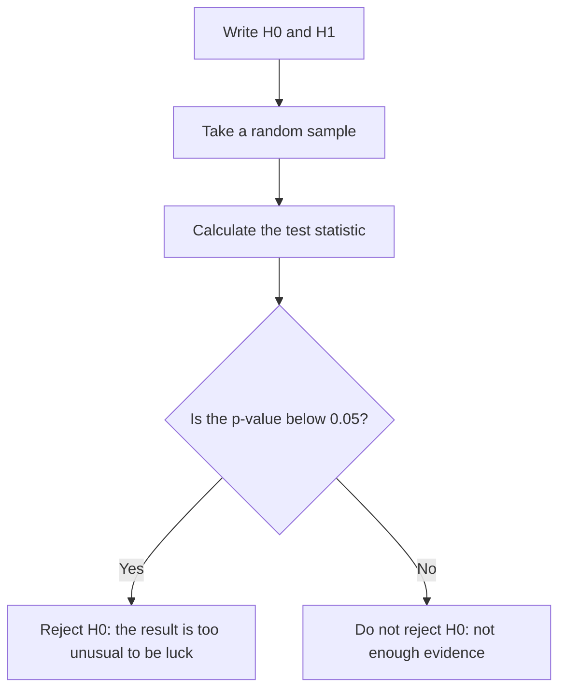

# Confidence Intervals and Statistical Tests

A beginner guide in simple English, with worked examples.

## Contents

1. [Population and sample](#1-population-and-sample)
2. [Standard error](#2-standard-error)
3. [Confidence intervals](#3-confidence-intervals)
4. [Hypothesis tests](#4-hypothesis-tests)
5. [How the interval and the test connect](#5-how-the-interval-and-the-test-connect)
6. [Left-tailed, right-tailed and two-tailed tests](#6-left-tailed-right-tailed-and-two-tailed-tests)
7. [z or t?](#7-z-or-t)
8. [Which test should I use?](#8-which-test-should-i-use)
9. [More worked examples](#9-more-worked-examples)
10. [Common mistakes](#10-common-mistakes)
11. [Where this shows up in ML and image processing](#11-where-this-shows-up-in-ml-and-image-processing)
12. [Cheat sheet](#12-cheat-sheet)
13. [Practice questions](#13-practice-questions)

---

## 1. Population and sample

- **Population**: everyone or everything you care about. Example: all 20,000 students at a university.
- **Sample**: the small group you actually measure. Example: 100 of those students.

**Analogy:** You are cooking a big pot of soup. You do not drink the whole pot to check the salt. You stir it and taste one spoonful. The pot is the population. The spoon is the sample.

Every spoonful is a little different. Statistics answers one question: **how much can I trust my spoonful?**

| | Population | Sample |
|---|---|---|
| Average (mean) | μ ("mu"), usually unknown | x̄ ("x-bar"), you calculate it |
| Spread (standard deviation) | σ ("sigma") | s |
| Size | N | n |

**Important:** the sample must be random. If you taste only from the top of a pot that was never stirred, no formula can fix that.

---

## 2. Standard error

If you took a new sample of 100 students, you would get a slightly different average. Take another, and it changes again. The sample average **wobbles**.

The **standard error (SE)** measures the size of that wobble.

```
SE = s / √n
```

- `s` is the spread of your sample.
- `n` is the sample size.

A bigger sample gives a smaller wobble. Note the square root: to cut the wobble in half, you need **4 times** as many people.

| Sample size (n) | SE when s = 1.5 |
|---|---|
| 25 | 1.5 / 5 = 0.30 |
| 100 | 1.5 / 10 = 0.15 |
| 400 | 1.5 / 20 = 0.075 |

Do not mix up these two:

- **Standard deviation (s)**: how much individual people differ from each other.
- **Standard error (SE)**: how much the *sample average* would differ from one study to the next.

---

## 3. Confidence intervals

A sample average is one number, and it is almost never exactly right. A **confidence interval (CI)** gives a range instead:

> "The true population average is probably between A and B."

**Analogy:** Catching a fish with a spear is hard (one exact number). Catching it with a net is easier (a range). A wider net is more likely to catch the fish, but it tells you less about where the fish is.

### The formula

```
margin = critical value × SE
CI     = sample average − margin   to   sample average + margin
```

The **critical value** sets how confident you want to be:

| Confidence level | Critical value (z) |
|---|---|
| 90% | 1.645 |
| 95% | 1.96 |
| 99% | 2.576 |

### Worked example: student sleep

You ask 100 students how long they sleep. The average is 6.5 hours and s is 1.5 hours.

```
Step 1:  SE     = 1.5 / √100       = 0.15
Step 2:  margin = 1.96 × 0.15      ≈ 0.29
Step 3:  CI     = 6.5 − 0.29  to  6.5 + 0.29
                = 6.21 to 6.79 hours
```

```
        6.21              6.79
          |=====range=====|
  --------+-------+-------+--------
                 6.5
            (sample average)
```

A common slip is to use the SE (0.15) as the margin. The margin is the SE **times the critical value** (0.29).

### What does "95% confident" mean?

If you repeated the study many times and built an interval each time, about 95 out of 100 of those intervals would contain the true average.

The interval is a list of **believable values for the true population average**.

It does **not** mean:

- "95% of students sleep between 6.21 and 6.79 hours." Individual students vary far more than that. Some sleep 4 hours, some sleep 9.
- "95% of my sample is inside this range."

### What makes the interval wider or narrower?

| Change | Effect on the interval |
|---|---|
| Bigger sample (n goes up) | Narrower |
| More spread in the data (s goes up) | Wider |
| Higher confidence (95% to 99%) | Wider |

The same sleep data at different confidence levels:

| Confidence | Margin | Interval |
|---|---|---|
| 90% | 1.645 × 0.15 ≈ 0.25 | 6.25 to 6.75 |
| 95% | 1.96 × 0.15 ≈ 0.29 | 6.21 to 6.79 |
| 99% | 2.576 × 0.15 ≈ 0.39 | 6.11 to 6.89 |

To be more sure, you need a wider net.

---

## 4. Hypothesis tests

A test answers a yes or no question: **is this result real, or could it be just luck?**

**Analogy:** It works like a court trial. The starting belief is "innocent". You only say "guilty" if the evidence is strong.

### The parts of a test

| Part | Meaning | Sleep example |
|---|---|---|
| **Claim** | One number that someone states about the population | "Students sleep 7 hours on average" |
| **H₀ (null hypothesis)** | "Nothing has changed. The claim is true." | mean = 7 |
| **H₁ (alternative hypothesis)** | What you suspect instead | mean ≠ 7 |
| **Test statistic** | How far your sample is from the claim, counted in standard errors | see below |
| **p-value** | If H₀ were true, how often would you see a result this far away? | see below |
| **Significance level (α)** | Your cutoff for "too unusual". Usually 0.05 (5%). | 0.05 |

### The steps



### Worked example: is the "7 hours" claim true?

The university claims students sleep 7 hours. Your sample of 100 gave 6.5 hours, with SE = 0.15.

```
test statistic = (sample average − claimed value) / SE
               = (6.5 − 7) / 0.15
               = −3.33
```

Your sample is 3.33 standard errors below the claim. The p-value is about 0.001. That is far below 0.05, so you **reject H₀**. The data says students do not sleep 7 hours on average.

### The picture

If the claim were true, 95% of all possible samples would land in the middle zone below.

```
                      ___
                    /     \
                  /         \
                /             \
   reject     /    middle 95%   \     reject
   2.5%     /    "not surprising" \    2.5%
  ########/                         \########
 ---------+------------+------------+---------
        −1.96          0          +1.96
   ^
   our result: −3.33 (far out in the left tail)
```

Our result is deep in the "reject" zone, so luck is a poor explanation.

### Reading a p-value

| p-value | Plain meaning |
|---|---|
| 0.50 | Very normal result. No evidence against the claim. |
| 0.06 | A bit unusual, but not enough to reject at the 5% level. |
| 0.03 | Unusual. Reject at the 5% level. |
| 0.001 | Very unusual. Strong evidence against the claim. |

**Analogy:** A friend says "I live about 10 minutes from the office" (the claim). You time the trip once (the sample). Trips vary by a few minutes because of traffic (the wobble). If your trip took 11 minutes, that fits the claim. If it took 25 minutes, normal traffic cannot explain it, so you stop believing the claim.

---

## 5. How the interval and the test connect

They are two views of the same math.

```
        6.21              6.79
          |=====range=====|            claim
  --------+-------+-------+--------------x------
                 6.5                     7.0
```

| Where is the claim? | Decision | Meaning |
|---|---|---|
| **Outside** the 95% interval | Reject H₀ | The claim does not fit the data. |
| **Inside** the 95% interval | Do not reject H₀ | The claim fits the data. This does **not** prove it is true. |

In the sleep example, 7.0 is outside 6.21 to 6.79. That matches the test, which also rejected the claim.

**Why this works:** 95% of the time, a sample average lands within one margin of the true average. So if the claim were true, your sample average would be within one margin of the claim 95% of the time. If it is further away than that, something is off.

Keep in mind which thing moves:

- The **claim** is fixed. It is one number.
- The **sample average** is what changes from study to study.
- You **build the interval yourself** from your sample. Nobody gives it to you.

---

## 6. Left-tailed, right-tailed and two-tailed tests

The "tail" tells you **which direction counts as surprising**. It comes from H₁, meaning what you suspect.

**Analogy:** A bag of chips says "100 g" on the label. Three people check it.

- A **customer** only worries the bag has *less* than 100 g. That is a **left-tailed** test.
- The **cost manager** only worries the bag has *more* than 100 g, because that gives away free chips. That is a **right-tailed** test.
- The **machine engineer** worries about *any* difference. That is a **two-tailed** test.

The claim is the same (100 g). Each person asks a different question.

| Test | H₁ | "Reject" zone | Cutoff at 5% |
|---|---|---|---|
| Two-tailed | mean ≠ claim | Both ends, 2.5% each | below −1.96 or above +1.96 |
| Left-tailed | mean < claim | Left end only, full 5% | below −1.645 |
| Right-tailed | mean > claim | Right end only, full 5% | above +1.645 |

H₀ is the same in all three: the mean equals the claim.

```
Two-tailed (≠)          Left-tailed (<)         Right-tailed (>)

      ___                     ___                     ___
     /   \                   /   \                   /   \
    /     \                 /     \                 /     \
##_/       \_##         ###/       \___         ___/       \###
2.5%       2.5%         5%                                   5%
-1.96     +1.96       -1.645                              +1.645

## = reject H0 zone
```

The total "reject" area is always 5%. A two-tailed test splits it across both ends. A one-tailed test puts all of it on one end, so the cutoff moves closer to the centre.

### The sleep example with each tail

The test statistic was −3.33.

| Question | Test | Result |
|---|---|---|
| Is sleep **different** from 7? | Two-tailed | −3.33 is below −1.96. Reject H₀. |
| Is sleep **less** than 7? | Left-tailed | −3.33 is below −1.645. Reject H₀. |
| Is sleep **more** than 7? | Right-tailed | −3.33 is nowhere near +1.645. Do not reject H₀. |

### How to choose

| Words in the question | Test |
|---|---|
| different, changed, not equal | Two-tailed |
| less, decreased, below, lower | Left-tailed |
| more, increased, above, higher | Right-tailed |

Two rules:

1. **Pick the tail before you look at the data.** Choosing after is like placing a bet after the race ends.
2. **When unsure, use two-tailed.** It is the safer and more common choice.

The confidence interval check in section 5 is the two-tailed test, because the interval has a limit on both sides.

---

## 7. z or t?

Both work the same way. The only difference is the critical value.

- Use **z** when you know the population spread σ. This is rare in real life.
- Use **t** when you only have the sample spread s. This is the usual case.

The t value is a little bigger than the z value, to be safe with small samples. It depends on the **degrees of freedom**, which is `n − 1`.

| Sample size (n) | Degrees of freedom | t value for 95% (two-tailed) |
|---|---|---|
| 5 | 4 | 2.776 |
| 10 | 9 | 2.262 |
| 16 | 15 | 2.131 |
| 30 | 29 | 2.045 |
| 100 | 99 | 1.984 |
| very large | very large | 1.96 (same as z) |

Once n is above about 30, z and t give nearly the same answer. That is why the sleep example (n = 100) used 1.96.

---

## 8. Which test should I use?

| Your situation | Test |
|---|---|
| One sample average against a claimed value, and you know σ | z-test |
| One sample average against a claimed value, and you only have s | One-sample t-test |
| Averages of two separate groups (class A against class B) | Two-sample t-test |
| The same people measured twice (before and after) | Paired t-test |
| A percentage against a claimed value | One-proportion z-test |
| Averages of three or more groups | ANOVA |
| Two category variables (is gender linked to product choice?) | Chi-square test |

---

## 9. More worked examples

### Example A: small sample (t-test), and why the tail matters

A coffee shop claims the average wait is 5 minutes. You time 16 orders. The average is 5.6 minutes and s is 1.2 minutes.

```
SE             = 1.2 / √16         = 0.3
test statistic = (5.6 − 5) / 0.3   = 2.0
degrees of freedom = 16 − 1        = 15
```

**Two-tailed** (is the wait *different* from 5 minutes?)

- The cutoff for 15 degrees of freedom is 2.131.
- 2.0 is smaller than 2.131, so **do not reject H₀**.
- Check with the interval: 5.6 ± (2.131 × 0.3) = 5.6 ± 0.64, which is 4.96 to 6.24. The claim of 5 is inside (only just).

**Right-tailed** (is the wait *longer* than 5 minutes?)

- The cutoff for 15 degrees of freedom is 1.753.
- 2.0 is bigger than 1.753, so **reject H₀**.

Same data, different answer. This is why you must choose the tail **before** you see the data, based on the question you really want to ask.

### Example B: a percentage (model accuracy)

Your image model gets 900 out of 1,000 test images right. That is 90% accuracy.

For a percentage, the standard error formula is:

```
SE = √( p × (1 − p) / n )
```

**The confidence interval:**

```
SE     = √(0.90 × 0.10 / 1000)  ≈ 0.0095
margin = 1.96 × 0.0095          ≈ 0.019
CI     = 88.1% to 91.9%
```

So the true accuracy on all future images is probably between 88.1% and 91.9%.

**The test:** the vendor claimed "at least 92% accurate". You suspect it is lower, so this is a left-tailed test.

- H₀: accuracy = 92%
- H₁: accuracy < 92%

For this test, the SE is calculated with the *claimed* value (0.92), because we are asking what would happen if the claim were true.

```
SE             = √(0.92 × 0.08 / 1000)   ≈ 0.0086
test statistic = (0.90 − 0.92) / 0.0086  ≈ −2.33
```

−2.33 is below the left-tailed cutoff of −1.645, so **reject H₀**. The data does not support the 92% claim.

---

## 10. Common mistakes

| Mistake | What is correct |
|---|---|
| "p = 0.03 means a 3% chance the claim is true." | It means: if the claim were true, a result this extreme would happen only 3% of the time. |
| "We did not reject H₀, so H₀ is proven." | It only means there is not enough evidence. It is like a "not guilty" verdict. |
| "Significant means important." | With a huge sample, a tiny and useless difference can still be significant. Always look at the size of the difference too. |
| "95% of the data is inside the confidence interval." | The interval is about the true *average*, not about individual values. |
| Using SE as the margin. | The margin is SE × critical value. |
| Picking the tail after seeing the data. | Decide the tail first. |
| Trusting a sample that is not random. | The formulas only work for random samples. |

---

## 11. Where this shows up in ML and image processing

| Statistics | Machine learning |
|---|---|
| Population | All the data the model will ever see in the real world |
| Sample | Your test set |
| Sample average | Accuracy on the test set |
| Confidence interval | Error bars on that accuracy |
| Hypothesis test | "Is model A really better than model B?" |

- **Comparing models:** In Example B, the interval was 88.1% to 91.9%. If a second model scores 91%, you cannot yet say it is better, because 91% is inside that range.
- **Noise in images:** Averaging 100 noisy photos of the same scene cuts the noise by √100 = 10 times. It is the same √n as in the standard error formula.
- **Detection:** "Is this bright pixel a real edge, or just noise?" is a hypothesis test. H₀ is "just noise". You only call it an edge if it is far out in the tail.

---

## 12. Cheat sheet

```
Standard error (average)     SE = s / √n
Standard error (percentage)  SE = √( p × (1 − p) / n )

Margin                       margin = critical value × SE
Confidence interval          sample average ± margin

Test statistic               (sample average − claimed value) / SE

Decision                     p-value below 0.05  →  reject H0
                             otherwise           →  do not reject H0
```

| | 90% | 95% | 99% |
|---|---|---|---|
| Two-tailed cutoff (z) | 1.645 | 1.96 | 2.576 |
| One-tailed cutoff (z) | 1.282 | 1.645 | 2.326 |

| Symbol | Meaning |
|---|---|
| μ | Population average |
| x̄ | Sample average |
| σ | Population standard deviation |
| s | Sample standard deviation |
| n | Sample size |
| SE | Standard error |
| H₀ | Null hypothesis ("nothing changed") |
| H₁ | Alternative hypothesis ("something changed") |
| α | Significance level, usually 0.05 |

---

## 13. Practice questions

**Question 1.** A sample of 64 light bulbs lasts 52 days on average, with s = 8 days. Build the 95% confidence interval. The maker claims the average is 50 days. Do you reject the claim (two-tailed)?

<details>
<summary>Answer</summary>

```
SE     = 8 / √64     = 1
margin = 1.96 × 1    = 1.96
CI     = 50.04 to 53.96
```

The claim of 50 is just outside the interval, so reject H₀. The test statistic agrees: (52 − 50) / 1 = 2.0, which is above 1.96.

</details>

**Question 2.** Pick the tail for each one.

1. "A new drug lowers blood pressure."
2. "The machine fills bottles with exactly 500 ml."
3. "The new website design increases time spent on the page."

<details>
<summary>Answer</summary>

1. Left-tailed (lower).
2. Two-tailed (any difference matters).
3. Right-tailed (higher).

</details>

**Question 3.** True or false: "The p-value was 0.20, so the claim is proven true."

<details>
<summary>Answer</summary>

False. A p-value of 0.20 means there is not enough evidence against the claim. That is not the same as proof.

</details>

**Question 4.** You want to cut your margin of error in half. Your sample has 200 people now. How many do you need?

<details>
<summary>Answer</summary>

800 people. The margin shrinks with √n, so you need 4 times the sample size to halve it.

</details>
